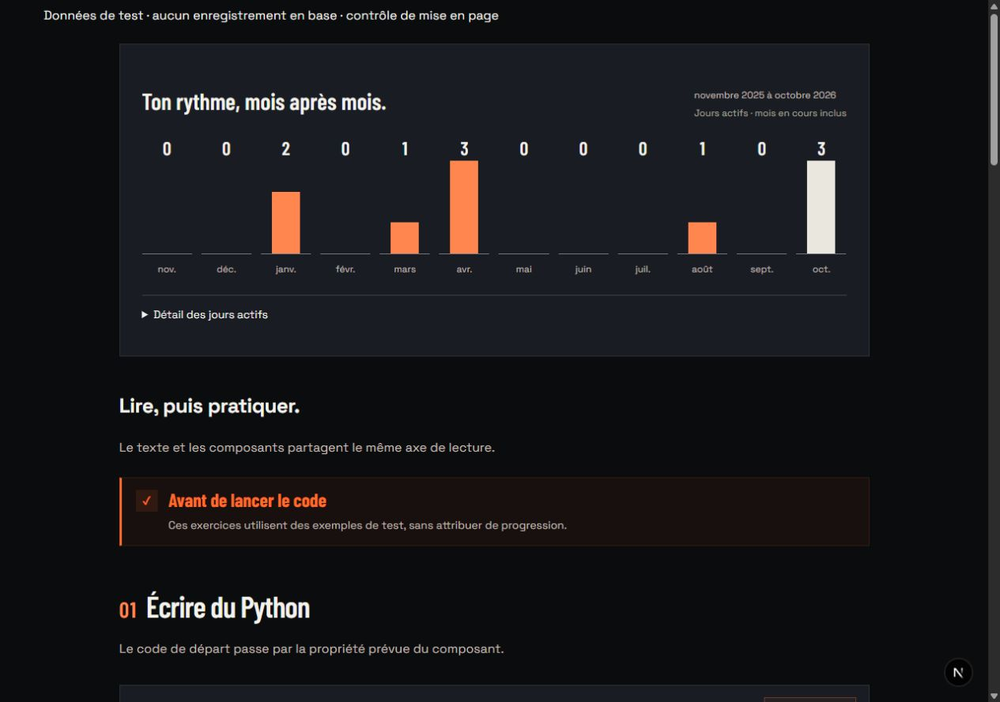
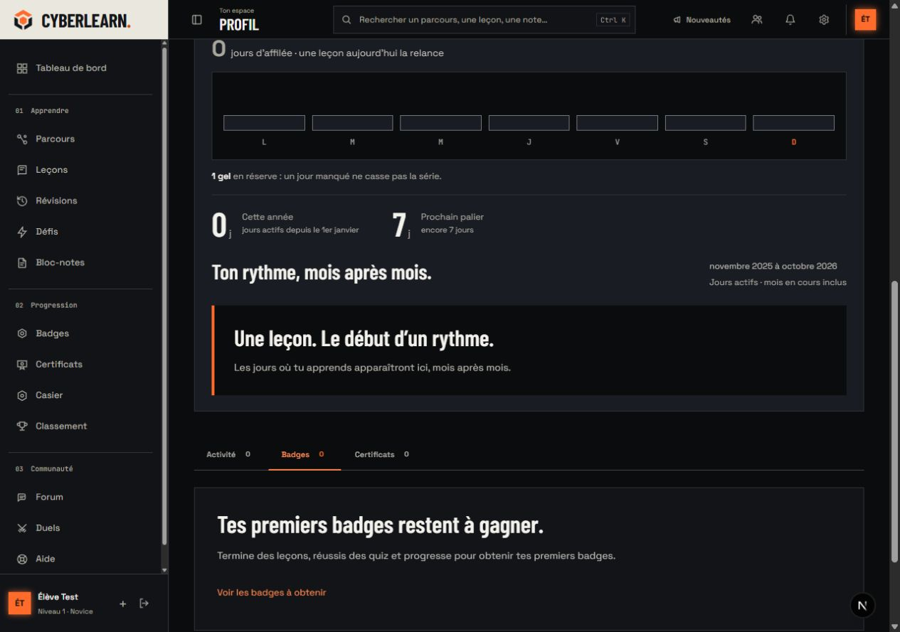
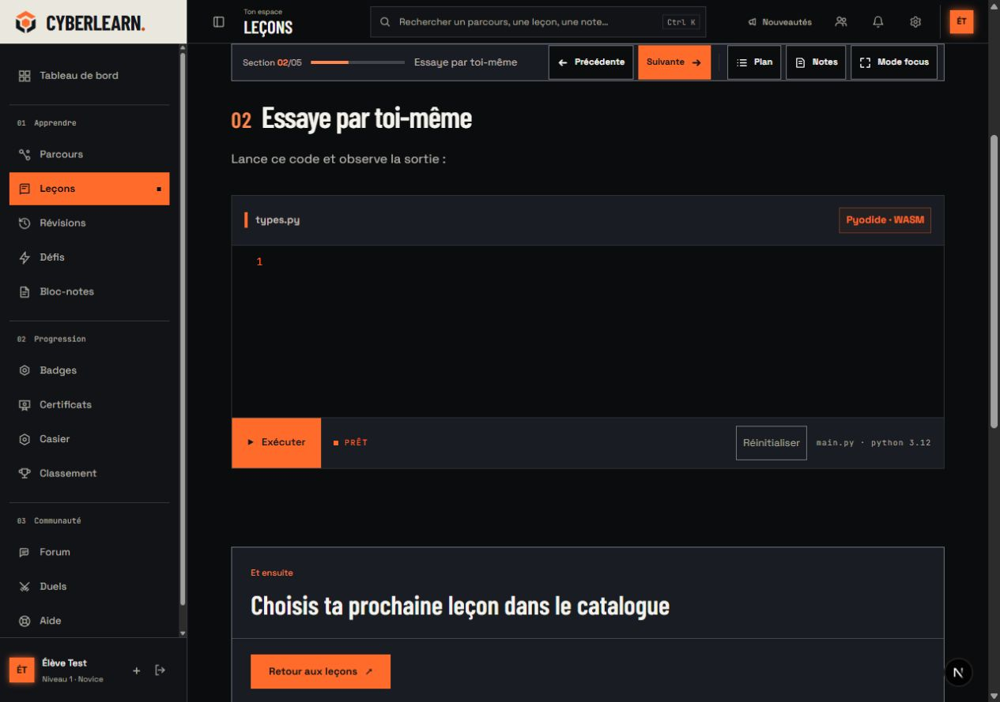
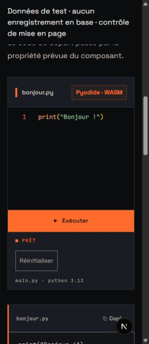

# Correction : activité et composants de leçon

25 octobre 2026. Demande : remplacer le calendrier d’activité montré sur la capture et corriger le décalage entre texte et composants dans les leçons, notamment `python-interactif-demo`.

Lecture de conception : suivre son rythme puis lire et pratiquer dans un même axe, dans la DA Bastion existante. ENERGY 3 / RHYTHM 3 / MOTION 2, sans ajouter de mouvement à des informations qui se lisent à l’arrêt. Angles droits, carbone/craie/cuivre et polices communes.

## Ce qui change et pourquoi

| Choix | Raison |
| --- | --- |
| Bilan mensuel au lieu de 371 petites cases | Lire les périodes actives et leurs nombres sans survoler chaque jour. |
| Douze mois civils, mois en cours inclus | Donner un repère temporel explicite ; la période est écrite au-dessus du graphique. |
| Une activité multiple le même jour compte pour un jour actif | Le bilan représente la régularité, pas un nombre d’actions présenté comme un nombre de jours. |
| Détail quotidien dans un tableau replié | Conserver les dates et décomptes disponibles sans les imposer à la lecture principale, y compris les jours plus anciens encore fournis par le service. |
| État court sans graphique lorsque tout est à zéro | Une grille vide ne raconte rien et occupe la place de l’information utile. |
| Copie distincte pour un visiteur du profil public | Le visiteur ne doit pas être interpellé comme le propriétaire du compte. |
| Cadre commun de leçon de 960 px, prose limitée à 720 px | Garder une lecture confortable et laisser de la place aux exercices, avec le même bord gauche. |
| Polices et fond carbone dans les éditeurs | Retirer l’ancien fond violet et rendre le code, les contrôles et leur contexte cohérents avec le site. |
| Commandes tactiles de 44 px minimum | Garder l’exécution et la réinitialisation accessibles sur téléphone. |
| Suppression des halos et pulsations décoratives | Réserver le mouvement à un vrai chargement et conserver l’attention sur la consigne et le résultat. |

Les compteurs de série, record, gels, paliers et jours actifs de l’année gardent leurs services et règles. Le bilan est calculé côté serveur à partir du dictionnaire existant de jours, sans lecture supplémentaire en base. Il n’affiche aucune activité future. Le mois courant est identifié dans le texte accessible et passe sur craie ; les autres mois actifs restent cuivre. Sur téléphone, les douze mois se répartissent en deux rangées de six, avec la même échelle.

Le texte de la leçon ne se recentre plus indépendamment entre deux composants. Titres, paragraphes, tableau, encadré, code, quiz, exercice et figure partagent le bord gauche de l’article. Les composants peuvent utiliser les 960 px du cadre, tandis que la prose reste limitée à 720 px. En-tête, suite de leçon et questions utilisent ce même cadre. Les figures pleine largeur restent dans ses limites au lieu de déborder de 24 px.

Le thème Monaco reste constitué de couleurs hexadécimales, comme l’exige son moteur. Le curseur conserve l’accent équipé de l’apprenant ; syntaxe, commentaires et numéros de ligne restent distincts. Les deux exercices Python partagent leur habillage. Le quiz perd ses anciens dégradés bleus et son texte blanc sur cuivre ; les boutons de réponse et de signalement utilisent une encre contrastée. Les titres d’encadré, champs SQL, tableaux de résultat, vidéo et séparations des questions suivent aussi les tokens de la leçon. Les couleurs sémantiques des simulations et les choix cosmétiques ne sont pas remplacés arbitrairement.

## Preuves navigateur

- Avant correction, à 1440 px dans la démo Python : titres et paragraphes à `x = 472,5`, exercice à `x = 296`. Après correction, les trois commencent à `x = 352,5` dans le cadre de 960 px. Lors du dernier contrôle à 1280 px, ils commencent tous à `x = 296`, dans l’espace réellement disponible de 913 px.
- À 320 px, la vraie leçon affiche titres, paragraphes, tableau et éditeur à `x = 16`, largeur 273 px dans le navigateur de contrôle. Aucun débordement horizontal. Les sections suivante et précédente restent accessibles et ramènent le focus dans le contenu.
- Un aperçu temporaire, signalé comme données de test, a rendu les vrais composants d’encadré, éditeur libre, code statique, défi Python, SQL, quiz et image. Sur bureau, ses treize blocs directs ont le même bord gauche ; sur téléphone, ils ont la même largeur disponible. Les deux Monaco ont un fond calculé `rgb(11, 12, 14)`.
- Exécuter l’exemple Python affiche `Bonjour !`. Le défi d’addition passe son test `addition(2, 3) = 5`. La requête SQL renvoie la ligne `Exemple`. Choisir SELECT dans le quiz puis valider affiche la bonne réponse et son explication. Ces interactions se déroulent hors d’une route de leçon et sans contexte de progression ; aucun XP ou résultat de leçon n’est écrit en base.
- Sur téléphone, les boutons Exécuter et Lancer les tests mesurent 46,75 px de haut ; Réinitialiser mesure 44 px. Les commandes reviennent dans le flux sous l’éditeur. Aucun débordement dans l’aperçu de composants.
- Bilan mensuel sur données de test : mois nuls et actifs visibles, mois courant identifié, ouverture du détail quotidien puis fermeture. Le tableau conserve les dates et nombres d’actions. À 320 px, six colonnes par rangée et aucun débordement.
- Profil réel local : état sans activité, série, gel, chiffres annuels et prochain palier conservés. Contrôle bureau puis téléphone, aucun rayon non nul dans le nouveau bilan et aucun débordement.

Le code initial de `types.py` est vide dans le rendu local de la vieille leçon de démonstration : son seed historique fournit le code en expression de contenu, filtrée par les règles MDX actuelles. Ce contrôle de DA ne modifie ni le filtre de sécurité, ni les contenus enregistrés, ni les brouillons du compte. Les essais d’exécution utilisent donc les vrais composants avec `starterCode` dans l’aperçu signalé, plutôt qu’une progression fictive dans la leçon réelle.

## Vérifications et nettoyage

La première série ciblée a passé 289 tests sur 41 fichiers : composants des leçons, brouillons de code, série et nouveau regroupement mensuel. La suite web complète finale passe : 2 164 tests dans 289 fichiers, y compris la copie du profil public, ses compteurs et la confidentialité. L’ancienne assertion de présence de la grille a été remplacée par la vérification du nouveau titre et de l’accès au détail quotidien ; les assertions de compteurs et de badges restent en place.

TypeScript strict (`tsc --noEmit`), ESLint sans avertissement sur les fichiers TypeScript touchés, le formatage Biome des 24 sources de cette correction et `git diff --check` passent également. Les types de routes sont régénérés avec webpack. Cette correction a été vérifiée sur le serveur de développement ; aucun nouveau build de production n’est annoncé.

L’aperçu `app/dev/lesson-layout/page.tsx` était temporaire, bloqué hors développement, puis archivé hors du dépôt et supprimé avant livraison. Les types de routes sont régénérés après suppression ; recharger son URL affiche bien la page 404. Les captures dont le nom contient `test` utilisent les données signalées ; les captures du profil et de la leçon viennent du compte local.

Le contrôle de contraste donne 7,10:1 pour le texte secondaire `#AAA79F` sur `#191C22`, 10,92:1 pour les mots-clés `#FFAF85` sur `#0B0C0E`, 12,20:1 pour les chaînes `#A3D9AE` sur ce même fond, 11,76:1 pour les types `#BFC6F6` et 6,42:1 pour l’encre `#141518` sur le cuivre `#FF6B2B`. Ces cinq paires passent AA pour le texte courant.

La dette de présentation native reste enregistrée dans [MOBILE_PARITY.md](../MOBILE_PARITY.md). Aucune nouvelle dépendance, règle d’authentification, fonction de publication ou modification de score n’est ajoutée.

## Gate Anti Slop

| Règle | Résultat et preuve |
| --- | --- |
| R-01 | PASS : palette mate, anciens dégradés de sélection du quiz retirés. |
| R-02 | PASS : consignes et libellés fonctionnels français ; périodes écrites, pas de slogan promotionnel. |
| R-03 | PASS : vraies pages et composants de test contrôlés à 320 px sans débordement. |
| R-04 | PASS : pictogrammes de commande conservés ; l’étoile décorative de conseil devient une coche. |
| R-05 | PASS : historique, prose, éditeur et quiz gardent des compositions adaptées à leur contenu. |
| R-06 | PASS : Barlow pour les titres et nombres, Space pour les commandes, monospace pour le code. |
| R-07 | PASS : la grille annuelle de petites cases est retirée du rendu, aucun motif de fond ajouté. |
| R-08 | PASS : pas de nouvelle flèche décorative ; commandes de navigation existantes conservées. |
| R-09 | PASS : moteur, langue, état de test et résultat restent des informations utiles. |
| R-10 | PASS : surfaces opaques, sans ajout de flou. |
| R-11 | PASS : géométrie carrée du site et mesure de rayon nul dans le bilan. |
| R-12 | PASS : pas de nouvelle ombre, tableaux et exercices séparés par matière et bordures. |
| R-13 | PASS : halos du contrôle Python et du quiz retirés. |
| R-14 | PASS : les composants conservent leur propre espace de travail, sans imposer une carte identique à chaque bloc. |
| R-15 | PASS : Exécuter, Lancer les tests, Réinitialiser et Détail des jours actifs décrivent leur action. |
| R-16 | PASS : aucune promesse marketing ajoutée. |
| R-17 | PASS : vrais comptes de jours, exemples signalés et exclusion des jours futurs couverte par tests. |
| R-18 | PASS : aucun témoignage créé. |
| R-19 | PASS : pas de mouvement du graphique à la lecture ; chargement réel des runtimes conservé. |
| R-20 | PASS : titres condensés, carbone, craie et cuivre prolongent Bastion. |
| R-21 | PASS : thème de marque existant, aucun faux sélecteur de thème ajouté. |
| R-22 | PASS : aucun visuel générique ajouté ; la figure de contrôle emploie le vrai logo et reste un exemple. |
| R-23 | PASS : données et actifs existants, échantillons signalés avant leur rendu. |
| R-24 | PASS : destinations conservées, aperçu temporaire retiré. |
| R-25 | PASS : encre sur cuivre contrastée, texte et numéros de ligne renforcés sur carbone ; mesures des paires jointes aux vérifications finales. |
| R-26 | PASS : détail ouvert/fermé, Python, tests Python, SQL et quiz exécutés sur les exemples de contrôle. |
| R-27 | PASS : état vide d’activité, chargement de Python et résultats de réussite conservés ; erreurs et brouillons gardent leurs tests. |
| R-28 | PASS : aucune FAQ ajoutée. |
| R-29 | PASS : neutres et cuivre pour l’interface, couleurs de syntaxe et de résultat sémantiques. |
| R-30 | PASS : composition fondée sur la leçon et les données du produit. |
| R-31 | PASS : raisons du graphique, du cadre, de la mesure de prose, des polices et des états écrites ci-dessus. |
| R-32 | PASS : détail natif utilisable au clavier, région de tableau focalisable, focus des sections conservé. |
| R-33 | PASS : changements directs dans les sources avec apply_patch, formatage par Biome. |
| R-34 | PASS : thème unique, couleurs Monaco résolues en hexadécimal, accent équipé conservé et testé. |
| R-35 | PASS : rendu réel exécuté, parcours et mesures consignés ; les exemples sont distingués des données du compte. |
| R-36 | PASS : aucune nouvelle affirmation de performance, sécurité ou conformité. |
| R-37 | PASS : direction et dials de la session existante conservés. |
| R-38 | PASS : historique de contrôle signalé, aucun faux acquis ajouté au compte local. |

C-1 PASS : choix motivés par lecture et comparaison. C-2 PASS : commandes exécutées et résultats observés. C-3 PASS : prose et exercices restent distincts dans un même cadre. C-4 PASS : mobile, mois vides, changement d’année et jour bissextile contrôlés. C-5 PASS : activité réelle et échantillons distingués.

