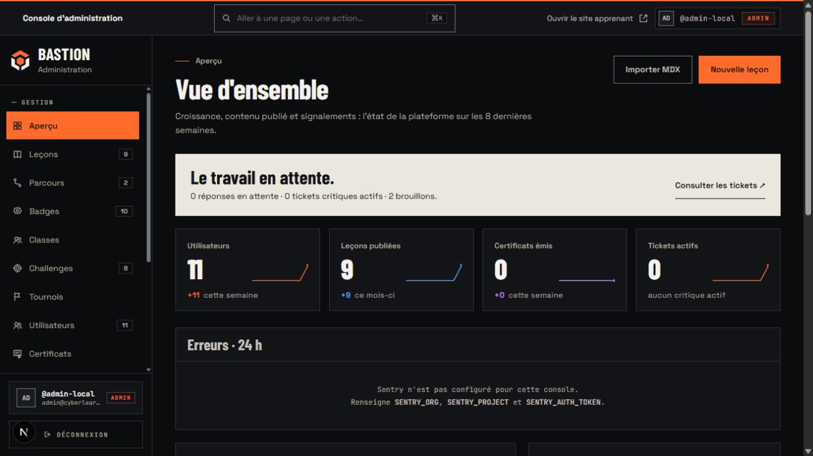
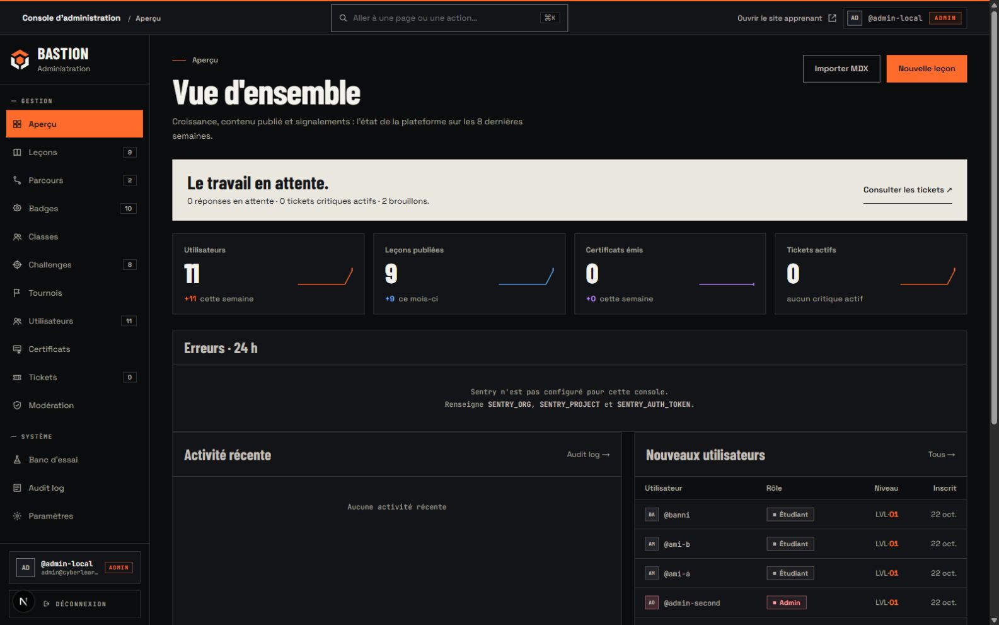
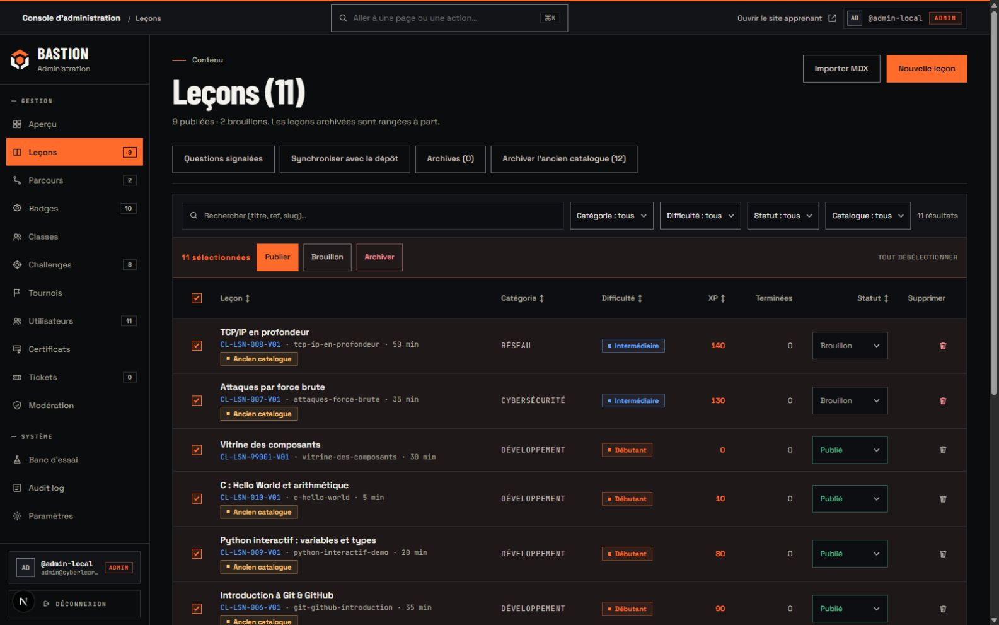
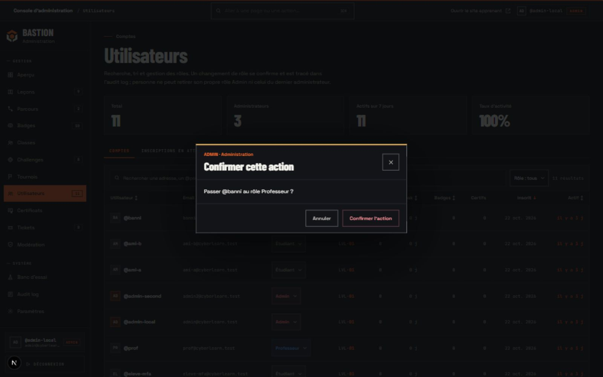
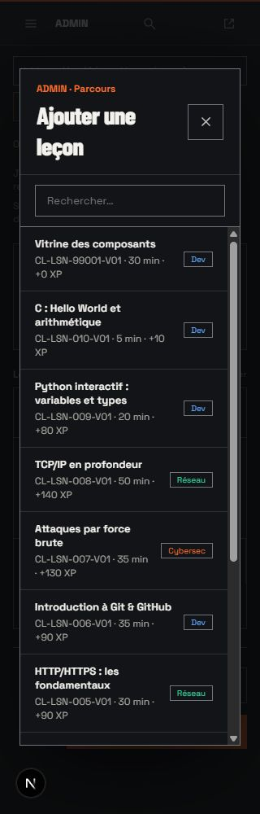
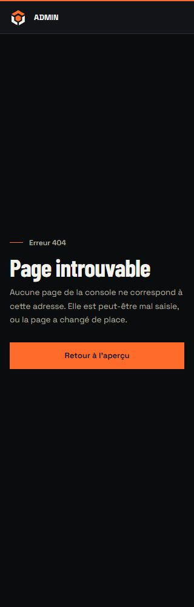

# Console Bastion : couverture et vérifications

25 octobre 2026. Périmètre : les **42 modèles de pages** de `apps/admin/app`, leurs états et les composants de rédaction partagés. Le jalon web `6cb288fc` a été poussé sur `origin/redesign` avant de modifier la console.

## Décisions de composition

La console garde une structure de travail dense : titre, commandes, filtres, tableau ou formulaire. La synthèse craie du dashboard sert à repérer les tâches en attente ; ses chiffres proviennent des requêtes existantes. Les fonctions secondaires du catalogue de leçons sont rangées dans une barre distincte pour laisser la création et l’import lisibles.

Le cuivre désigne l’espace actif et l’action principale. Succès, information, avertissement et danger gardent leurs libellés et leurs couleurs distinctes ; un contenu publié est vert, sans reprendre la couleur d’une action de navigation. Les graphiques représentent les données locales existantes, y compris les zéros. Sentry non configuré et les listes vides sont annoncés comme tels.

La marque et les marges vivent dans `@cyberlearn/ui`. Les imports web du logo restent compatibles. Les polices Next ont un sous-chemin séparé du barrel de composants, afin de ne pas charger `next/font` dans les consommateurs qui n’en ont pas besoin. Aucun paquet ajouté, aucune migration, aucun changement d’API métier.

## Identification administrative

- Barre opaque de 56 px, repère cuivre inclus dans sa hauteur ; « Console d’administration » sur bureau, « ADMIN » sous 768 px.
- Sidebar de 240 px, logo Bastion vers le dashboard admin et mention Administration. Sous 1024 px : menu superposé, focus retenu, Échap et retour au bouton d’ouverture.
- Titres `ADMIN · [page] · CyberLearn` et favicon admin conservé.
- Lien distinct « Ouvrir le site apprenant », nouvel onglet et `noopener noreferrer`.
- Fenêtres sensibles communes : contexte ADMIN, action et cible nommées ; annulation et Échap avant toute mutation.
- Connexion, MFA, accès refusé et 404 utilisent le même shell d’accès, avec une barre administrative permanente. Les gardes ADMIN et TOTP restent dans leur chemin d’exécution habituel.

## Inventaire des 42 pages

« Kit » signifie que la page utilise le cadre, le PageHeader et les composants de travail communs. Les pages de détail gardent leurs données, leurs actions et leurs protections.

| Famille | Nombre | Routes | Couverture |
| --- | ---: | --- | --- |
| Entrée | 1 | `/` | Redirection existante conservée |
| Accès | 4 | `/login`, `/mfa`, `/mfa/setup`, `/access-denied` | Shell, formulaires, code MFA, erreurs et titres |
| Dashboard | 1 | `/dashboard` | Synthèse, chiffres, tendances, activité, contenu et Sentry |
| Utilisateurs | 3 | `/users`, `/users/pending`, `/users/[id]` | Filtres URL, tris, rôles, profil, accès, progression, modération et confirmations |
| Leçons | 7 | `/lessons`, `/lessons/new`, `/lessons/[id]/edit`, `/lessons/import`, `/lessons/sync`, `/lessons/archives`, `/lessons/reports` | Catalogue, sélection multiple, rédaction, couverture, import, synchronisation et signalements |
| Parcours et examen | 5 | `/paths`, `/paths/new`, `/paths/[id]/edit`, `/paths/archives`, `/paths/[id]/quiz` | Composition, choix des leçons, ordre, réglages et questions du quiz |
| Badges | 3 | `/badges`, `/badges/new`, `/badges/[id]/edit` | Critères, raretés, aperçu et suppression |
| Défis | 3 | `/challenges`, `/challenges/new`, `/challenges/[id]/edit` | Activation, paramètres, contenu, indices et suppression |
| Classes | 4 | `/classes`, `/classes/new`, `/classes/structure`, `/classes/[id]` | Structure, création, membres et composition |
| Tournois | 3 | `/tournaments`, `/tournaments/new`, `/tournaments/[id]` | Création, sélection des exercices, scores et commandes selon la phase |
| Certificats | 1 | `/certificates` | Recherche, état, motif de révocation et rétablissement |
| Tickets | 2 | `/tickets`, `/tickets/[id]` | Filtres, conversation, pièces jointes et état terminal conservé |
| Modération | 2 | `/moderation`, `/moderation/notes` | Files, décisions, sanctions et retours d’action |
| Exploitation | 3 | `/audit`, `/settings`, `/lab` | Filtres, configuration et banc d’essai en lecture seule |
| **Total** | **42** | | |

S’ajoutent huit chargements et quatre limites d’erreur ou pages introuvables, tous raccordés au même cadre. Le fallback global reste lisible sans la feuille de styles de l’application et utilise le contrat `retry` de la version de Next installée.

L’éditeur MDX partagé a aussi été repris : panneaux carbone, champs et contrôles carrés, thème Monaco, édition par blocs, guide et deux modes d’aperçu. Les colonnes s’empilent dans la console quand sa largeur utile devient insuffisante. Le code conserve JetBrains Mono ; les couleurs de syntaxe gardent leur fonction. Les leçons rédigées ne sont pas transformées par ce changement d’habillage.

## Mesures et parcours navigateur

Comparaison sur les véritables pages Parcours web et admin. Les valeurs mesurées sont identiques ; [mesures enregistrées](assets/admin-margins.json).

| Largeur | Latéral | Haut | Bas | Barre admin | Navigation admin |
| ---: | ---: | ---: | ---: | ---: | --- |
| 320 px | 16 px | 24 px | 80 px | 56 px | Menu superposé |
| 768 px | 28 px | 28 px | 96 px | 56 px | Menu superposé |
| 1280 px | 36 px | 32 px | 110 px | 56 px | Sidebar visible |
| 1600 px | 36 px | 32 px | 110 px | 56 px | Sidebar visible |

Contrôles effectués dans le navigateur local :

- Connexion admin et second facteur, sans désactivation ni contournement.
- Ouverture des listes des familles, des créations, de l’import, de la synchronisation, des archives et de la structure des classes ; mesures de largeur à 320 px. Un débordement du compositeur de parcours a été corrigé puis remesuré.
- Détails disponibles : compte, leçon, parcours, quiz, badge, défi et ticket fermé. Les tableaux défilent dans leur propre région, avec accès clavier.
- Filtre Utilisateurs « Professeur », puis tri Email : URL observée `?role=TEACHER&sort=email`, un résultat. Aucune modification de compte.
- Sélection des onze leçons de la page, affichage de la barre d’actions, puis désélection. Aucune publication ni mise aux archives.
- Sélecteur de rôle en portail, fenêtre qui nomme le compte, puis annulation. Formulaire de profil : confirmation ouverte puis fermée par Échap, sans soumettre l’action.
- Menu mobile ouvert puis fermé par Échap, retour du focus ; repère ADMIN visible menu fermé. Ctrl+K et navigation rapide utilisés sur téléphone.
- Fenêtre d’ajout de leçon sur téléphone : recherche, titres longs, liste défilante et fermeture ; shell d’accès contrôlé avec la vraie 404.
- Contrastes contrôlés : encre/cuivre 6,42:1, métadonnées/menu 7,10:1, encre/craie 14,78:1. Les animations de navigation et de fenêtres restent brèves ; `prefers-reduced-motion` les supprime.

Les contrôles portent sur les données de développement existantes. Aucun envoi d’e-mail, changement de rôle, suppression, révocation, publication ou modification de progression réelle n’a été nécessaire.

## Validation technique

Le formatage Biome, le lint et les types du monorepo passent. La suite du monorepo passe avec quatre workers par suite et deux suites simultanées :

| Espace | Fichiers de tests | Tests |
| --- | ---: | ---: |
| Web | 291 | 2170 |
| Admin | 57 | 694 |
| UI | 15 | 144 |
| DB | 65 | 662 |
| Lib | 97 | 2445 |
| Types | 26 | 226 |
| E-mail | 11 | 139 |
| Mobile | 48 | 746 |
| **Total** | **610** | **7226** |

Quatre nouveaux tests de confirmation vérifient l’annulation et le brouillon, les données et le bouton d’envoi conservés, Échap et le retour du focus, puis une nouvelle confirmation après refus de la validation native. Les tests des gardes et des actions existantes restent exécutés.

Les deux builds de production, web et admin, réussissent avec webpack. Biome contrôle 2 182 fichiers sans correction et le contrôle typographique passe. Les serveurs de développement sont relancés sur les ports 3000 et 3001 ; la base locale reste active.

Après relance, le dashboard a été rouvert dans un nouvel onglet : barre de 56 px, largeur normale de 1280 px, aucun débordement ni erreur de console relevée pour cette visite.

## Gate antislop

Direction fournie et approuvée par l’utilisateur : Bastion, cuivre/carbone/craie, angles droits. Pour la console, ENERGY 2 / RHYTHM 2 / MOTION 2 : hiérarchie typographique et synthèse craie, alternance entre synthèses et travail tabulaire, transitions réservées aux changements d’état. La densité est une décision liée aux tâches administratives.

| Règles | État | Preuve et décision |
| --- | --- | --- |
| R-01, R-07, R-10, R-12, R-13 | PASS | Fonds mats ; retrait des halos, dégradés et grilles décoratives. L’ombre d’une fenêtre la sépare du contenu qu’elle bloque. |
| R-02, R-16, R-28 | PASS | Typographie du produit contrôlée ; libellés d’action concrets, aucune FAQ ajoutée. |
| R-03 | PASS | Grilles adaptées, mesures et captures mobiles ; défilement des tableaux contenu dans leur région. |
| R-04, R-08, R-22, R-23 | PASS | Logo existant partagé, icônes de navigation liées aux tâches. Les flèches indiquent une destination ; aucune illustration ou photo inventée. |
| R-05, R-14, R-15 | PASS | Commandes prioritaires séparées de l’entretien du catalogue ; chiffres, listes et formulaires structurés selon leur contenu. |
| R-06, R-11, R-20, R-21, R-29, R-30 | PASS | Typographie Bastion, angles droits, palette définie, thème sombre de console voulu par la DA ; aucune copie de produit tiers. |
| R-09 | PASS | Statuts et raretés portent des valeurs métier ; pas de badge promotionnel ajouté. |
| R-17, R-18, R-36, R-38 | PASS | Chiffres issus des requêtes, données locales identifiées, absence de faux témoignages ou de nouvelle promesse de sécurité. |
| R-19 | PASS | Transitions d’état et navigation ; réduction des mouvements conservée. |
| R-24, R-26, R-27 | PASS | Destinations conservées, actions et états existants raccordés au kit ; validations et retours d’erreur conservés. |
| R-25, R-32 | PASS | Contrastes mesurés, focus visible, menu et fenêtres testés au clavier ; sélecteurs et pile de fenêtres partagés. |
| R-31, R-33, R-37 | PASS | Décisions consignées ici ; modifications écrites dans les sources et feuilles partagées via patch, sans script de réécriture ; direction approuvée. |
| R-34, R-35 | PASS | Thème livré contrôlé sur application lancée ; parcours navigateur consignés, tests des composants et actions exécutés, builds consignés séparément. |
| C-1 à C-5 | PASS | Intentions, composition par tâche, fonctions conservées, états de repli et preuves réelles ; limites ci-dessous. |

## Limites de vérification

Les données locales ne contiennent pas de classe ni de tournoi à ouvrir en détail. Ces deux modèles utilisent les composants migrés et passent les contrôles de code ; leurs états peuplés n’ont pas été parcourus visuellement. Le certificat est contrôlé en liste vide et par ses tests d’action ; aucun certificat réel n’a été révoqué pour une capture.

L’accès refusé et l’activation MFA restent protégés par leurs conditions réelles. Le shell commun a été contrôlé sur connexion/MFA et 404, sans fabriquer une session autorisée ou affaiblir les gardes. Les erreurs réseau et racine ne sont pas provoquées artificiellement dans le serveur laissé à l’utilisateur.

La suite RLS/IDOR avec stack éphémère CI, les envois externes et un appareil physique ne sont pas revendiqués. Les différences de polices d’un client e-mail restent annoncées dans le banc d’essai. Les fonctionnalités et permissions ne sont pas réécrites par cette refonte.

## Captures

