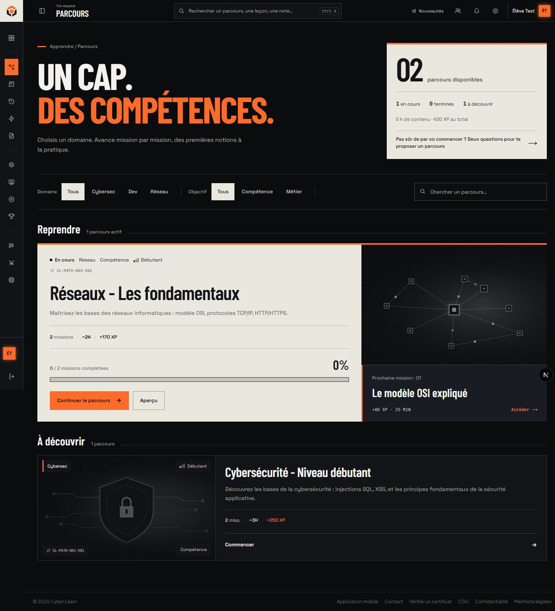
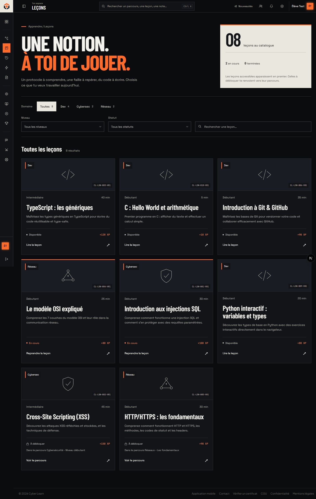

# CyberLearn : direction artistique Bastion

Référence du rework visuel, mise à jour le 22 octobre 2026.

Cette direction associe le logo Bastion à trois matières : **carbone, craie et cuivre**. Elle donne à CyberLearn le caractère d'un espace où l'on apprend en pratiquant : des titres francs, une progression lisible, des surfaces mates et une action principale facile à repérer.

Le document décrit le système effectivement mis en place et ses règles de continuation. Les anciennes maquettes de pages ne constituent pas des gabarits à reproduire. La structure de chaque écran doit partir de ses fonctions et de son contenu.

## Périmètre et état

- La home publique, le dashboard, les catalogues de parcours et de leçons, la sidebar et la barre supérieure portent la nouvelle signature typographique et visuelle. Le catalogue public reprend les mêmes cartes et la même entrée typographique que les parcours connectés.
- Les écrans d'authentification et de détail de parcours intègrent les premières adaptations de palette et de surfaces du rework. Leur présentation n'est pas un modèle imposé aux autres pages.
- Les autres écrans peuvent encore contenir des styles historiques. La migration est progressive : ce document ne signifie pas que l'ensemble du site a été harmonisé.
- L'application web conserve son thème sombre imposé pour le lancement. Les tokens clairs existent, mais leur présence ne constitue pas un mode clair complet et validé.
- La navigation web et la dette visuelle de l'application native sont consignées dans [MOBILE_PARITY.md](../MOBILE_PARITY.md).

## 1. Signature et composition

Le **Bastion** est le logo existant : trois axes protègent un noyau cuivre et évoquent les trois domaines, cybersécurité, développement et réseaux. Réutiliser le composant [BastionLogo](../../apps/web/components/bastion-logo.tsx), sans redessiner une variante par page.

L'identité repose sur des choix répétés :

- Des titres condensés et des angles droits, en continuité avec le logo.
- Un fond carbone pour le travail quotidien et une surface craie pour faire ressortir une tâche importante.
- Le cuivre pour l'action principale, la page active et les repères de progression.
- Des listes et des séparations franches lorsque le contenu appelle une lecture séquentielle.
- Un contraste de composition entre la mission, l'itinéraire, les objectifs et le bilan ; éviter de donner le même poids à chaque bloc.

Une page doit avoir un point d'entrée clair. Sur le dashboard, c'est la leçon à reprendre. Les compteurs, les révisions et les quêtes accompagnent cette action.

## 2. Palette

Les tokens partagés se trouvent dans [packages/ui/src/tokens.css](../../packages/ui/src/tokens.css). Les styles de page complètent ces tokens pour les surfaces propres au rework.

| Rôle | Valeur | Usage |
| --- | --- | --- |
| Carbone | `#0B0C0E` | Fond principal |
| Panneau | `#121418` | Exercice, résultats de recherche, panneaux flottants |
| Plateau | `#0D0E12` | Surfaces en retrait |
| Surface relevée | `#191C22` | Itinéraire et états de survol |
| Craie de lecture | `#F4F2ED` | Texte principal sur fond sombre |
| Craie de surface | `#EAE7DF` | Mission principale, bande de méthode, bandeau de marque |
| Encre | `#141518` | Texte sur craie |
| Secondaire renforcé | `#AAA79F` | Métadonnées lisibles dans les nouvelles compositions sombres |
| Cuivre signal | `#FF6B2B` | Action principale, page active, progression |
| Texte sur cuivre | `#0B0C0E` | Boutons et navigation active |

Les nuances de gris restent subordonnées à ces rôles. Les bordures indiquent une séparation ; elles ne doivent pas dessiner une grille autour de tout le contenu.

Les couleurs sémantiques de succès, d'erreur, de rareté et de domaine conservent leur sens. Le bleu du développement et le vert des réseaux ne deviennent pas des accents décoratifs concurrents.

Les noms historiques `--color-brand-blue` et `--color-brand-turquoise` existent encore pour compatibilité ; leurs valeurs de marque sont désormais cuivre. Respecter `--cosmetic-accent` lorsqu'une surface suit la personnalisation choisie par l'apprenant. Éviter de réintroduire les anciennes valeurs violettes codées en dur dans les nouveaux composants.

## 3. Typographie

Les nouvelles polices sont chargées par `next/font` dans [brand-typeface.ts](../../apps/web/components/brand-typeface.ts), sans nouvelle bibliothèque.

| Police | Fonction | Règles |
| --- | --- | --- |
| **Barlow Condensed** | Titres, signature et grands nombres | Graisses 600, 700 ou 800 ; capitales pour les titres structurants ; interligne compact sans couper les accents |
| **Space Grotesk** | Interface et texte courant des surfaces migrées | Casse normale pour les paragraphes et les actions ; hiérarchie par taille et graisse |
| **JetBrains Mono** | Code et données techniques | Requêtes HTTP, durées, XP, numéros et repères de module ; pas de paragraphes entièrement monospace |

Les variables sont `--font-display`, `--font-interface` et `--font-mono`. La classe `brandTypeface` est appliquée aux nouvelles compositions et au conteneur de navigation authentifiée. Les composants de ce périmètre peuvent faire pointer `--font-sans` vers `--font-interface`.

Plus Jakarta Sans reste chargé par le layout racine pour les écrans non migrés. Ne pas considérer cette coexistence comme une invitation à ajouter une nouvelle police à chaque écran.

Les titres peuvent être grands et expressifs. Les paragraphes doivent rester faciles à lire. Sur téléphone, laisser le titre revenir à la ligne ; ne pas le compresser avec une transformation CSS et ne pas animer un masque qui rogne ses accents.

## 4. Formes, surfaces et icônes

**Le rayon d'interface est strictement nul.** Cela concerne les cartes, boutons, champs, panneaux, compteurs, états de chargement et indicateurs de niveau. Ne pas ajouter de pilule pour un statut ou un filtre.

La géométrie interne du logo et des icônes conserve son sens : un cercle dessiné dans une icône n'est pas un arrondi de carte.

- Préférer les surfaces mates. Pas de halos ambiants, de néon ou de grille technique décorative pour remplir un fond.
- Réserver l'ombre aux éléments réellement superposés, comme un panneau de recherche. Les blocs du contenu restent plats.
- Utiliser les icônes pour nommer une fonction ou une destination, avec un tracé cohérent. Les icônes de la sidebar reprennent des traits angulaires.
- Conserver les personnalisations équipées par l'utilisateur ; les effets cosmétiques ne définissent pas la signature visuelle par défaut.
- Donner aux actions un libellé précis : « Reprendre la leçon », « Voir la démo », « Créer mon compte ».

## 5. Organisation des surfaces principales

### Home

Le message d'entrée associe apprentissage et pratique. L'exercice HTTP est réellement utilisable : POST et GET affichent chacun une explication. Il est explicitement présenté comme un aperçu sans enregistrement de progression ni d'XP.

Les domaines sont organisés en lignes. La méthode utilise une bande craie. Les parcours et leurs compteurs viennent des repositories ; si leur lecture échoue, la page ne fabrique pas de statistiques de remplacement.

### Dashboard

La mission craie rassemble contexte, titre, explication, durée, XP et action principale. Le logo en grand sert de signature en arrière-plan. À droite, l'itinéraire sombre situe la leçon dans son module avec des états textuels : « En cours », « À suivre », « Validée ».

Les quêtes et la série restent sous la mission. Les révisions et le bilan complètent la page avec moins de poids visuel. Les règles de sélection de leçon, de progression et de révision restent côté serveur.

### Navigation

La sidebar reprend le bandeau craie et le logo Bastion. Les groupes existants sont numérotés pour faciliter le repérage. La page active porte le cuivre ; l'information ne repose pas uniquement sur la couleur, car le lien conserve `aria-current="page"`. Le registre de navigation fait autorité sur les destinations, leur visibilité et leur regroupement : la DA n'impose pas un nombre fixe d'entrées ou de groupes.

La barre supérieure affiche la section courante, la recherche et les actions existantes. Les résultats de recherche, amis et notifications utilisent les mêmes surfaces et la même typographie. La hauteur de la barre reste définie par `NAVBAR_HEIGHT` pour conserver les bons décalages des éléments sticky.

Ces captures utilisent la base locale de développement. Les chiffres et le compte affichés ne sont pas des statistiques de production.

## 6. Motion

Le mouvement sert l'ordre de lecture et le retour d'action. Il ne doit ni retarder l'accès à un bouton, ni cacher un contenu utile, ni donner l'impression que des blocs flottent sans raison.

| Surface | Comportement actuel |
| --- | --- |
| Entrée de la home | Introduction regroupée sur 520 ms ; exercice décalé de 70 ms ; translation courte et variation d'opacité modérée |
| Sections sous le premier écran | Révélation unique de 420 ms à l'entrée dans la vue |
| Réponse HTTP | Feedback de 180 ms, avec espace réservé pour conserver la hauteur du panneau |
| Dashboard | Arrivée séquencée du titre, de la mission et des étapes du module |
| Navigation | Survol bref et ouverture du plateau de compte ; pas d'animation d'entrée de toute la sidebar à chaque changement de page |

La home utilise [HomeMotion](../../apps/web/app/_components/home-motion.tsx), un petit composant client qui observe les sections. Après leur première entrée, `unobserve` empêche une nouvelle animation au scroll inverse. Les contenus déjà visibles au chargement ne sont pas dissimulés pour les rejouer.

Règles à conserver :

1. Le HTML rendu côté serveur reste visible si JavaScript n'est pas disponible ou si IntersectionObserver n'est pas pris en charge.
2. Pas de `animation-timeline: view()` qui efface le contenu quand le lecteur remonte.
3. Pas de masque `clip-path` sur les lignes du grand titre de la home.
4. Ne pas animer séparément chaque mot, chaque lien et chaque chiffre d'un même groupe.
5. Une animation ne doit pas déplacer la cible lorsqu'elle reçoit le focus clavier.
6. Respecter `prefers-reduced-motion` : animations et transitions coupées, défilement doux désactivé.
7. Ne pas ajouter de boucle de flottement, de pulsation ou de faux indicateur d'activité.

## 7. Responsive et accessibilité

- Vérifier au minimum le téléphone étroit, le téléphone courant, une largeur intermédiaire et le bureau.
- Éviter tout débordement horizontal à 320 px. Le contenu doit se recomposer, pas être réduit comme une image.
- Prévoir des cibles d'au moins 44 × 44 px pour les actions de navigation sur téléphone.
- Le rail de bureau peut être replié ; le tiroir mobile reste développé quand il est ouvert, même si le rail avait été replié auparavant.
- Le tiroir mobile se ferme avec son bouton, Échap ou le choix d'une destination. Il contient le focus lorsqu'il est ouvert et le rend au déclencheur à la fermeture.
- Les destinations du tiroir fermé sont inertes, donc absentes de la navigation clavier.
- Les panneaux amis et notifications tiennent dans la largeur utile du téléphone.
- Le focus doit rester visible : clair sur carbone, sombre sur craie.
- Les états ne doivent pas être exprimés uniquement par une couleur ou une icône.

Les contrastes mesurés dans la navigation par défaut sont de 7,74:1 pour le texte secondaire sur la sidebar, 8,99:1 pour les liens, 14,78:1 pour l'encre sur craie et 6,89:1 pour le texte sombre sur cuivre. Ces mesures ne constituent pas une certification de toutes les pages ni de toutes les personnalisations.

## 8. Catalogues et carte des sources

### Catalogues : choisir un cap ou une notion

Les parcours et les leçons partagent une entrée condensée, un bilan réel sur craie et des filtres carrés. Le nombre affiché provient du catalogue accessible au compte ; celui des leçons suit les filtres courants. Il ne représente pas un nombre de leçons débloquées.

Le parcours en cours reçoit un plateau craie, une progression lisible et un accès à sa prochaine mission ou à son examen. Les parcours à choisir restent sur carbone. Une seule carte remplit la ligne ; plusieurs se répartissent sur deux colonnes, puis une sur téléphone. Les vignettes existantes sont conservées et désaturées pour laisser le cuivre guider l'action.

Les leçons utilisent une grille régulière pour comparer niveau, durée, XP et état. Leurs descriptions restent lisibles, leur état apparaît en toutes lettres, et une leçon verrouillée nomme le parcours qui la débloque. Les cartes accessibles précèdent les verrouillées, avant pagination ; cette règle métier existante est conservée. Les cartes sont rendues sur le serveur, sans embarquer l'ancienne décoration animée de `LessonCard`.

L'arrivée de l'en-tête dure 420 ms, sur 8 px au maximum. Les résultats restent stables pendant la recherche et les filtres. Le survol déplace seulement le repère d'ouverture et renforce la bordure ; aucun clignotement continu. La préférence de réduction des mouvements désactive ces effets.

### Fichiers de référence

| Source | Responsabilité |
| --- | --- |
| `packages/ui/src/tokens.css` | Palette et tokens partagés |
| `apps/web/components/bastion-logo.tsx` | Logo de marque |
| `apps/web/components/brand-typeface.ts` | Chargement des polices de la nouvelle signature |
| `apps/web/app/_components/landing-client.tsx` | Composition serveur de la home, malgré le nom historique du fichier |
| `apps/web/app/_components/landing-interactions.tsx` | Démo et exercice HTTP local |
| `apps/web/app/_components/home-motion.tsx` | Révélations uniques de la home |
| `apps/web/app/_components/landing.css` | Styles de la home et de la navigation publique |
| `apps/web/app/(app)/dashboard/dashboard.css` | Styles propres au dashboard |
| `apps/web/components/learning-catalogue.css` | Titres, bilans et filtres communs aux catalogues |
| `apps/web/app/(app)/paths/_components/paths-collection.tsx` | Recherche locale, domaines, objectifs et états des parcours |
| `apps/web/app/(app)/paths/_components/paths-catalog-v2.css` | Reprise sur craie et cartes de parcours |
| `apps/web/app/(app)/lessons/page.tsx` | Catalogue serveur, filtres URL, disponibilité et pagination |
| `apps/web/app/(app)/lessons/_components/catalogue-lesson-card.tsx` | Métadonnées, état et score de quiz d'une leçon |
| `apps/web/app/(app)/lessons/lessons-catalogue.css` | Grille responsive et états visuels des leçons |
| `apps/web/components/app-shell.tsx` | Conteneur partagé de l'espace connecté |
| `apps/web/components/app-chrome.css` | Identité de la sidebar, de la barre et de leurs panneaux |
| `apps/web/components/sidebar-nav.tsx` | Navigation et actions du compte |
| `apps/web/components/sidebar-wrapper.tsx` | Rail et tiroir responsive, gestion du focus |
| `apps/web/components/navigation-location.tsx` | Section courante dans la barre supérieure |
| `apps/web/lib/chrome.ts` | Dimensions des éléments fixes et décalages sticky |
| `docs/MOBILE_PARITY.md` | Parité native et décisions web-only |

Conserver des styles de page limités à leur racine pour éviter les régressions entre écrans. Les tokens partagés changent le vocabulaire commun ; un ajustement local de composition n'a pas à modifier tout le site.

## 9. Continuer le rework

Pour une nouvelle page, identifier d'abord la tâche principale, les données nécessaires et les états vide, chargement, erreur et succès. Construire sa composition à partir de ces éléments, puis appliquer palette, typographie et motion.

Avant de livrer : contrôler les angles droits, le contraste, le clavier, la réduction des mouvements, la largeur à 320 px et les fonctions existantes. Exécuter les vérifications adaptées au changement et mettre à jour le registre de parité si une surface partagée évolue.

Ne pas déduire de cette DA une autorisation d'ajouter des fonctionnalités, des dépendances, une nouvelle promesse produit ou de modifier les règles métier.
