# CyberLearn : direction artistique Bastion

Référence du rework visuel, mise à jour le 27 octobre 2026.

Cette direction associe le logo Bastion à trois matières : **carbone, craie et cuivre**. Elle donne à CyberLearn le caractère d'un espace où l'on apprend en pratiquant : des titres francs, une progression lisible, des surfaces mates et une action principale facile à repérer.

Le document décrit le système effectivement mis en place et ses règles de continuation. Les anciennes maquettes de pages ne constituent pas des gabarits à reproduire. La structure de chaque écran doit partir de ses fonctions et de son contenu.

## Périmètre et état

- La home publique, le dashboard, les catalogues de parcours et de leçons, la sidebar et la barre supérieure portent la nouvelle signature typographique et visuelle. Le catalogue public reprend les mêmes cartes et la même entrée typographique que les parcours connectés.
- Les familles de pages produit ont été adaptées : compte, communauté, détails d'apprentissage, classe, événements, authentification, pages publiques, documents et états. Leur présentation part de leurs fonctions, sans imposer le dashboard comme modèle universel.
- L'[audit de couverture](redesign-audit.md) rapproche les 61 modèles de routes produit, les quatre limites d'erreur et de page introuvable et les sept sections de paramètres de leurs contrôles. Il précise les états sur données de test, les limites de validation et les outils exclus.
- Le [rapport des extensions](extensions-review.md) complète cet inventaire avec les fenêtres, panneaux, e-mails, PDF, images de partage, icônes et vidéos intégrées. La couverture ne se déduit pas du seul nombre de pages.
- L'application web conserve son thème sombre imposé pour le lancement. Les tokens clairs existent, mais leur présence ne constitue pas un mode clair complet et validé.
- La navigation web et la dette visuelle de l'application native sont consignées dans [MOBILE_PARITY.md](../MOBILE_PARITY.md).

## 1. Signature et composition

Le **Bastion** est le logo existant : trois axes protègent un noyau cuivre et évoquent les trois domaines, cybersécurité, développement et réseaux. Réutiliser le composant [BastionLogo](../../apps/web/components/bastion-logo.tsx), sans redessiner une variante par page.

L'identité repose sur des choix répétés :

- Des titres condensés et des angles droits, en continuité avec le logo.
- Un fond carbone pour le travail quotidien et une surface craie pour faire ressortir une tâche importante.
- Le cuivre pour l'action principale, la page active et les repères de progression.
- Des listes et des séparations franches lorsque le contenu appelle une lecture séquentielle.
- Un contraste de composition entre la mission, l'itinéraire, les objectifs et le bilan ; éviter de donner le même poids à chaque bloc.

Une page doit avoir un point d'entrée clair. Sur le dashboard, c'est la leçon à reprendre. Les compteurs, les révisions et les quêtes accompagnent cette action.

## 2. Palette

Les tokens partagés se trouvent dans [packages/ui/src/tokens.css](../../packages/ui/src/tokens.css). Les styles de page complètent ces tokens pour les surfaces propres au rework.

| Rôle | Valeur | Usage |
| --- | --- | --- |
| Carbone | `#0B0C0E` | Fond principal |
| Panneau | `#121418` | Exercice, résultats de recherche, panneaux flottants |
| Plateau | `#0D0E12` | Surfaces en retrait |
| Surface relevée | `#191C22` | Itinéraire et états de survol |
| Craie de lecture | `#F4F2ED` | Texte principal sur fond sombre |
| Craie de surface | `#EAE7DF` | Mission principale, bande de méthode, bandeau de marque |
| Encre | `#141518` | Texte sur craie |
| Secondaire renforcé | `#AAA79F` | Métadonnées lisibles dans les nouvelles compositions sombres |
| Cuivre signal | `#FF6B2B` | Action principale, page active, progression |
| Texte sur cuivre | `#0B0C0E` | Boutons et navigation active |

Les nuances de gris restent subordonnées à ces rôles. Les bordures indiquent une séparation ; elles ne doivent pas dessiner une grille autour de tout le contenu.

Les couleurs sémantiques de succès, d'erreur, de rareté et de domaine conservent leur sens. Le bleu du développement et le vert des réseaux ne deviennent pas des accents décoratifs concurrents.

Le cuivre est l'accent par défaut, pas une couleur fixe : l'accent équipé dans le casier le remplace partout, logo compris. Une surface ne code donc jamais `#FF6B2B` en dur ; elle lit l'une des trois teintes de l'accent, déclarées ensemble pour chaque accent dans `tokens.css` :

| Variable | Rôle |
| --- | --- |
| `--cosmetic-accent` | Le signal : action principale, page active, progression, logo |
| `--cosmetic-accent-hover` | La teinte plus claire : survol, texte d'accent sur carbone |
| `--cosmetic-accent-ink` | La teinte sombre, lisible sur craie (5:1 au moins) |

Les noms historiques `--color-brand-blue`, `--color-brand-turquoise` et `--color-brand-hover` sont des alias de cet accent, redéclarés sur `[data-accent]` : une variable est calculée là où elle est déclarée, et un alias posé seulement sur `:root` garderait le cuivre. Le fournisseur des cosmétiques pose aussi les attributs sur `<html>`, pour que les fenêtres, menus et toasts rendus hors du cadre suivent l'accent. Les e-mails, les PDF et les images de partage, rendus hors du navigateur de l'apprenant, gardent le cuivre littéral. Éviter de réintroduire les anciennes valeurs violettes, turquoise ou bleu nuit dans les nouveaux composants.

## 3. Typographie

Les nouvelles polices sont chargées par `next/font` dans [brand-typeface.ts](../../apps/web/components/brand-typeface.ts), sans nouvelle bibliothèque.

| Police | Fonction | Règles |
| --- | --- | --- |
| **Barlow Condensed** | Titres, signature et grands nombres | Graisses 600, 700 ou 800 ; capitales pour les titres structurants ; interligne compact sans couper les accents |
| **Space Grotesk** | Interface et texte courant des surfaces migrées | Casse normale pour les paragraphes et les actions ; hiérarchie par taille et graisse |
| **JetBrains Mono** | Code et données techniques | Requêtes HTTP, durées, XP, numéros et repères de module ; pas de paragraphes entièrement monospace |

Les variables sont `--font-display`, `--font-interface` et `--font-mono`. La classe `brandTypeface` est appliquée au corps du site, et les alias `--font-sans` et `--font-body` y utilisent Space Grotesk. Les portails héritent ainsi de la même interface. Le code garde JetBrains Mono ; les fenêtres ne deviennent pas des blocs de texte monospace.

Plus Jakarta Sans a été retiré du layout racine après migration des familles de pages. Les supports générés utilisent les mêmes polices de marque embarquées localement, avec les replis nécessaires à chaque moteur ; ne pas ajouter une nouvelle police par écran.

Les titres peuvent être grands et expressifs. Les paragraphes doivent rester faciles à lire. Sur téléphone, laisser le titre revenir à la ligne ; ne pas le compresser avec une transformation CSS et ne pas animer un masque qui rogne ses accents.

## 4. Formes, surfaces et icônes

**Le rayon d'interface est strictement nul.** Cela concerne les cartes, boutons, champs, panneaux, compteurs, états de chargement et indicateurs de niveau. Ne pas ajouter de pilule pour un statut ou un filtre.

La géométrie interne du logo et des icônes conserve son sens : un cercle dessiné dans une icône n'est pas un arrondi de carte.

- Préférer les surfaces mates. Pas de halos ambiants, de néon ou de grille technique décorative pour remplir un fond.
- Réserver l'ombre aux éléments réellement superposés, comme un panneau de recherche. Les blocs du contenu restent plats.
- Utiliser les icônes pour nommer une fonction ou une destination, avec un tracé cohérent. Les icônes de la sidebar reprennent des traits angulaires.
- Conserver les personnalisations équipées par l'utilisateur ; les effets cosmétiques ne définissent pas la signature visuelle par défaut.
- Les avatars sont carrés, sans hexagone. L'image ou les initiales reposent sur carbone, jamais sur l'accent : une photo orange sur une tuile orange disparaissait. Le style de contour équipé (l'emplacement `HEXAGON_STYLE`, nommé d'après sa forme d'origine) donne au cadre son épaisseur, son trait (plein, pointillé, double) et sa teinte ; le cadre de profil ajoute un second liseré. Les règles communes sont dans `globals.css` (« Avatar frames ») ; chaque surface ne fixe que sa taille et `--avatar-scale`. Le contour par défaut n'a pas de halo.
- Donner aux actions un libellé précis : « Reprendre la leçon », « Voir la démo », « Créer mon compte ».

## 5. Organisation des surfaces principales

### Home

Le message d'entrée associe apprentissage et pratique. L'exercice HTTP est réellement utilisable : POST et GET affichent chacun une explication. Il est explicitement présenté comme un aperçu sans enregistrement de progression ni d'XP.

Les domaines sont organisés en lignes. La méthode utilise une bande craie. Les parcours et leurs compteurs viennent des repositories ; si leur lecture échoue, la page ne fabrique pas de statistiques de remplacement.

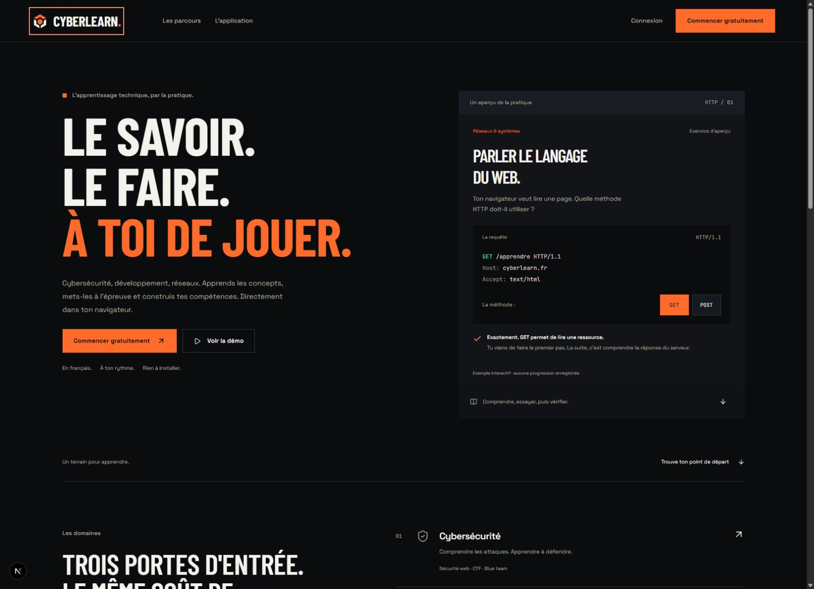

### Dashboard

La mission craie rassemble contexte, titre, explication, durée, XP et action principale. Le logo en grand sert de signature en arrière-plan. À droite, l'itinéraire sombre situe la leçon dans son module avec des états textuels : « En cours », « À suivre », « Validée ».

L'itinéraire montre trois leçons au plus (`routeWindow`) : celle d'avant, la leçon en cours et la suivante ; le reste du module est compté sur une ligne, pour que la carte garde la hauteur de la mission. Les quêtes et la série restent sous la mission. Les révisions et le bilan complètent la page avec moins de poids visuel. Les règles de sélection de leçon, de progression et de révision restent côté serveur.

### Navigation

La sidebar reprend le bandeau craie et le logo Bastion. Les groupes existants sont numérotés pour faciliter le repérage. La page active porte le cuivre ; l'information ne repose pas uniquement sur la couleur, car le lien conserve `aria-current="page"`. Le registre de navigation fait autorité sur les destinations, leur visibilité et leur regroupement : la DA n'impose pas un nombre fixe d'entrées ou de groupes.

Le rail replié centre les icônes dans des cibles de 44 px, sur le même axe que le logo et le compte. Seule la liste des destinations défile ; le conteneur extérieur ne crée pas une seconde gouttière. Le repère supplémentaire de page active disparaît dans ce mode pour ne pas décaler l'icône.

La barre supérieure affiche la section courante, la recherche et les actions existantes. Les résultats de recherche, amis et notifications utilisent les mêmes surfaces et la même typographie. La hauteur de la barre reste définie par `NAVBAR_HEIGHT` pour conserver les bons décalages des éléments sticky.

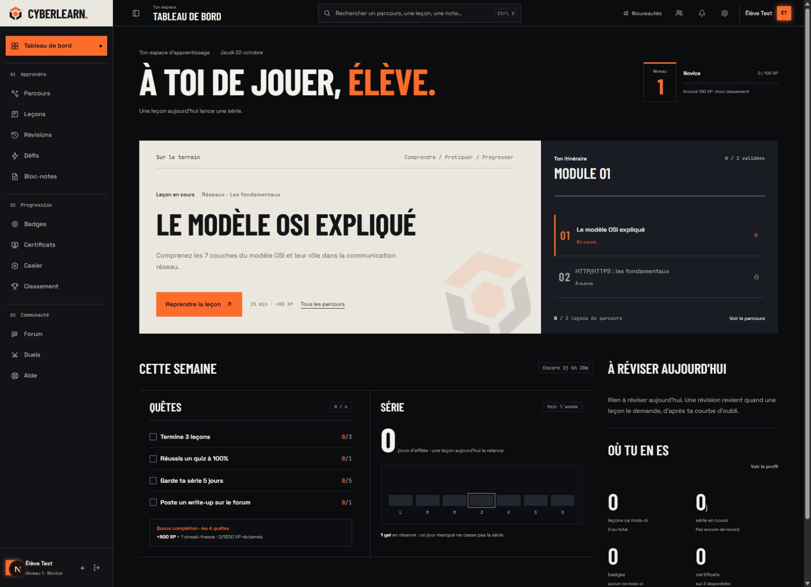

Ces captures utilisent la base locale de développement. Les chiffres et le compte affichés ne sont pas des statistiques de production.

## 6. Motion

Le mouvement sert l'ordre de lecture et le retour d'action. Il ne doit ni retarder l'accès à un bouton, ni cacher un contenu utile, ni donner l'impression que des blocs flottent sans raison.

| Surface | Comportement actuel |
| --- | --- |
| Entrée de la home | Introduction regroupée sur 520 ms ; exercice décalé de 70 ms ; translation courte et variation d'opacité modérée |
| Sections sous le premier écran | Révélation unique de 420 ms à l'entrée dans la vue |
| Réponse HTTP | Feedback de 180 ms, avec espace réservé pour conserver la hauteur du panneau |
| Dashboard | Arrivée séquencée du titre, de la mission et des étapes du module |
| Navigation | Survol bref et ouverture du plateau de compte ; pas d'animation d'entrée de toute la sidebar à chaque changement de page |

Le reste du site partage [motion.css](../../apps/web/components/motion.css) : la page entre par une montée de 10 px en 360 ms, les principales listes arrivent dans l’ordre (40 ms d’écart, huit éléments au plus), les cartes se soulèvent de 2 px au survol, un bouton s’enfonce de 1 px à l’appui et sa flèche avance, l’icône d’un lien de la sidebar se décale au survol et une barre de progression se remplit depuis son début à l’affichage. Toutes les entrées utilisent un remplissage `backwards` : une fois jouées, rien ne reste transformé.

La home utilise [HomeMotion](../../apps/web/app/_components/home-motion.tsx), un petit composant client qui observe les sections. Après leur première entrée, `unobserve` empêche une nouvelle animation au scroll inverse. Les contenus déjà visibles au chargement ne sont pas dissimulés pour les rejouer.

Règles à conserver :

1. Le HTML rendu côté serveur reste visible si JavaScript n'est pas disponible ou si IntersectionObserver n'est pas pris en charge.
2. Pas de `animation-timeline: view()` qui efface le contenu quand le lecteur remonte.
3. Pas de masque `clip-path` sur les lignes du grand titre de la home.
4. Ne pas animer séparément chaque mot, chaque lien et chaque chiffre d'un même groupe.
5. Une animation ne doit pas déplacer la cible lorsqu'elle reçoit le focus clavier.
6. Respecter `prefers-reduced-motion` : animations et transitions coupées, défilement doux désactivé.
7. Ne pas ajouter de boucle de flottement, de pulsation ou de faux indicateur d'activité.

## 7. Responsive et accessibilité

- Vérifier au minimum le téléphone étroit, le téléphone courant, une largeur intermédiaire et le bureau.
- Éviter tout débordement horizontal à 320 px. Le contenu doit se recomposer, pas être réduit comme une image.
- Prévoir des cibles d'au moins 44 × 44 px pour les actions de navigation sur téléphone.
- Le rail de bureau peut être replié ; le tiroir mobile reste développé quand il est ouvert, même si le rail avait été replié auparavant.
- Le tiroir mobile se ferme avec son bouton, Échap ou le choix d'une destination. Il contient le focus lorsqu'il est ouvert et le rend au déclencheur à la fermeture.
- Les destinations du tiroir fermé sont inertes, donc absentes de la navigation clavier.
- Les panneaux amis et notifications tiennent dans la largeur utile du téléphone.
- Le focus doit rester visible : clair sur carbone, sombre sur craie.
- Les états ne doivent pas être exprimés uniquement par une couleur ou une icône.

Les contrastes mesurés dans la navigation par défaut sont de 7,74:1 pour le texte secondaire sur la sidebar, 8,99:1 pour les liens, 14,78:1 pour l'encre sur craie et 6,89:1 pour le texte sombre sur cuivre. Ces mesures ne constituent pas une certification de toutes les pages ni de toutes les personnalisations.

## 8. Catalogues et carte des sources

### Catalogues : choisir un cap ou une notion

Les parcours et les leçons partagent un titre condensé sur une ligne, un bilan compact et des filtres carrés. Le nombre affiché provient du catalogue accessible au compte ; celui des leçons suit les filtres courants. Il ne représente pas un nombre de leçons débloquées.

Le parcours en cours associe une affiche Bastion, un plateau craie et une prochaine mission sur cuivre. La progression segmentée est accompagnée de son nombre de missions et de son pourcentage ; la barre accessible conserve son libellé. Les autres parcours déjà commencés forment une liste plus compacte. Les parcours à choisir restent sur carbone : une carte remplit la ligne, plusieurs se répartissent sur deux colonnes, puis une sur téléphone.

Les affiches réutilisent le logo existant, le domaine réel et la référence du contenu. Une couverture disponible reste présente, désaturée en fond. Le logo et le nom du domaine occupent des rangées distinctes dans une grille : aucune superposition du logo avec le texte, y compris sur téléphone. Les axes fins prolongent la géométrie du logo.

Les leçons donnent d'abord un accès direct à une leçon en cours, si la page en contient au moins trois et que cette leçon est accessible. Elle apparaît une seule fois, dans le bandeau « Reprends le fil ». La sélection se fait ensuite par quatre tuiles de domaine avec pictogramme et compte réel, puis par niveau, statut ou recherche. Les cartes courtes privilégient titre, domaine, durée, niveau, XP et état ; la description complète reste dans la leçon. Une leçon verrouillée nomme toujours le parcours qui la débloque. Les cartes accessibles précèdent les verrouillées, avant pagination ; les règles métier existantes sont conservées. Le catalogue et ses cartes sont rendus sur le serveur.

L'arrivée du titre dure 400 ms, sur 8 px au maximum ; les axes des affiches se dessinent une seule fois en une seconde. Les résultats restent stables pendant la recherche et les filtres. Le survol déplace seulement le repère d'ouverture et renforce la bordure ; aucun clignotement continu. La préférence de réduction des mouvements désactive ces effets.

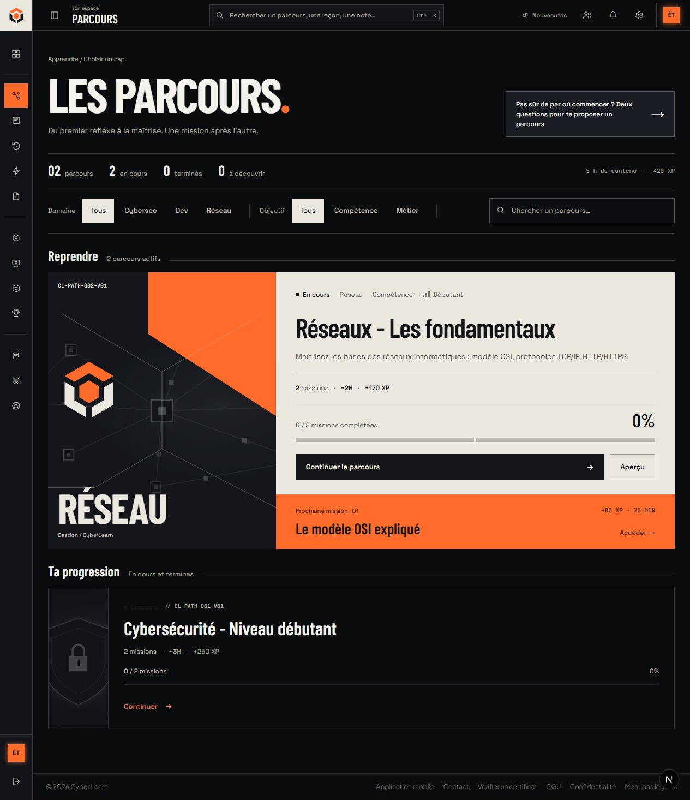

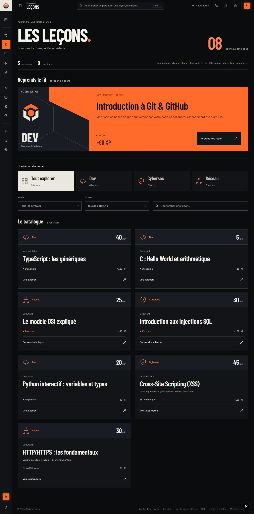

### Fichiers de référence

| Source | Responsabilité |
| --- | --- |
| `packages/ui/src/tokens.css` | Palette et tokens partagés |
| `apps/web/components/bastion-logo.tsx` | Logo de marque |
| `apps/web/components/brand-typeface.ts` | Chargement des polices de la nouvelle signature |
| `apps/web/app/_components/landing-client.tsx` | Composition serveur de la home, malgré le nom historique du fichier |
| `apps/web/app/_components/landing-interactions.tsx` | Démo et exercice HTTP local |
| `apps/web/app/_components/home-motion.tsx` | Révélations uniques de la home |
| `apps/web/app/_components/landing.css` | Styles de la home et de la navigation publique |
| `apps/web/app/(app)/dashboard/dashboard.css` | Styles propres au dashboard |
| `apps/web/components/learning-catalogue.css` | Titres, bilans, filtres et affiches communs aux catalogues |
| `apps/web/components/catalogue-artwork.tsx` | Composition du logo, domaine, référence et couverture existante |
| `apps/web/components/catalogue-domain-icon.tsx` | Pictogrammes des domaines pour les choix et cartes de leçons |
| `apps/web/app/(app)/paths/_components/paths-collection.tsx` | Recherche locale, domaines, objectifs et états des parcours |
| `apps/web/app/(app)/paths/_components/paths-catalog-v2.css` | Reprise sur craie et cartes de parcours |
| `apps/web/app/(app)/paths/_components/paths-workshop.css` | Composition affiche, plateau et prochaine mission du catalogue connecté |
| `apps/web/app/(app)/lessons/page.tsx` | Catalogue serveur, filtres URL, disponibilité et pagination |
| `apps/web/app/(app)/lessons/_components/catalogue-lesson-card.tsx` | Métadonnées, état et score de quiz d'une leçon |
| `apps/web/app/(app)/lessons/lessons-catalogue.css` | Grille responsive et états visuels des leçons |
| `apps/web/components/app-shell.tsx` | Conteneur partagé de l'espace connecté |
| `apps/web/components/app-chrome.css` | Identité de la sidebar, de la barre et de leurs panneaux |
| `apps/web/components/sidebar-nav.tsx` | Navigation et actions du compte |
| `apps/web/components/sidebar-wrapper.tsx` | Rail et tiroir responsive, gestion du focus |
| `apps/web/components/navigation-location.tsx` | Section courante dans la barre supérieure |
| `apps/web/lib/chrome.ts` | Dimensions des éléments fixes et décalages sticky |
| `docs/MOBILE_PARITY.md` | Parité native et décisions web-only |

Conserver des styles de page limités à leur racine pour éviter les régressions entre écrans. Les tokens partagés changent le vocabulaire commun ; un ajustement local de composition n'a pas à modifier tout le site.

## 9. Réviser, pratiquer et conserver

Révisions, Défis et Bloc-notes reprennent la typographie et les contrôles communs, avec une composition propre à leur usage.

- **Révisions** : une session numérotée, l’échéance et la durée avant l’auto-évaluation. La leçon ouverte passe sur craie ; Oublié, Difficile et Facile restent les trois réponses existantes. Le résultat reste visible après enregistrement et rechargement serveur. Le panneau latéral explique le prochain rappel sans détourner de la session. L’état sans révision due offre les leçons et le tableau de bord, sans inventer une prochaine échéance.
- **Défis** : le défi de la semaine est le point d’entrée, sur craie, avec les pièces et les conditions sur carbone. Le bonus, le compte à rebours, les tentatives et les indices viennent des données existantes. Les explications du déroulement sont dans une ouverture facultative. Les autres défis gardent leur aperçu réel ou leur état verrouillé, avec accès au prérequis ; aucune fausse session de terminal n’est ajoutée.
- **Bloc-notes** : les dossiers restent sur carbone, les notes prennent la matière craie pour évoquer le document à relire. La bibliothèque conserve les menus contextuels, le déplacement, les dossiers personnalisés, les notes reçues, l’édition et les exports. Couleurs et icônes de dossier restent des choix de l’utilisateur. La palette et ses cibles se recomposent sur téléphone. La lecture et l’édition restent dans la fenêtre existante, avec des outils carrés.

La création de dossier suit aussi la règle des angles droits : champs, couleurs, icônes et menus ont un rayon nul. Les choix de couleur et d’icône occupent 44 × 44 px ; la sélection claire et le focus cuivre sont distincts. Les couleurs transmises à l’action serveur sont des valeurs hexadécimales, conformes à sa validation existante.

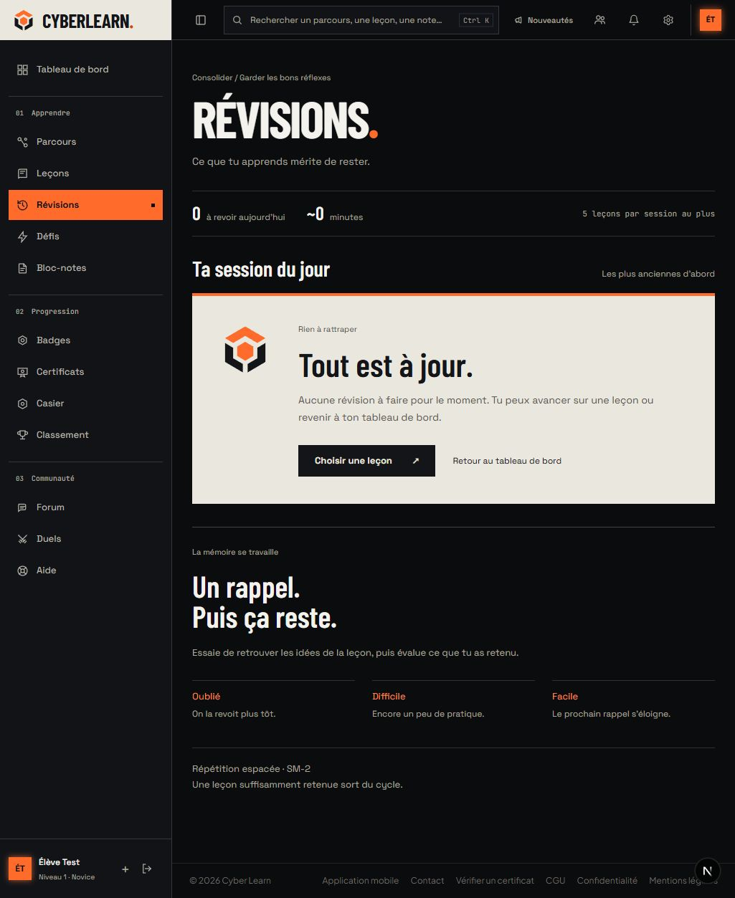

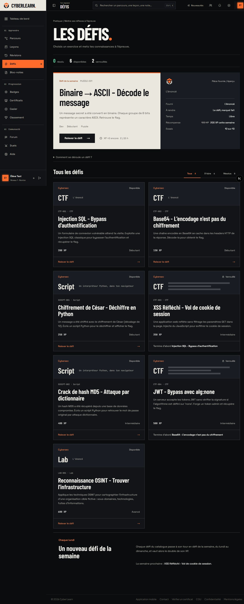

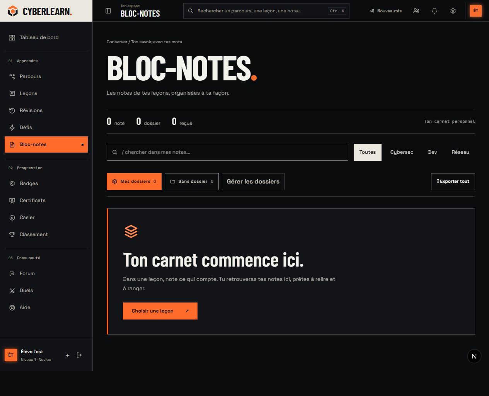

## 10. Section Progression

Les pages partagent un titre franc et des chiffres réels, mais ne se réduisent pas à une même grille de cartes.

- **Badges** : bilan sur craie, filtre par rareté et collection par groupes. Les médaillons existants et leurs couleurs de rareté restent utiles au repérage ; la surface autour devient mate, le nom gagne en présence et les conditions restent lisibles même pour un badge non obtenu.
- **Certificats** : des documents sur craie, avec référence, date, examen et empreinte existants. Le PDF et la vérification gardent leurs destinations ; un certificat révoqué conserve son état et son motif, sans les actions du certificat valide. L’état vide explique le parcours et son examen sans dessiner un faux certificat.
- **Casier** : une sélection de cosmétiques et un aperçu qui réagit à l’équipement. Chaque carte montre le cosmétique sur la surface qu’il change (le logo et un aplat pour un accent, l’avatar pour un contour ou un cadre, un bloc de code pour un terminal) ; « Équipé » remplace « Équiper » à la même taille. L’aperçu « Sur le site » est fait des vrais composants : la navigation avec le logo et la page active, la mission avec sa barre de progression et son bouton, le bloc de code des leçons et l’avatar du profil. Équiper s’applique aussitôt à tout le site. Sans choix, le cosmétique par défaut de chaque emplacement est affiché comme équipé. Un emplacement vide est expliqué.
- **Classement** : une liste de joueurs, avec rang, identité autorisée, XP et série. La position personnelle est sur craie ; le podium distingue le premier lorsqu’au moins trois joueurs sont disponibles. Global, Amis, Ligue, périodes et confidentialité conservent leurs règles. La poule de ligue se recompose sur téléphone, sans masquer les XP, le niveau ou la zone.

L’arrivée du titre reste brève. Les panneaux de notation, de gestion de dossiers et d’explication apparaissent par une variation d’opacité de 180 ms, sans déplacer leurs boutons. Pas de boucle d’activité décorative. Les chargements réservent titre, bilan, contrôles et contenu ; les états vides gardent une action adaptée. La réduction des mouvements coupe animations et transitions.

Sources principales : `components/learning-workspace.css`, `components/progression-workspace.css`, `components/progression-heading.tsx` et `components/workspace-loading.tsx` dans `apps/web`, puis les composants et styles locaux de chaque page. Les styles restent limités aux racines de ces espaces pour préserver les écrans qui attendent encore leur rework.

Les captures utilisent le compte local : dix badges à obtenir, aucun certificat ni cosmétique, deux joueurs anonymisés dans le classement. Les états vides sont conservés dans ces captures plutôt que remplis de données fictives.

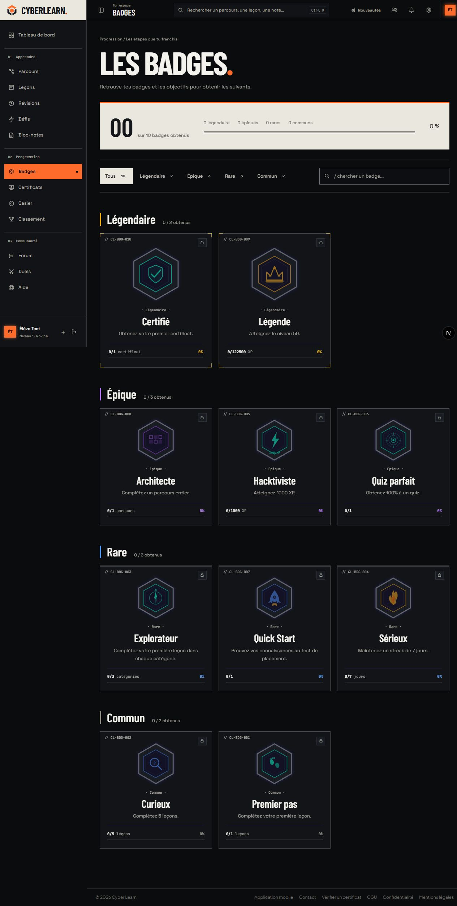

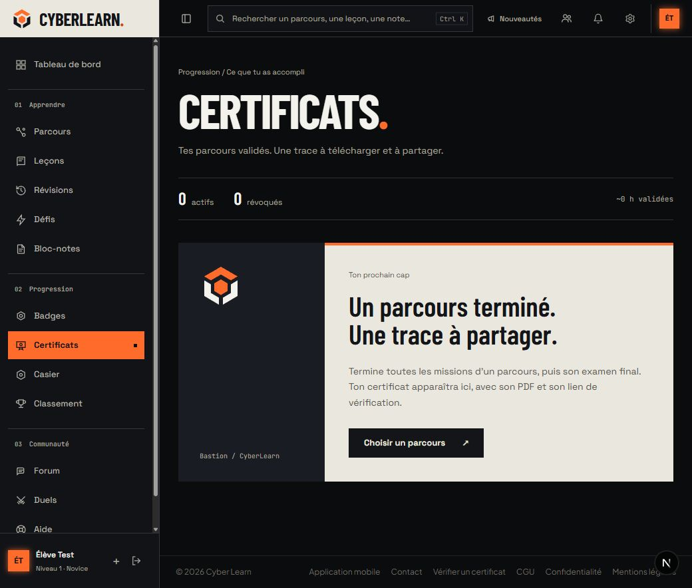

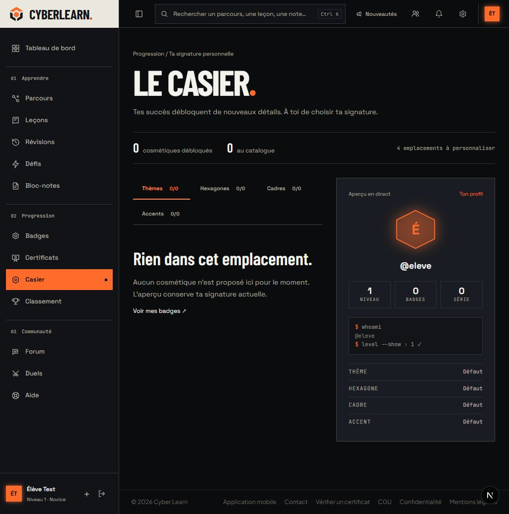

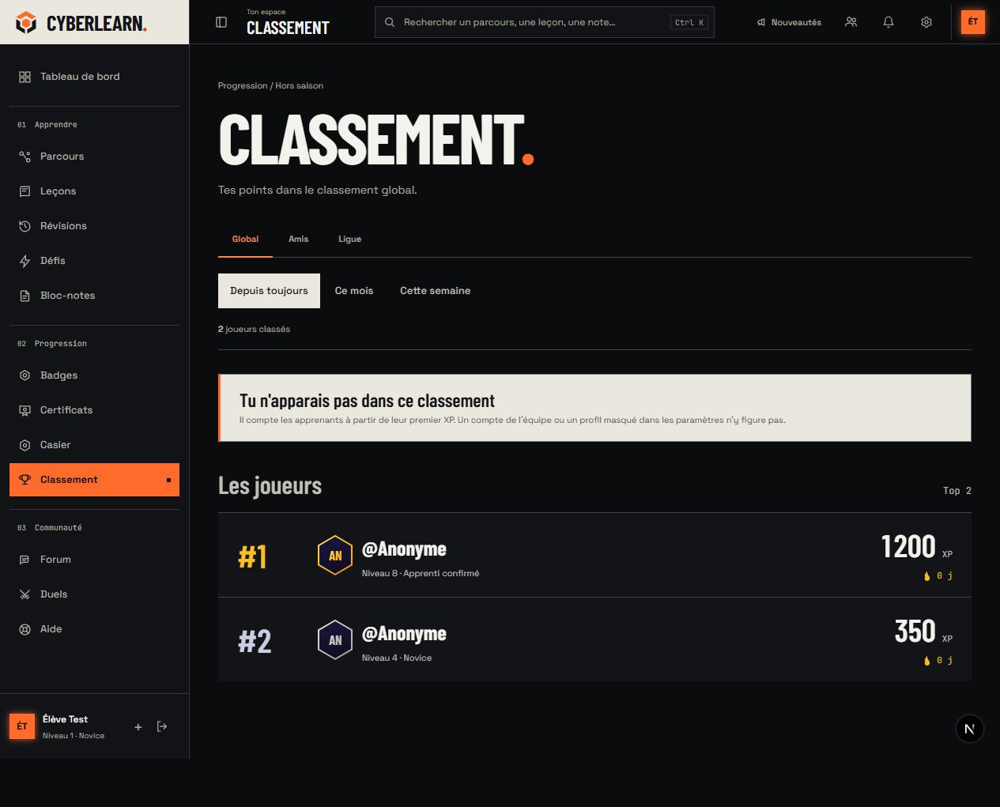

## 11. Communauté et échanges

L’accueil du forum donne la priorité aux échanges : dernière discussion sur craie, autres sujets dans le fil, répertoire compact des sections à droite. Le bouton « Nouveau sujet » propose une section puis ouvre son compositeur existant. Sur téléphone, les sections passent au-dessus du fil, sur deux colonnes ; leurs noms disposent de toute la largeur de leur tuile et les compteurs restent nommés. Le conseil de rédaction remplace l’espace vide sous un fil court. Le chargement reprend cette composition. Dans un sujet, l’auteur reste sur carbone, le message se lit sur craie ; les messages retirés restent nommés et visibles à leurs ayants droit. Édition, réponse, modération, pagination et marques d’amitié conservent leurs règles. Voir [le contrôle du nouvel accueil et des marges](page-spacing-and-forum-review.md).

Les duels privilégient l’invitation ou le lancement d’une partie. Les règles détaillées sont disponibles dans une ouverture facultative. Le bilan, les adversaires, les scores, les échéances, les réponses et les résultats viennent des données existantes. Le logo et les textes occupent deux colonnes distinctes dans le panneau de lancement ; elles se superposent sur téléphone. Le point de suivi n’est pas animé en boucle.

L’aide affiche les demandes en lignes, avec leur état, la date d’envoi et le nombre de réponses. La création part d’un panneau craie ; le fil distingue les messages de l’apprenant sur carbone et ceux de l’équipe sur craie. Une demande résolue ou fermée conserve sa conclusion et n’offre pas de nouvelle réponse. L’ouverture d’une nouvelle demande et la validation de son formulaire restent celles du produit.

Les polices Bastion sont disponibles depuis le corps de la page pour que les fenêtres et listes rendues hors du conteneur principal les reçoivent aussi. Les listes de choix concernées restent carrées et leurs options ont une hauteur de 44 px. Les fenêtres apparaissent par opacité, sans mise à l’échelle ; la fermeture rend le focus au déclencheur encore présent. Le détail des contrôles et de leurs limites figure dans [la vérification Communauté](community-review.md).

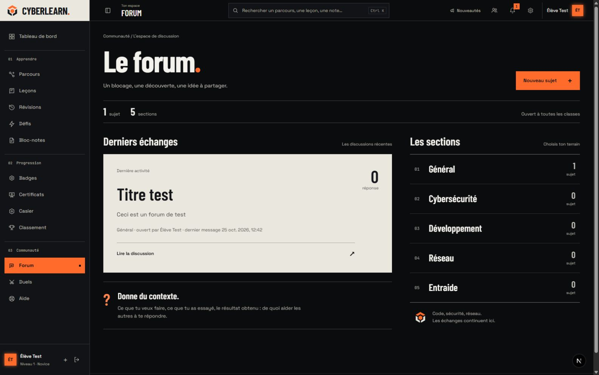

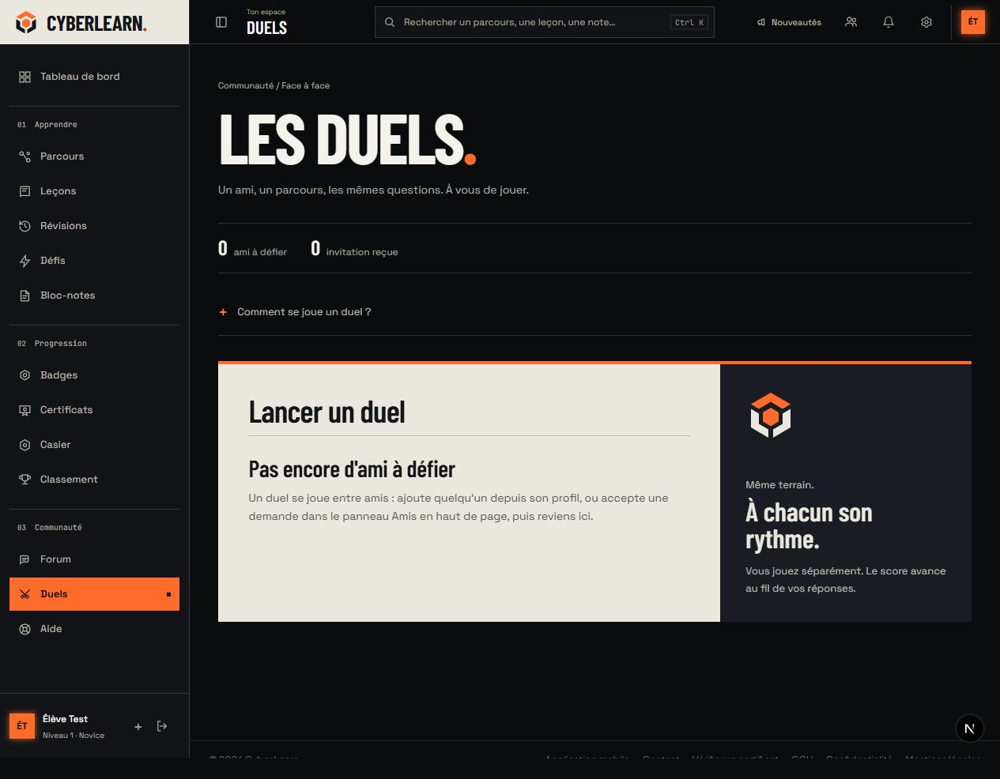

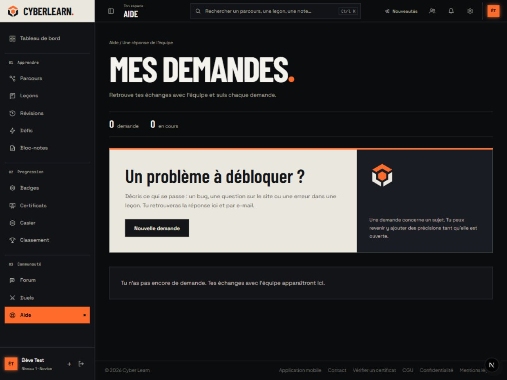

## 12. Profil et paramètres

Le profil privé met l’identité sur carbone, puis le niveau et les XP sur craie. L’activité annuelle, les badges, les leçons terminées et les certificats restent les données du compte. Les trois onglets proposent une action adaptée lorsqu’ils sont vides. Un certificat conserve son téléchargement, sa référence publique et son empreinte complète.

Le bilan d’activité remplace la grille de centaines de cases par des colonnes mensuelles : douze mois civils, mois en cours inclus, et un nombre de jours actifs lisible sans survol. Le mois courant passe sur craie ; les autres mois actifs utilisent le cuivre. Les décomptes quotidiens restent disponibles dans un détail replié. Sans activité, un état court remplace le graphique vide. Les copies du profil public distinguent le visiteur du propriétaire.

Le profil public reprend la même progression. Les réglages de visibilité et les relations d’amitié continuent de déterminer les sections et actions disponibles. Les personnalisations de l’avatar restent celles de son propriétaire.

Les sept sections de paramètres occupent un tiroir large sur bureau, avec une navigation numérotée. Sur téléphone, cette navigation défile et garde la section active visible. Changer de section conserve le brouillon ; Annuler restaure les valeurs chargées. Les sauvegardes, la confidentialité et la sécurité gardent leurs actions existantes. L’export et la suppression se présentent comme deux opérations distinctes avec leurs vraies limites. Les fenêtres, aides contextuelles et contrôles restent carrés. Une aide se ferme par Échap avant le tiroir qui la contient.

Barlow Condensed sert les titres ; Space Grotesk sert les formulaires et explications. La craie distingue le niveau à parcourir, le cuivre signale une action ou la sélection. L’ouverture des fenêtres ne déplace pas les cibles. Voir [les vérifications et limites du compte](account-review.md).

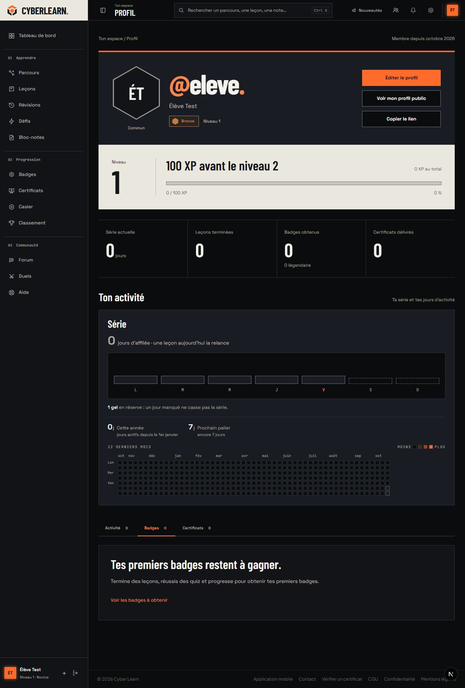

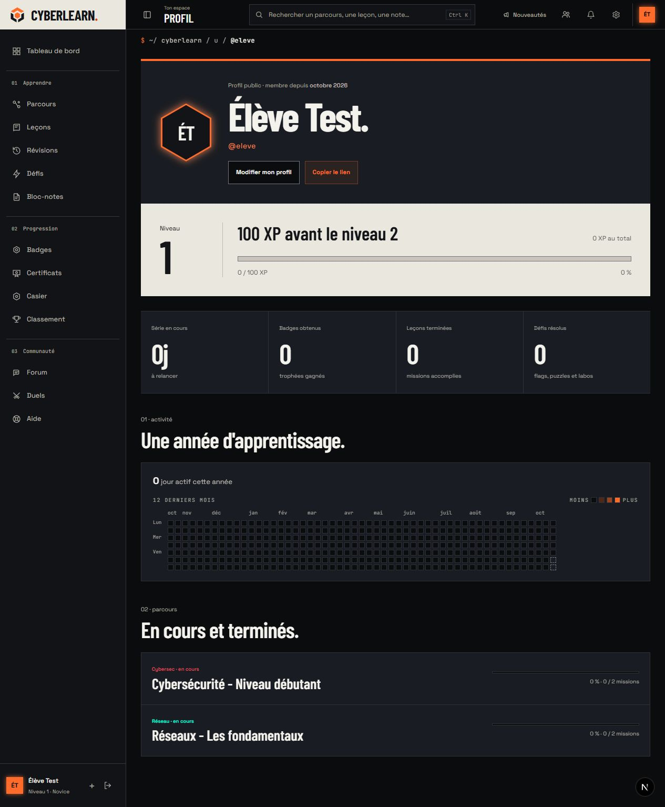

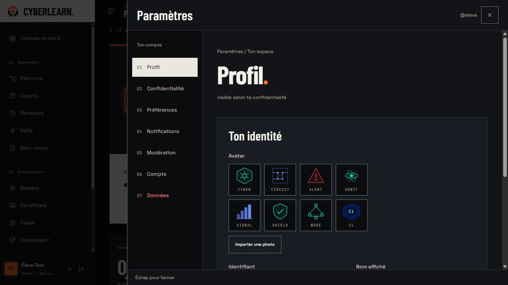

## 13. Parcourir et lire

Le détail d’un parcours prolonge son affiche de catalogue : titre, domaine et objectif d’un côté, logo et couverture existants de l’autre. Le plateau craie regroupe progression réelle, durée, XP des missions, certificat ou mention de classe et accès à la reprise. L’ancien itinéraire alterné est repris : missions de part et d’autre d’une ligne centrale, jalons carrés et portes de module. Le jalon de la prochaine mission est cuivre et sa carte craie ; les autres missions accessibles restent nommées « Disponible ». Les étapes terminées portent une coche et permettent la relecture, les étapes verrouillées un cadenas et le nom du prérequis. Chaque module garde son titre, son compte de leçons réellement terminées et sa fiche PDF. Quand la zone devient trop étroite, la ligne passe à gauche et les cartes dans une colonne ; l’ordre des leçons reste identique dans le document. Objectifs et avis occupent le rail de bureau, puis rejoignent le flux sur téléphone. Voir [le retour de l’itinéraire et ses contrôles](path-itinerary-review.md).

Le cadre d’une leçon utilise la largeur disponible avec les mêmes marges que les autres pages : 16 px sur téléphone, 28 px à partir de 768 px, 36 px à partir de 1280 px. Titres, prose, tableaux, médias et exercices partagent son bord gauche ; les paragraphes et listes, en 17 px avec un interligne de 1,75, prennent la largeur du cadre jusqu’à `--lesson-measure` (95rem, environ 140 caractères), sans recentrage séparé entre deux exercices ni bloc de prose décalé vers la droite. Tableaux et citations utilisent toute la largeur, comme l’en-tête, les exercices et la suite de leçon. Les éditeurs Monaco ont un fond carbone et une coloration lisible, avec l’accent équipé conservé sur le curseur. Les boutons Python, SQL et quiz gardent leurs comportements, avec texte lisible et cibles tactiles ; les indications lumineuses décoratives sont retirées. Voir [la correction et ses contrôles](activity-and-lesson-review.md), puis [l’élargissement et la vitrine locale](lesson-showcase-review.md).

Les cadres des pages partagent `--page-gutter`, `--page-space-top` et `--page-space-bottom` dans `globals.css`. Le haut vaut respectivement 24, 28 et 32 px aux trois tailles ; le bas 80, 96 et 110 px. Les composants de chargement utilisent les mêmes conteneurs. Les styles locaux composent l’intérieur des pages sans réécrire ces marges. Les en-têtes de catalogue connectés n’ajoutent plus un second padding supérieur ; les pages de défis et de forum n’ont plus leur ancien plafond de largeur indépendant.

Son titre condensé précède une ligne de métadonnées courtes et la barre d’outils mate : une barre plate de 56 px, sans flou, avec le compteur de section en Barlow, le nom de la section, un segment par section (terminée, en cours dans l’accent, atteinte, verrouillée ; un clic ouvre une section déjà permise), « Précédente » en contour, « Suivante » ou « Terminer » sur l’accent et trois outils carrés (plan, notes, mode focus) qui passent sur craie quand ils sont ouverts. Les liens « Pour aller plus loin » sont des rangées mates : domaine, titre, description et une flèche qui avance au survol. Le plan et les notes reprennent les mêmes polices et angles droits. La section active passe sur craie, les étapes à venir restent nommées et verrouillées. Les notes restent ancrées à côté du texte à partir de 1440 px, avec le comportement mobile existant en tiroir. Les sections conservent leurs exercices, quiz et conditions de progression ; les blocs de code gardent leur propre défilement horizontal.

Le bilan de fin présente les XP crédités sur craie, le score réel du quiz lorsqu’il existe, le nouveau niveau et les badges gagnés. Le décompte des XP ne rejoue pas de lueur ; il affiche immédiatement le résultat en réduction des mouvements. « Voir la suite » mène au panneau suivant, qui nomme la prochaine leçon ou le retour au parcours, avec son vrai verrou.

Le QCM de fin de leçon pose une question à la fois : la réponse confirmée garde son verdict et son explication, « Question suivante » remplace la carte par un fondu bref, et des segments carrés (juste, faux, en cours, à venir) rouvrent une question déjà répondue. Le verdict s’affiche aussitôt, puis la réponse enregistrée par le serveur fait foi. La dernière réponse du quiz final (`findFinalQuizStep` : la dernière section qui contient un quiz, sans exercice de code après elle) valide la leçon par le même chemin que « Terminer » et ouvre le bilan ; « À retenir », qui le suit souvent, reste lisible. Les leçons sans quiz final se terminent par « Terminer », au bout de leur dernière section.

Voir [les vérifications des détails d’apprentissage](learning-detail-review.md).

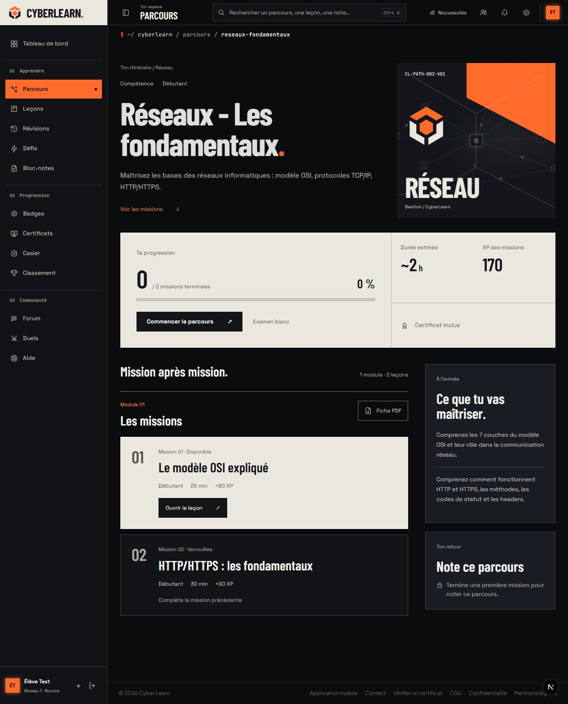

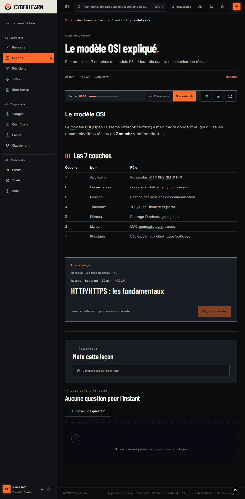

## 14. Examens et défis

Le départ d’un examen rassemble les conditions utiles sur craie : questions, durée, seuil et action. Le logo reste dans une zone réservée. Pendant l’épreuve, le chrono, la question et la navigation restent accessibles dans le cadre existant. Une réponse sélectionnée passe sur craie. Le bilan met le score réel en premier, puis le verdict, le seuil et la correction ; le délai avant une nouvelle tentative conserve sa date et son compte à rebours.

L’examen blanc reprend ce vocabulaire, avec ses modules, son historique et sa correction. Il explique qu’il ne donne ni XP ni certificat. Les indisponibilités sont annoncées depuis les données réelles du parcours.

Le détail d’un défi distingue la consigne, les conditions, l’espace de travail et les indices. Le plateau craie rassemble récompense, temps, tentatives et résolutions. Les prérequis, machines, scripts, pièces jointes, solutions et bonus hebdomadaire gardent leur fonctionnement. Les formulaires et panneaux restent carrés, y compris sur téléphone. L’ancienne route `/review` redirige vers les révisions existantes.

Voir [les contrôles et limites des examens et défis](assessment-review.md). Les vues de session et de résultat jointes à ce rapport utilisent des données de test explicitement signalées.

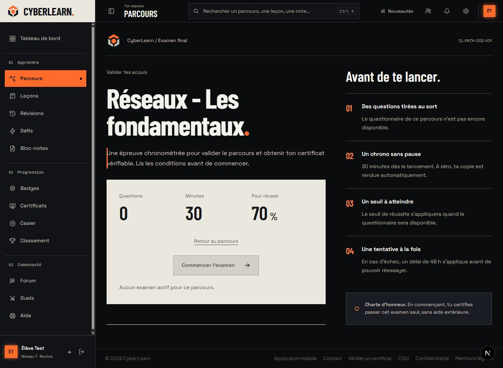

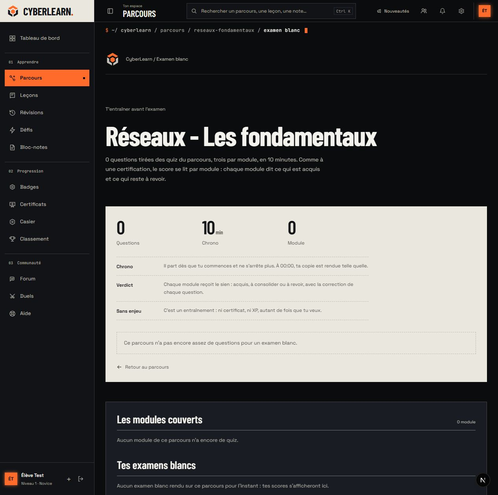

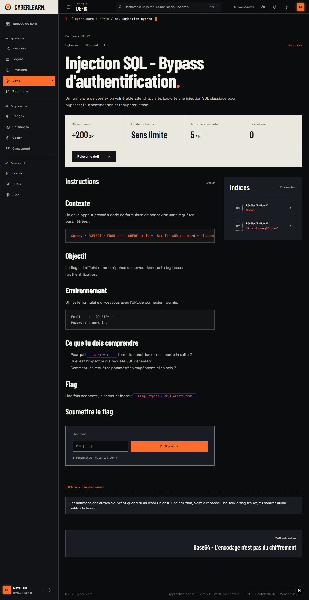

## 15. Apprendre et enseigner en classe

La page de classe conserve deux lectures. L’élève voit d’abord son travail et les ressources disponibles, puis ses professeurs, son rang et ses leçons terminées. Le plateau de chiffres et sa ligne personnelle passent sur craie ; les autres élèves restent sur carbone. La confidentialité et les marques d’amitié gardent leurs règles existantes.

Le professeur conserve ses établissements, promotions et classes. Les cinq onglets séparent élèves, travail, parcours, leçons et ressources. Les chiffres restent de vrais comptes ; les élèves restent ordonnés du moins avancé au plus avancé. Sur téléphone, les onglets défilent et les actions passent sous le contenu de leur ligne.

Les éditeurs de leçon et de parcours gardent leurs champs, validations et actions. Les métadonnées occupent un panneau mat ; le parcours sélectionné est une liste numérotée sur craie, à côté des leçons disponibles sur carbone. Chaque commande de déplacement ou de retrait occupe 44 px et nomme sa leçon. Le catalogue reste filtrable sans modifier la sélection.

L’éditeur MDX partagé garde les blocs, le code, le guide et l’aperçu réel. Ses repères de style permettent au site de l’intégrer à la DA Bastion, avec un thème Monaco résolu en couleurs hexadécimales ; la console conserve sa palette de repli. Les blocs et l’aperçu se superposent sur téléphone, avec les mêmes commandes. Aucun nouveau flux de publication ou de gestion de classe n’est ajouté.

Voir [les vérifications et limites de la classe](class-review.md). Les captures suivantes sont des rendus des composants avec des données de test signalées ; le compte local n’est rattaché à aucune classe.

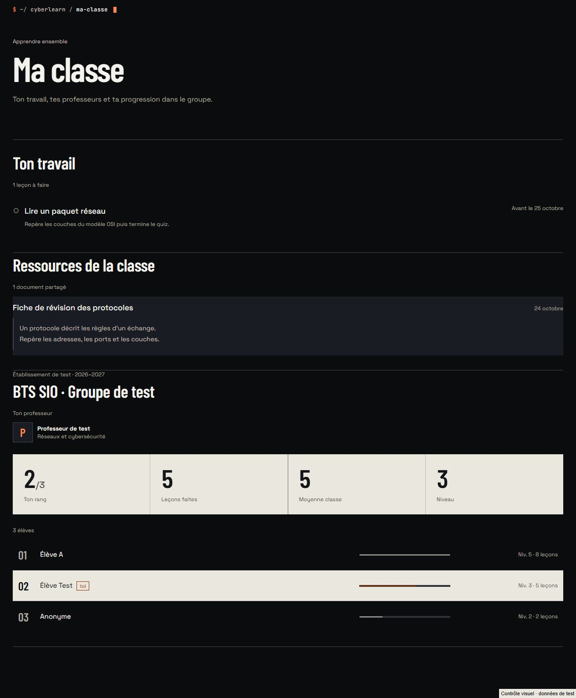

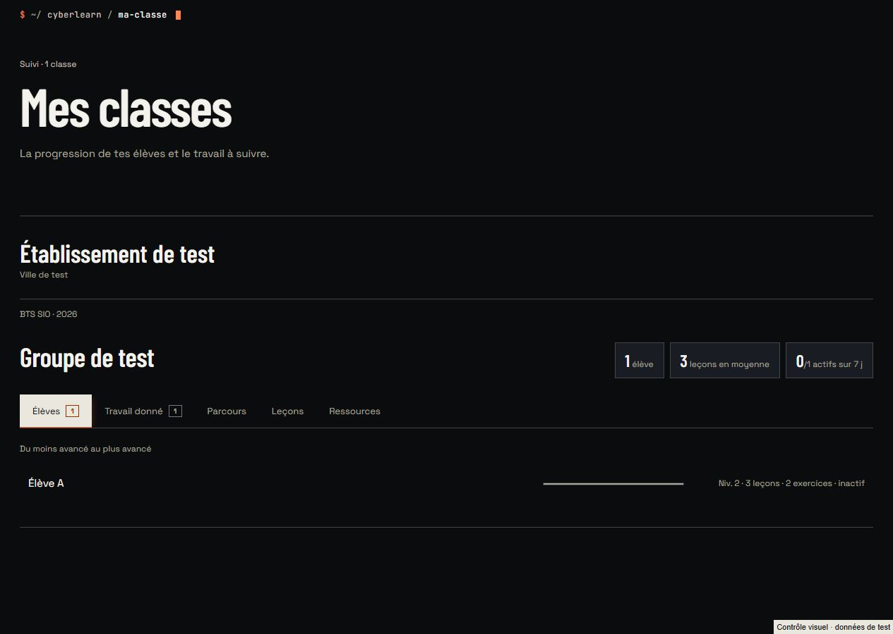

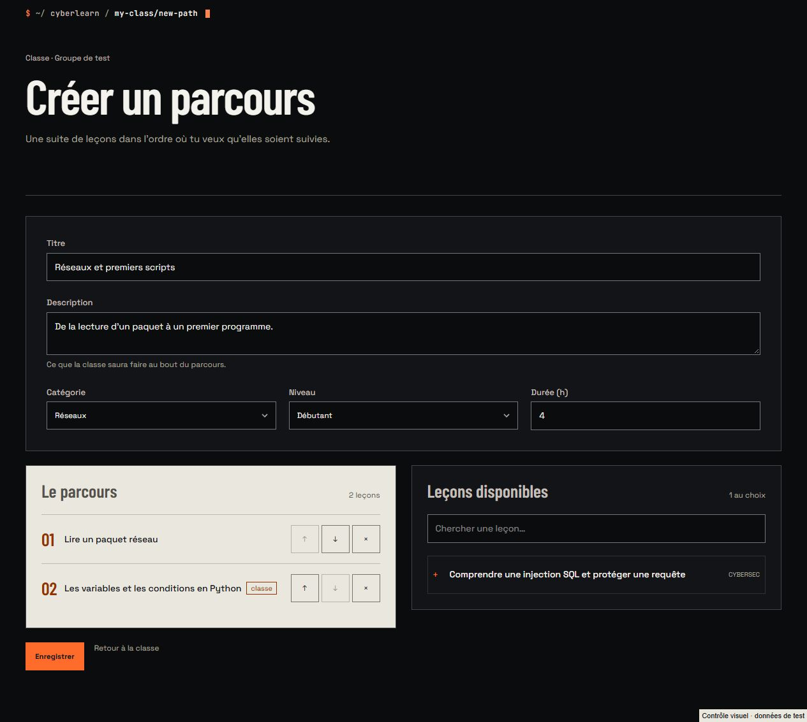

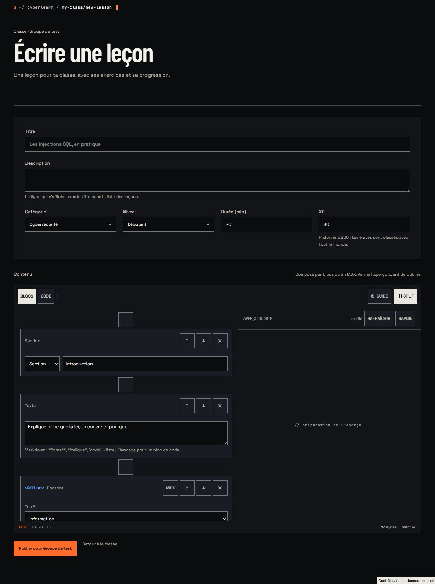

## 16. Tournois et récap annuel

Les tournois conservent leurs trois temps : à venir, en cours, terminé. La liste place la partie en cours avant les autres événements et replie les explications du score dans « Comprendre les scores ». Les dates, équipes, défis et durées restent les données du tournoi. L’état sans événement explique où paraîtra le prochain.

Le tableau du tournoi met le temps restant et la position personnelle sur craie. Les défis gardent leurs états explicites : trouvé par toi, par ton équipe, par un autre joueur ou pas encore trouvé. Avant le départ, seul leur nombre est visible. Les classements restent distincts ; l’équipe et le joueur du compte passent sur craie. Le bilan final nomme le vainqueur et retire le chrono et le repère « En direct ». Les scores gardent leur rafraîchissement existant.

Le détail d’un défi reprend la consigne, les outils et les règles dans la même matière. Le plateau craie rassemble points, statut, équipe et échéance ; le flag reste dans son formulaire existant. Les machines, scripts, fichiers et conditions de participation ne changent pas.

Wrapped garde son ouverture annuelle et son histoire à navigation manuelle ou automatique. La page fermée présente l’année sur une affiche craie avec le logo, puis la vraie date d’ouverture. Dans l’histoire, les chiffres deviennent les repères visuels ; les commandes restent fixes et les changements de diapositive sont brefs. La réduction des mouvements coupe l’avance automatique. Espace conserve son rôle normal sur un bouton, sans déclencher la pause globale à sa place.

La carte finale reprend les quatre statistiques et les mots partagés avec l’app. L’export reste une image 1080 × 1920 ; les formes du logo viennent de la même source que le SVG du site. Le rendu attend les polices avant de dessiner et conserve un état d’erreur et une nouvelle tentative. Le partage natif reste proposé seulement lorsque le navigateur sait partager un fichier.

Voir [les vérifications et limites des événements](events-review.md). Les captures de partie et d’histoire utilisent des données de test signalées, sans écrire de score en base.

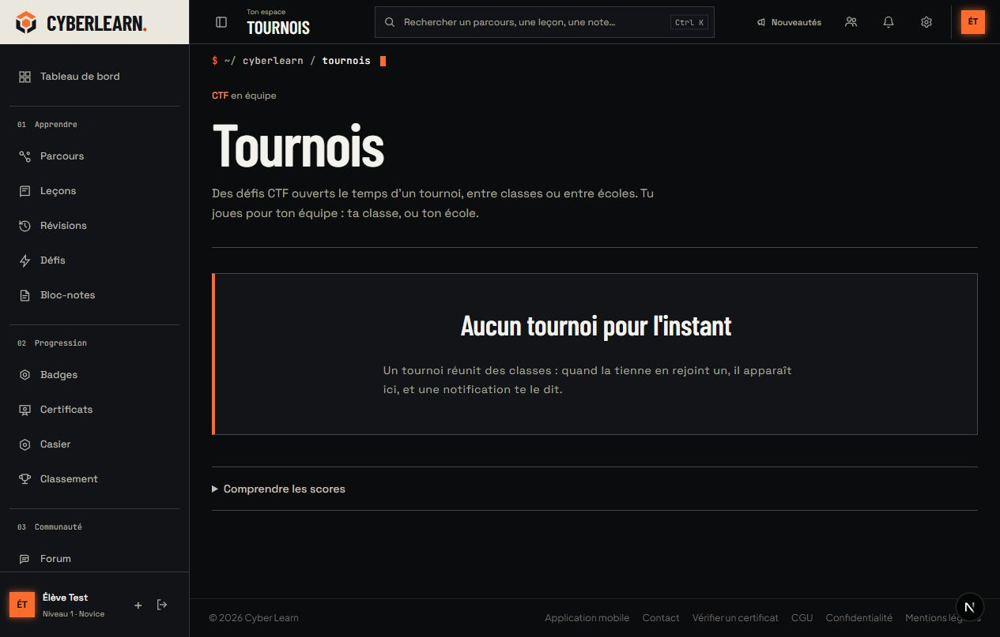

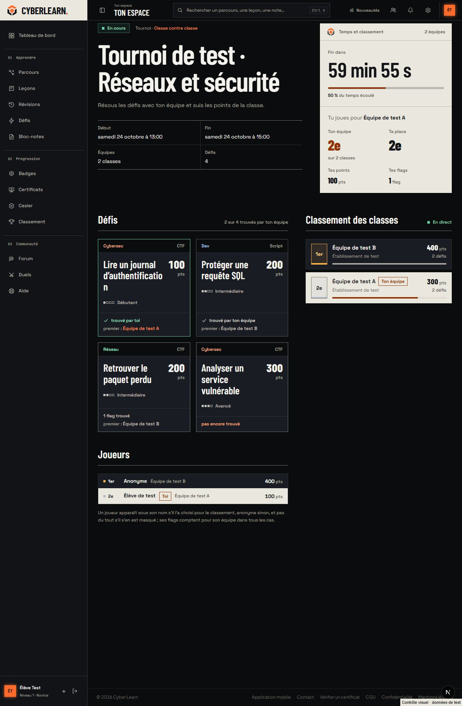

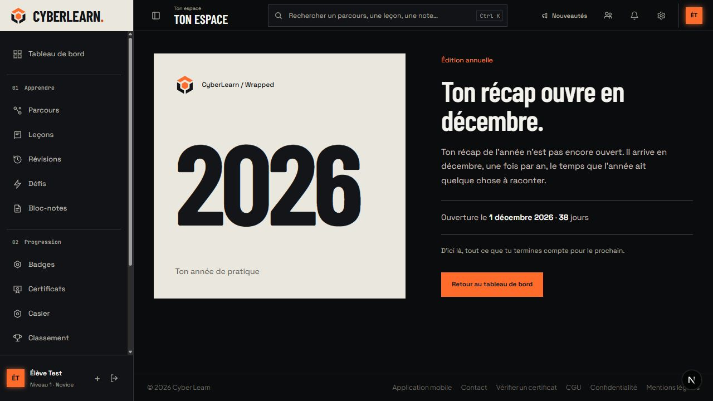

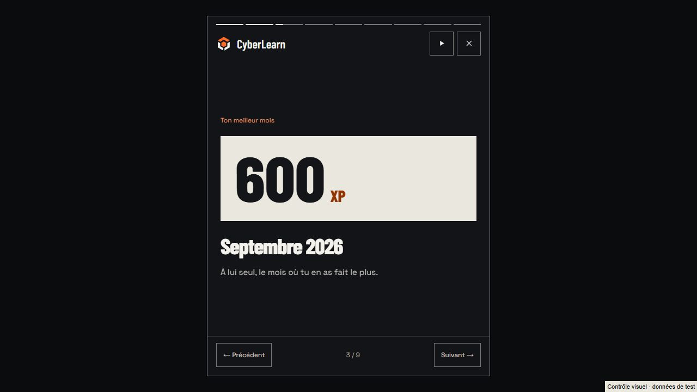

## 17. Accès au compte et premiers pas

Les pages d’accès partagent une affiche craie et un formulaire sur carbone. Le vrai logo et les titres Barlow Condensed signent l’ensemble ; sur téléphone, la marque devient une bande compacte pour laisser les champs en premier. Les boutons d’affichage du mot de passe restent fixes, carrés et utilisables au clavier. Erreurs, confirmation et vérification en cours gardent leur place dans le formulaire.

L’onboarding utilise un cadre serveur commun aux trois étapes : identité, avatar, objectif. La progression représente l’étape réelle. La collection d’avatars garde ses actifs et ses choix, avec une sélection sur craie et deux colonnes sur téléphone. Les objectifs gardent leurs champs natifs et leurs suggestions ; la première suggestion ressort sur craie, les suivantes sur carbone.

Le positionnement présente le nombre réel de questions et la durée estimée, puis des groupes de réponses carrées. Les résultats regroupent les trois domaines sur craie, avec leurs pourcentages, niveaux et dispenses. Le test reste optionnel ; les règles de calcul et les actions ne changent pas. Aucun arrondi, grille lumineuse ou animation en boucle n’est ajouté. L’arrivée du titre d’accès dure 180 ms et respecte la réduction des mouvements.

Voir [les contrôles et limites de l’accès au compte](access-review.md). La connexion et l’introduction du test ci-dessous sont les pages réelles. Les captures d’étapes protégées portent une mention de test.

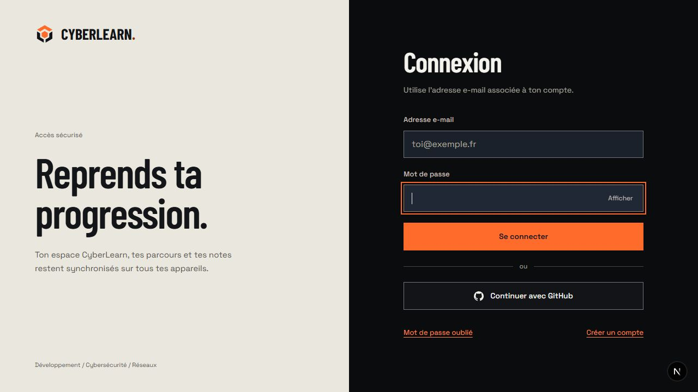

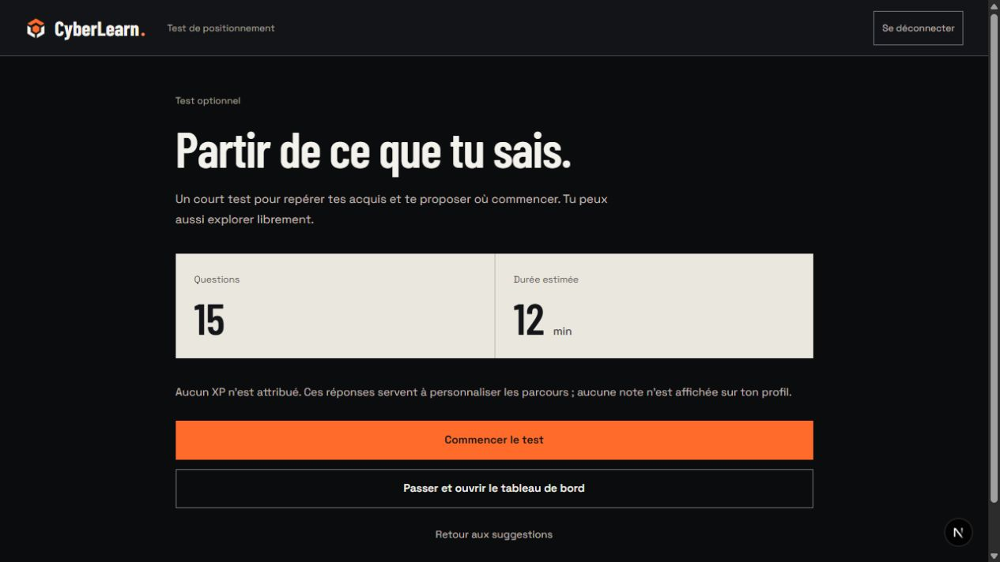

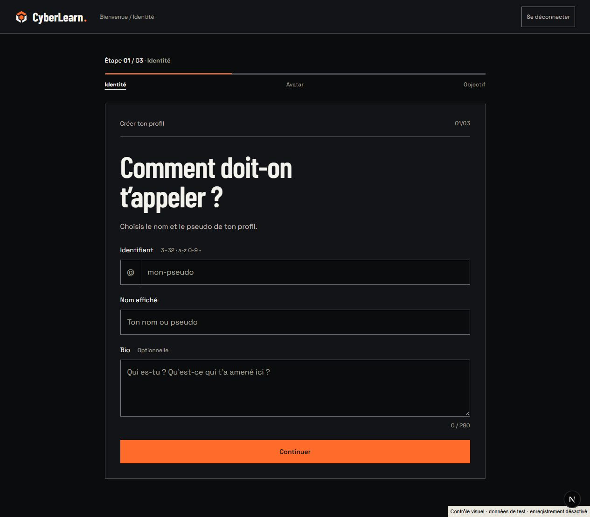

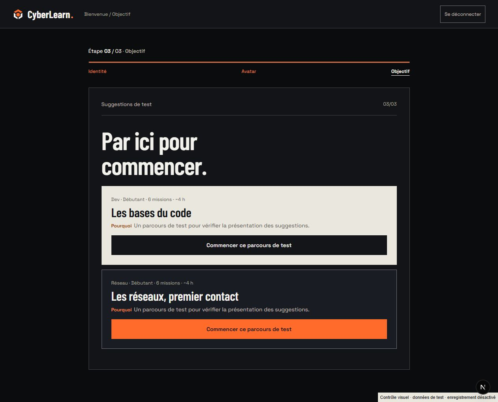

## 18. Parcourir, installer et vérifier

Le catalogue public conserve ses affiches Bastion et ses filtres. Il garde le cadre de l’app pour un compte connecté, avec des cartes vers les parcours, et la navigation publique pour un visiteur, avec des cartes vers l’inscription. Le glossaire reprend les titres de marque, le compte réel des termes sur craie et un index de catégories. Une définition ciblée par son lien passe sur craie, sans modifier son texte ni son identifiant.

La page de téléchargement remplace les chiffres d’un faux téléphone par une affiche du vrai logo. Les disponibilités restent déterminées par les liens configurés. Les informations de plateforme se lisent en lignes sur les petits écrans ; les instructions d’installation et les demandes de disponibilité restent les mêmes.

Le contact met son titre à gauche du formulaire sur grand écran et au-dessus sur téléphone. La liste des informations d’un établissement passe sur craie ; le menu des thèmes garde la même police et les mêmes angles quand il est ouvert. Les champs, préremplissages et protections du dépôt ne changent pas.

Le registre des certificats devient un document sur craie. Le statut est donné en texte avant le document et distingue la validité de la révocation. Le nom et les missions figés à l’émission, les dates, le score et l’empreinte restent lisibles ; les commandes restent conditionnées au titulaire et à la validité. Le chargement n’annonce pas encore de statut.

Voir [les contrôles et limites des pages publiques](public-review.md). Le document de certificat présenté ci-dessous utilise des données de test signalées ; aucun certificat n’a été créé pour la capture.

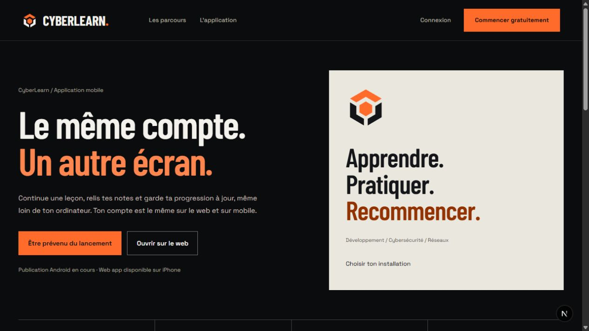

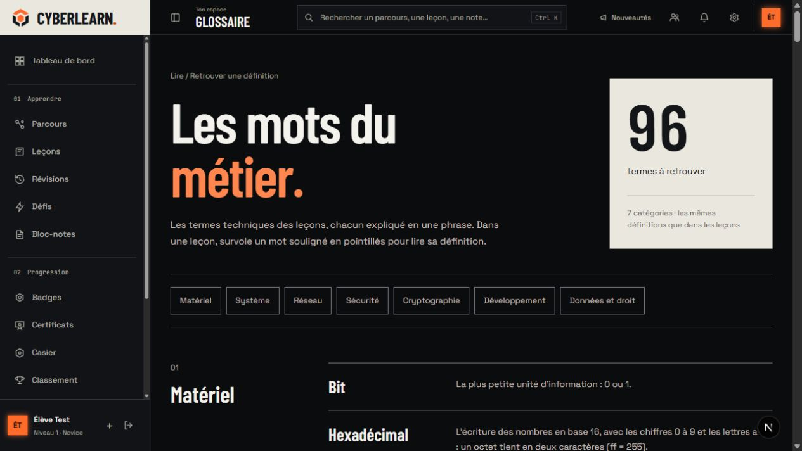

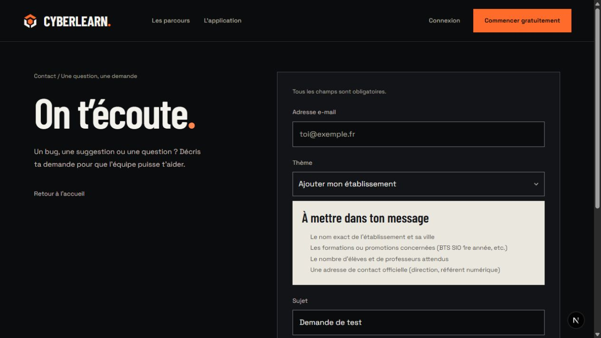

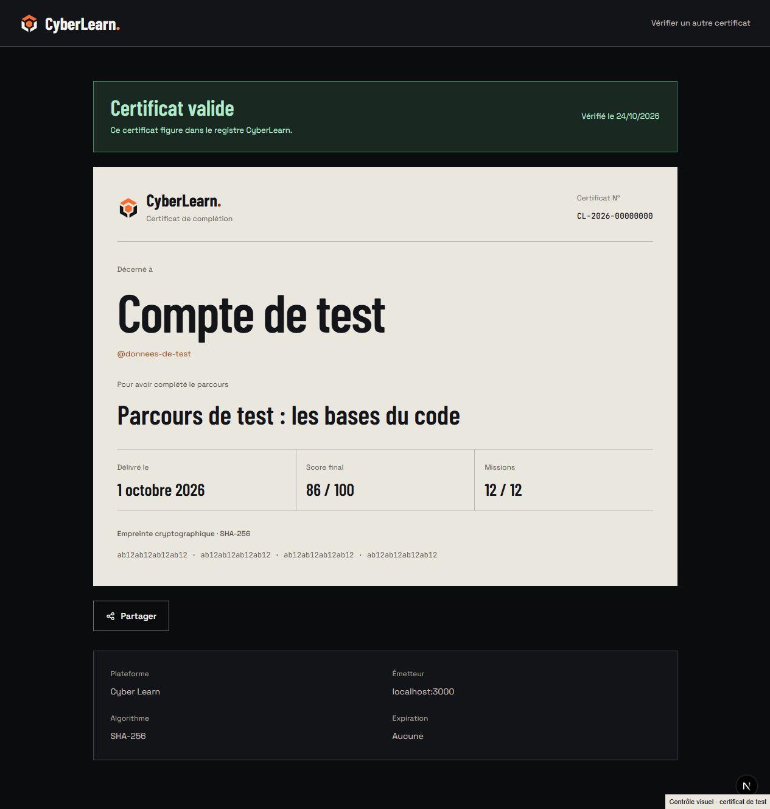

## 19. Informations et états du compte

Les mentions, conditions et règles de confidentialité partagent une feuille craie et une navigation de documents. La largeur de lecture reste limitée ; les tableaux défilent dans une région nommée et accessible au clavier. Leur texte et leurs dates ne sont pas réécrits par la refonte.

Les erreurs et les pages de cycle du compte utilisent un cadre mat signé du vrai logo sur craie. Le titre nomme la situation, les faits utiles occupent une feuille courte et les actions gardent des verbes explicites. La 404 adapte ses sorties à la session. Réessayer conserve le rappel de la limite d’erreur ; le digest reste la seule référence technique montrée. L’erreur globale apporte ses propres polices et styles lorsque le layout principal échoue.

Le bannissement distingue le motif, la durée et la date avant les commandes. Son dialogue et son formulaire d’appel restent carrés, même dans leur portail. Le rose signale la suspension ou la destruction ; il ne remplace pas le statut en texte. Les étapes de conservation et de suppression gardent leurs jetons, gardes et actions ; lire une confirmation ne déclenche aucune suppression. L’arrivée d’un titre dure 180 ms et disparaît en réduction des mouvements.

Voir [les contrôles et limites des informations et états](states-review.md) et [l’audit de couverture](redesign-audit.md). Les captures de bannissement et de cycle de compte utilisent des données de test signalées, avec écritures bloquées.

## 20. Fenêtres, messages et sorties

Les fenêtres, tiroirs, menus, toasts et contrôles de dossier suivent la même règle d’angles droits que les pages. Elle s’applique au corps du site, y compris aux portails. Leur fond reste mat ; les titres utilisent Barlow Condensed et le contenu Space Grotesk. Les commandes tactiles occupent au moins 44 px. Un sélecteur ouvert consomme son premier Échap ; un dialogue superposé conserve son propre focus et le rend à son déclencheur en fermant.

Les deux confirmations de suppression du bloc-notes passent dans le dialogue partagé. Elles nomment l’objet visé et gardent l’annulation avant l’action destructive. Le guide de parcours présente ses choix sur carbone et sa première suggestion sur craie ; le focus rejoint les suggestions après le calcul. Les règles de choix, de suppression et de partage restent celles du produit.

Les onze modèles d’e-mail utilisent un vocabulaire commun dans `packages/email/src/theme.ts`, un bandeau craie avec le vrai logo, des titres Barlow et des actions carrées. Le texte courant reste à 16 px, avec des polices locales publiées et une pile Arial de repli. Le code de récupération reste monospace. Les objets, destinations, jetons et échéances ne sont pas redéfinis par la DA ; aucun envoi réel n’est nécessaire à la vérification visuelle.

Le certificat PDF est une feuille craie A4 paysage : nom et parcours d’abord, faits sur carbone, référence et QR de vérification en pied. La fiche de révision privilégie le blanc pour l’impression et répète la marque et la pagination. Leurs polices et leur logo vectoriel sont embarqués localement. Les PDF déjà émis restent les originaux stockés : leur empreinte enregistrée serait invalidée par une réécriture rétroactive. Les nouvelles émissions prennent le nouveau modèle.

L’image de profil partagé conserve sa confidentialité : aucun nom ni chiffre privé n’est ajouté à une carte anonyme. Ses polices statiques locales permettent aussi le cyrillique sans requête distante. Les icônes du site et de la PWA dérivent du même SVG Bastion avec une marge de sécurité. Les exports Markdown et JSON gardent leur format portable, sans décoration.

Les vidéos de présentation et de bienvenue montrent les véritables écrans web actuels. Elles utilisent une entrée Remotion distincte des campagnes de l’app native, les polices et le logo communs, des transitions d’opacité de huit images et une mention de données locales de démonstration. Les commandes de lecture et la lecture muette initiale restent celles du lecteur existant. Le splash utilise une apparition brève de la marque, sans anneau tournant ; la réduction des mouvements supprime son animation.

Les simulations pédagogiques et les cosmétiques équipés conservent les couleurs qui font partie de leur sens ou du choix de l’apprenant. L’habillage du site ne doit pas fausser une expérience réseau, du code affiché ou une représentation de machine.

Voir [la couverture, les captures et les limites de validation](extensions-review.md).

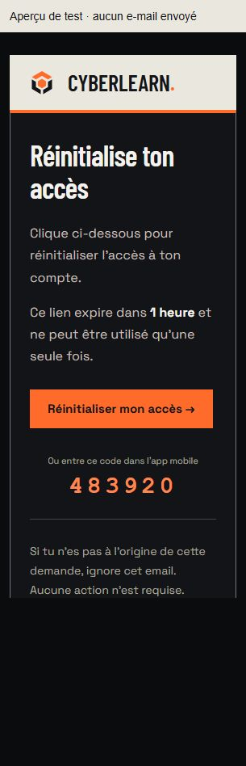

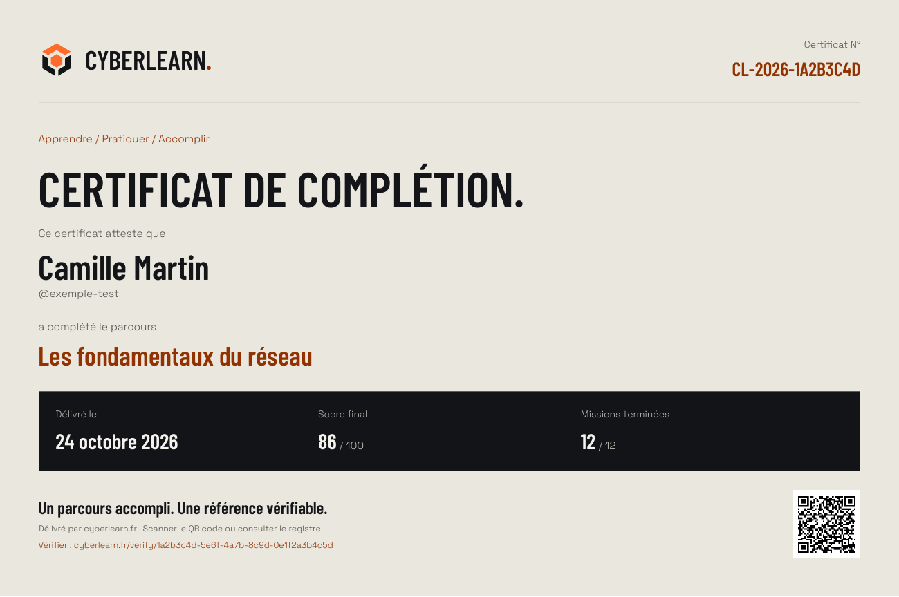

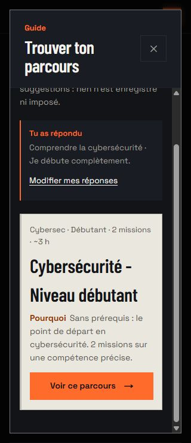

## 21. Continuer le rework

Pour une nouvelle page, identifier d'abord la tâche principale, les données nécessaires et les états vide, chargement, erreur et succès. Construire sa composition à partir de ces éléments, puis appliquer palette, typographie et motion.

Avant de livrer : contrôler les angles droits, le contraste, le clavier, la réduction des mouvements, la largeur à 320 px et les fonctions existantes. Exécuter les vérifications adaptées au changement et mettre à jour le registre de parité si une surface partagée évolue.

Ne pas déduire de cette DA une autorisation d'ajouter des fonctionnalités, des dépendances, une nouvelle promesse produit ou de modifier les règles métier.

## 22. Console d’administration Bastion

La console reprend la même marque et les mêmes marges, avec une composition plus dense pour gérer des listes et des formulaires. Elle reste identifiable avant toute interaction : « Console d’administration » dans la barre, « ADMIN » sur téléphone, mention Administration sous le logo de la sidebar et préfixe ADMIN dans les titres d’onglet. Le repère cuivre appartient à la barre de 56 px ; il n’ajoute pas de décalage au contenu. La sidebar mesure 240 px et passe en menu superposé sous 1024 px.

| Usage admin | Valeur |
| --- | --- |
| Fond, panneau, menu | `#0B0C0E`, `#121418`, `#191C22` |
| Synthèse craie | `#EAE7DF`, texte `#141518` |
| Texte, secondaire, métadonnées | `#F4F2ED`, `#C2BFB8`, `#AAA79F` |
| Action, survol | `#FF6B2B`, `#FF864F`, texte `#141518` |
| Séparation, contour de champ | `#303137`, `#74767D` |
| Succès, avertissement, erreur, information | `#62D4A1`, `#FFC36E`, `#FF929B`, `#60A5FA` |

Barlow Condensed porte les titres de 40 à 56 px ; Space Grotesk porte l’interface, JetBrains Mono le code et les identifiants. Les commandes principales font 44 px. Angles droits, fonds mats, mouvements courts liés à l’ouverture, au focus et aux changements d’état. La réduction des mouvements reste prise en compte.

Les marges sont désormais partagées dans `@cyberlearn/ui/layout.css` : latéral 16 / 28 / 36 px, haut 24 / 28 / 32 px, bas 80 / 96 / 110 px, aux seuils 768 et 1280 px. Les tableaux conservent leurs colonnes dans une région de défilement ; les formulaires et les aperçus se réorganisent selon la largeur utile.

Les confirmations sensibles nomment l’administration, l’action et la cible. Les sélecteurs en portail et les fenêtres utilisent les composants partagés. Les objets publiés et les réussites restent verts : le cuivre ne remplace pas le sens d’un statut.

Le lien vers le site apprenant ouvre explicitement un nouvel onglet. Le logo de la sidebar mène au dashboard admin. Les permissions, la MFA obligatoire, les règles métier et les API ne sont pas redéfinies par le design.

Voir [les 42 pages, les preuves et les limites de vérification](admin-redesign-review.md) et [les deux jalons Git](admin-redesign-progress.md).

L’intégration du 26 octobre porte cette couverture à 54 modèles : le studio et les nouvelles fonctions de gestion de `main` réutilisent le même cadre. La recherche étendue s’ouvre sous la barre sur téléphone pour garder ADMIN visible ; les toasts et les nouvelles confirmations suivent les alias de la console. Le séparateur et les aperçus du studio gardent leurs fonctions. [Détail de l’intégration et preuves](main-integration-review.md).
