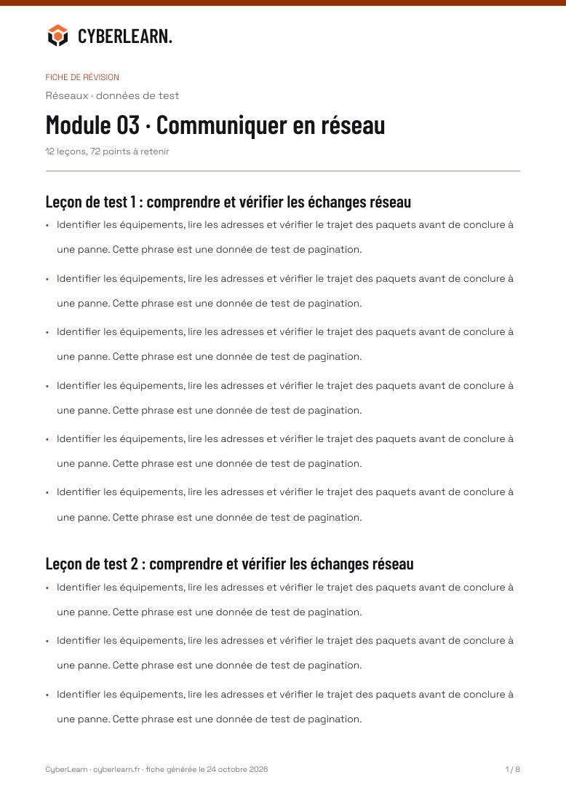
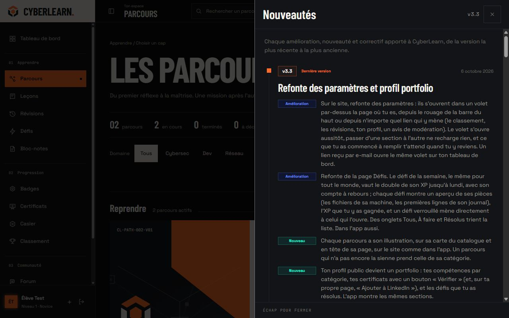
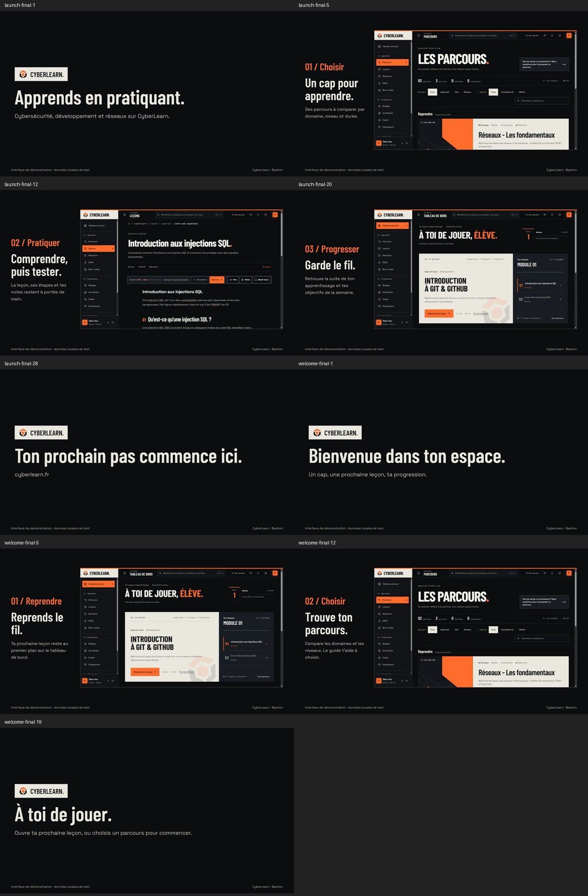
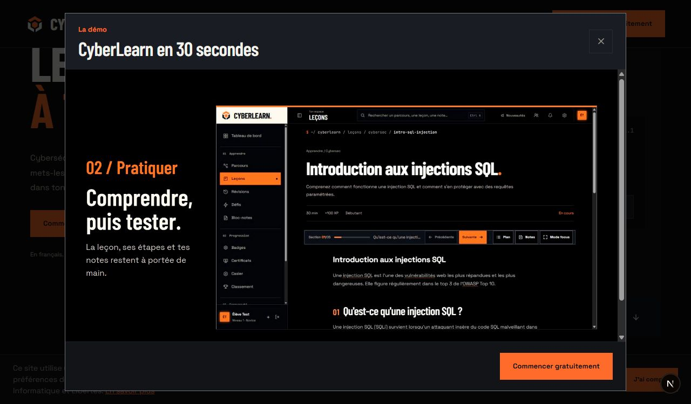

# Bastion : fenêtres et sorties de l’application web

24 octobre 2026. Complément de l’[audit des pages](redesign-audit.md), à la demande de couvrir aussi les fenêtres, e-mails, certificats et autres extensions. Périmètre : application web apprenant et sorties qu’elle utilise. La console d’administration et la présentation native restent des applications distinctes ; les messages envoyés aux apprenants depuis la console sont couverts ici. La dette native est explicite dans [MOBILE_PARITY.md](../MOBILE_PARITY.md).

Lecture de conception : outils d’apprentissage et documents pour des apprenants, dans la DA Bastion carbone/craie/cuivre existante. **ENERGY 3 / RHYTHM 3 / MOTION 2**, mode Anti Slop `during` choisi dans la conversation. Les règles de compte, contenus, calculs, services et permissions ne sont pas redéfinis par cette extension.

## Couverture

Les 64 fichiers `page.tsx` restent les 61 modèles produit et trois outils décrits dans l’audit précédent. L’inventaire ci-dessous part des producteurs de rendu et des appels aux fenêtres et portails ; il ne confond pas une page avec tous ses états.

| Famille | Couverture et sources | Preuves et limites |
| --- | --- | --- |
| E-mails | Onze modèles dans `packages/email/src/templates`, `theme.ts` commun, `EmailHead` et `EmailBrand` dans `shell.tsx`. Confirmation, connexion, récupération, invitation et changement d’adresse constituent cinq variantes du modèle d’accès. Les dix autres modèles couvrent suppression demandée/effective, bannissement, modération, inactivité, MFA retirée, classe rejointe/invitation, travail assigné et réponse de support. | Quinze HTML rendus et inspectés à 320 px : logo chargé, aucun débordement horizontal, rayon nul. Récupération également vue sur bureau. Tests des codes, liens, objets et échappements conservés. Aucun e-mail réel envoyé. |
| Certificat PDF | `lib/pdf/certificate-template.tsx`, marque vectorielle et polices locales dans `brand.tsx`. A4 paysage, identité, parcours, date, score, missions, référence publique, URL et QR. Traces de déploiement dans `pdf-routes.ts` et `next.config.ts`. | PDF normal et noms longs rendus : une page chacun, référence et texte extraits, PNG inspectés. Émission, stockage, hash et téléchargement gardent leurs gardes existantes. Les originaux historiques ne sont pas réécrits. |
| Fiche de révision PDF | `sheet-template.tsx` : impression blanche, en-tête de marque répété, titre et puces, pagination, date. Une section peut continuer sans détacher une puce de son texte. | Exemple de 72 points et douze leçons : huit pages, 72 points, douze titres et huit en-têtes retrouvés dans le PDF ; première et dernière pages inspectées. Le contenu et la génération métier restent ceux du service. |
| Partage et icônes | Profil OpenGraph dans `app/u/[username]/opengraph-image.tsx`, icônes du manifeste et fichiers `app/icon.png`, `apple-icon.png`, `favicon.ico`. SVG canonique et script reproductible `scripts/render-brand-assets.mjs`. Wrapped conserve son export de marque déjà traité dans [events-review.md](events-review.md). | PNG public avec cyrillique et carte privée générés par le vrai moteur, sans appel HTTP externe. Tests des formes du logo et dimensions déclarées. Source privée filtrée avant rendu ; aucune statistique privée ajoutée à l’image anonyme. |
| Lecteurs vidéo et splash | Présentation publique, bienvenue du dashboard et leur `VideoModal` commun. Deux compositions dédiées `apps/marketing/src/web-entry.tsx`, captures réelles locales et actifs dans `public/web-demo`. Splash avec vrai `BastionLogo`, arrivée 400 ms, sortie 160 ms, une fois par session. | Les anciennes vidéos bleues et leurs posters sont remplacés par les écrans actuels. Mention de données de démonstration dans chaque image. Lecture muette, contrôles natifs et actions existantes conservés. Les animations CSS respectent la réduction des mouvements ; les vidéos gardent les commandes de pause. |
| Dialogues partagés | `ModalShell`, `SideDrawer`, feuille mobile Radix, `secondary-surfaces.css` et héritage des polices sur le corps. Niveau supérieur, bilan de leçon, lecture vidéo, guides et dialogues superposés. | Niveau et bilan ouverts sur téléphone avec valeurs de test, sans progression écrite. Tab/Échap, pile de fenêtres et retour du focus couverts par les tests UI. Un Select consomme son Échap avant la fenêtre parente, vérifié aussi dans le navigateur. |
| Bloc-notes | Gestion des dossiers, icône/couleur, édition, lecteur, sélecteur de dossier, partage et destinataires, menu contextuel. Les confirmations de suppression de note/dossier utilisent maintenant `ModalShell`. | Création de dossier déjà contrôlée dans [notes-folder-review.md](notes-folder-review.md). Lecteur, menu, partage superposé et confirmation sur données de test à 320 px. Échap annule et rend le focus. Suppression acceptée et annulée couvertes par tests à actions simulées ; aucune note réelle supprimée pour les captures. |
| Guide de parcours | Le même contenu de guide garde ses règles d’objectif, niveau et recommandation. Titres Barlow, choix mats, première suggestion sur craie, focus transféré au résultat. | Choix cybersécurité/débutant puis recommandations dans le vrai catalogue à 320 px ; aucun débordement, rayon nul, région résultat focalisée. Test de focus ajouté. Pas de sauvegarde de choix. |
| Réglages et compte | Sept sections du tiroir, confidentialité, préférences, notifications, modération, compte et données ; MFA, suppression, export et recadrage de photo. Pages et états protégés dans [account-review.md](account-review.md), [access-review.md](access-review.md), [states-review.md](states-review.md). | Tiroir réel et recadrage ouverts sur téléphone avec le PNG Bastion de test ; annulation et retour du focus sur « Importer une photo ». Aucune photo envoyée, suppression exécutée, méthode MFA ajoutée/retirée ou réglage réel changé pour la DA. Tests des validations et états sensibles. |
| Navigation et petits panneaux | Sidebar, menu mobile, nouveautés, notifications, amis, recherche, compte, bulles d’aide, Tooltip, Select, toasts et cookies. | Navigation mobile, amis et notifications réels ouverts à 320 px, nouveautés sur téléphone et 1280 px. Toast et cookies rendus avec exemples signalés. Aucun rayon ni débordement sur ces contrôles. Focus visible et noms français de la feuille mobile. Les actions de lecture et liens gardent leurs destinations. |
| Lecture et exercices | Plan et notes de leçon, bilan et avis, FAQ, code et diagrammes, carte et photo OSINT ; éditeur MDX et aperçu de classe, sessions de révision, examens et défis. | Vraie leçon SQL ouverte, tiroirs Plan et Notes ouverts sans valider de section. Thème Mermaid, OSINT et aperçu MDX alignés sur la palette. Les moteurs pédagogiques gardent leurs états et règles ; [learning-detail-review.md](learning-detail-review.md), [assessment-review.md](assessment-review.md) et [class-review.md](class-review.md) détaillent les états sur exemples. |
| Communauté, événements et erreurs | Composer/modifier un sujet, réponse et signalement, aide et demande, duels, tournois, Wrapped, états vide/chargement/erreur/interdit, confirmation de bannissement. | Les rapports [communauté](community-review.md), [événements](events-review.md), [public](public-review.md) et [états](states-review.md) conservent leurs preuves. Les portails partagent désormais aussi la typographie et les angles droits du corps. Pas de publication réelle, score de tournoi ou appel soumis pour la vérification. |

Les exports de données JSON et Markdown restent des formats portables. Les simulations de systèmes, diagrammes et cosmétiques gardent leurs couleurs porteuses de sens ; la couleur d’une vulnérabilité, d’une syntaxe ou d’un objet équipé n’est pas un accent de marque à remplacer aveuglément.

## Décisions et raisons

| Décision | Raison |
| --- | --- |
| Carbone, craie, cuivre | Continuer la matière validée et distinguer tâche, résultat et commande principale. |
| Barlow Condensed et Space Grotesk | Donner une voix aux titres sans sacrifier la lecture des champs et paragraphes. Le code seul garde une police technique. |
| Angles droits sur le corps et les portails | Appliquer l’instruction explicite du propriétaire à toutes les fenêtres, y compris celles rendues hors d’une page. |
| Fenêtres mates et transition d’opacité brève | Signaler l’ouverture sans déplacer le texte, ajouter de flou ou superposer des halos. |
| 44 px et texte de champ à 16 px | Permettre l’usage tactile et limiter le zoom automatique des formulaires sur téléphone. |
| E-mails en tableaux, styles littéraux et polices de repli | Les clients mail ne partagent pas le moteur CSS ni le chargement des polices du site. |
| PDF craie ou blanc, textes vectoriels | Garder une lecture nette et une impression raisonnable ; le certificat et une fiche de travail n’ont pas la même composition. |
| PDF historique intact | Son empreinte enregistrée porte sur ses octets d’origine ; une modification visuelle rétroactive le rendrait incohérent. |
| Polices embarquées dans PDF et OG | Éviter une dépendance réseau au moment du rendu. Satori exige ici les variantes statiques ; Noto Sans apporte le repli cyrillique. |
| Logo tiré des chemins réels | Éviter le retour de l’ancien bouclier et les variantes approximatives selon le support. |
| Vidéos avec écrans réels et mention de démonstration | Montrer l’interface livrée sans inventer une progression ou publier les données d’un apprenant. |
| Entrée Remotion web distincte | Actualiser les vidéos du site sans prétendre avoir refait la campagne de l’application native. |

Les fichiers de polices et leurs licences OFL sont dans `apps/web/public/brand/fonts`. Sources officielles : [Google Fonts Barlow Condensed](https://github.com/google/fonts/tree/main/ofl/barlowcondensed), [Google Fonts Space Grotesk](https://github.com/google/fonts/tree/main/ofl/spacegrotesk), [Space Grotesk statique](https://github.com/floriankarsten/space-grotesk/tree/master/fonts/ttf/static), [Noto Sans](https://github.com/notofonts/noto-fonts/tree/main/hinted/ttf/NotoSans). Aucune bibliothèque supplémentaire installée pour cette extension.

## Vérifications finales

- Suite web permanente : **2 158 tests sur 288 fichiers**, passée avec `--maxWorkers=4`.
- Paquet UI : **144 tests sur quinze fichiers** ; paquet e-mail : **139 tests sur onze fichiers**, suites complètes passées.
- TypeScript strict web, UI, e-mail et marketing ; ESLint web, UI et e-mail réussis. Biome a contrôlé les 309 sources modifiées ou ajoutées ; les espaces du diff sont contrôlés avec `git diff --check`.
- Build web de production webpack réussi, avec collecte des 131 entrées statiques et des routes dynamiques. Les traces des routes de fiche, API mobile et image OpenGraph contiennent les polices locales attendues ; les routes PDF embarquent aussi les fontes standard PDFKit.
- Les deux MP4 et leurs posters JPEG ont été rendus depuis les sources Remotion : vidéo H.264 1920 × 1080, 30 images/s, 30 et 21 secondes. Les pistes AAC originales sont conservées comme sources, réencodées par le rendu ; la durée des conteneurs est de 30,059 et 21,056 secondes avec leur fin de piste audio. Neuf images extraites couvrent introduction, chapitres et clôture, inspectées en planche.
- Certificats normal et à noms longs inspectés ; fiche de révision inspectée sur ses huit pages, avec contrôle du texte extrait. Le contenu de test est explicitement nommé.

Un premier lancement web concurrent avec les rendus et outils de vérification a dépassé les cinq secondes du test qui parcourt les sources pour refuser les suffixes alpha hexadécimaux. Ce test seul puis la suite complète avec quatre workers ont passé, sans changement de code, assertion ou délai. Le premier lancement UI concurrent de cette extension avait connu la même limite de lecture du dépôt ; la suite complète finale passe également. Ce sont les suites finales qui figurent dans les comptes ci-dessus.

La revue React a vérifié les frontières serveur/client, les effets de focus et leur nettoyage, les noms accessibles, les clés des listes et les props typées. Les nouvelles compositions PDF/OG restent serveur ; les composants interactifs existants gardent leurs frontières client. Les entrées indépendantes de polices OG se lisent en parallèle et aucune bibliothèque de rendu n’est ajoutée au client web.

Le CLI Remotion signale la version Zod du catalogue (4.6.5, contre 4.3.6 indiquée par son contrôle de compatibilité). Ces compositions n’utilisent pas Zod : les deux rendus et TypeScript réussissent. Aucune dépendance n’a été changée pour masquer cet avertissement. Les avertissements du framework sur `middleware.ts` et certains imports Edge sont conservés ; la règle du dépôt impose encore le middleware Edge, pas `proxy.ts`.

Les routes temporaires `/dev/extensions` et `/dev/email-preview` ont été archivées hors du dépôt puis supprimées ; les types de routes ont été régénérés et leurs deux adresses observées en vraie 404. Le test temporaire de rendu PDF/HTML a également été archivé puis retiré. Les tests permanents de géométrie des actifs et de rendu OpenGraph restent dans le dépôt.

Les couleurs principales ont été mesurées avec le vérificateur Anti Slop : secondaire sur panneau 7,10:1, paragraphe 10,04:1, lien 7,70:1, encre sur craie 14,78:1, encre sur cuivre 6,42:1, encre sur danger 8,55:1, cuivre sombre sur craie 6,34:1. Ces mesures portent sur les nouvelles paires de texte, pas sur toutes les images, simulations ou couleurs cosmétiques du produit.

Le contrôle du lecteur public a révélé que le bandeau cookies passait devant les commandes du dialogue. Son niveau d’empilement est ramené sous les fenêtres et tiroirs, et l’ancien `z-index: 1` imposé à chaque enfant du corps est retiré : il enfermait les dialogues dans une couche sous le bandeau. Le texte, l’accusé de lecture et l’espace réservé en bas de page restent identiques.

Les variables des Select sont également définies sur le corps, pour que leurs listes montées en portail gardent Space Grotesk et les surfaces neutres. Leurs options mesurent au moins 44 px, y compris hors d’un formulaire de page. Le survol de fermeture d’un tiroir utilise le cuivre du site.

Dernier contrôle navigateur : les sept options du formulaire de contact ont une hauteur mesurée de 44 px, Space Grotesk à 14 px et un fond actif neutre ; Échap referme la liste sans envoyer le formulaire. Pour la démo publique, le centre de l’action du dialogue reste effectivement au-dessus du bandeau cookies sur bureau et à 320 px, sans débordement ni arrondi. Échap rend le focus à « Voir la démo ». Le serveur de développement est ensuite laissé accessible à `localhost:3000` et la base Supabase locale reste saine.

## Gate Anti Slop de l’extension

Chaque ligne se rapporte au périmètre et aux preuves ci-dessus, complétés par les rapports de familles. Les opérations sensibles sont contrôlées par tests et rendus signalés, sans prétendre les avoir soumises réellement.

| Règle | Résultat et preuve |
| --- | --- |
| R-01 | PASS : surfaces mates ; aucun dégradé ou halo décoratif ajouté aux sorties ou fenêtres. |
| R-02 | PASS : textes fonctionnels français, titres et commandes liés à l’action, aucun slogan de remplissage ajouté. |
| R-03 | PASS : quinze e-mails et familles de fenêtres contrôlés à 320 px sans débordement ; longue identité et PDF multipage rendus. |
| R-04 | PASS : marque canonique, pictogrammes existants liés aux fonctions ; aucun robot ou symbole magique décoratif ajouté. |
| R-05 | PASS : certificat paysage, fiche paginée, e-mail vertical, lecteur et guide répondent à des contenus différents. |
| R-06 | PASS : Barlow signe les titres, Space sert la lecture, monospace limité au code ; raisons explicites ci-dessus. |
| R-07 | PASS : ni grille technique ni points décoratifs dans les nouveaux supports. |
| R-08 | PASS : flèches décoratives retirées des boutons e-mail ; les navigations gardent leurs indications utiles. |
| R-09 | PASS : niveaux, récompenses et statuts restent des données produit ; aucune capsule promotionnelle ajoutée. |
| R-10 | PASS : fond de dialogue mat, sans verre dépoli. |
| R-11 | PASS : angles droits imposés aux descendants et portails du corps, HTML e-mail sans border-radius, PDF et médias carrés. |
| R-12 | PASS : fenêtres et toasts sans grandes ombres ; séparation par matière et bordure. |
| R-13 | PASS : anciens halos de niveau et accents violets de panneaux remplacés par la matière commune. |
| R-14 | PASS : plateau de résultat, liste de destinataires, texte de mail et fiche imprimée gardent leur structure propre. |
| R-15 | PASS : commandes nommées « Partager », « Supprimer », « Annuler », « Reprendre » selon l’opération, destinations conservées. |
| R-16 | PASS : aucune promesse marketing ou formule d’IA ajoutée. |
| R-17 | PASS : valeurs réelles ou exemples signalés, aucune audience ou performance inventée. |
| R-18 | PASS : aucun témoignage créé. |
| R-19 | PASS : ouverture en opacité, splash court, transitions vidéo de huit images ; réduction des mouvements sur CSS et lecteur avec pause. |
| R-20 | PASS : même Bastion, titres condensés, cadre craie/carbone et action cuivre sur les différents supports. |
| R-21 | PASS : thème sombre déjà imposé par la DA de lancement ; documents imprimables clairs, aucun faux interrupteur de thème. |
| R-22 | PASS : vrai logo vectoriel et captures de vrais écrans ; aucune illustration générique. |
| R-23 | PASS : marque fournie et direction existante réutilisées ; médias et identités de test explicitement signalés. |
| R-24 | PASS : destinations existantes conservées et aperçus e-mail corrigés vers les vraies routes ; outils QA retirés. |
| R-25 | PASS : paires de texte mesurées entre 6,34:1 et 14,78:1 ; contraste et focus renforcés dans les composants secondaires. |
| R-26 | PASS : gestionnaires et services conservés ; confirmations, menus et lecteurs ouverts/annulés ; acceptation destructive vérifiée avec actions simulées. |
| R-27 | PASS : états d’erreur, vide, chargement, succès et attente conservés, anonymat OG et noms longs rendus. |
| R-28 | PASS : contenu d’aide et questions produit existants, aucune FAQ générique ajoutée. |
| R-29 | PASS : neutres et cuivre comme accent ; rose sémantique pour destruction, couleurs pédagogiques et cosmétiques justifiées. |
| R-30 | PASS : aucune copie d’un service tiers, continuité de la DA Bastion validée. |
| R-31 | PASS : raisons de couleur, composition, typographie, espacement, marque et médias écrites dans ce rapport. |
| R-32 | PASS : Tab, Échap et retour du focus testés ; Select imbriqué corrigé et vérifié dans le lecteur réel. |
| R-33 | PASS : modifications écrites directement dans les sources avec apply_patch ; formatage par Biome, génération des seuls actifs par Sharp/Remotion. |
| R-34 | PASS : thème unique, polices de repli e-mail explicites, PDF/OG autonomes sans réseau. |
| R-35 | PASS : application exécutée, rendus réels et parcours navigateur consignés par famille ; limites des opérations sensibles explicites. |
| R-36 | PASS : fausse mention de signature SHA-256 décorative retirée du modèle PDF ; référence et vérification réelles conservées. |
| R-37 | PASS : DA existante et choix de session appliqués, aucune direction inventée à la place du brief. |
| R-38 | PASS : données locales de test signalées dans les vidéos, captures et échantillons ; aucun contenu fictif présenté comme celui d’un apprenant réel. |

C-1 PASS : chaque décision majeure a une raison écrite. C-2 PASS : comportements conservés et régression Échap corrigée. C-3 PASS : la composition suit le message, la lecture ou la tâche. C-4 PASS : téléphone, superpositions, noms longs, plusieurs pages et polices locales vérifiés. C-5 PASS : les preuves distinguent clairement données locales, tests et limites.

Les dials restent explicites : ENERGY 3 par la marque et les titres, RHYTHM 3 par des supports de natures différentes, MOTION 2 par des transitions brèves. Chaque écran ou document garde son point focal ; la marge sépare identité, contenu et commande. Le cuivre reste délibéré et la signature condensée se répète sans multiplier les ornements.

## Limites de validation

Le navigateur vérifie le HTML des e-mails et leur repli, pas tous les clients physiques Outlook, Gmail ou Apple Mail. Aucun envoi SMTP réel, déploiement, changement de réglage de production, émission réelle de certificat ou suite d’intégration RLS/IDOR n’est revendiqué. Les simulations lourdes, services externes et appareils physiques ne sont pas tous exécutés par ce contrôle de DA. Les tests existants couvrent les règles que la refonte ne remplace pas.

La nouvelle présentation ne modifie pas les consentements ni les textes juridiques. Les originaux PDF émis restent immuables ; les nouvelles émissions utilisent le modèle Bastion. L’adaptation visuelle native reste due et inscrite au registre, sans être présentée comme accomplie.

