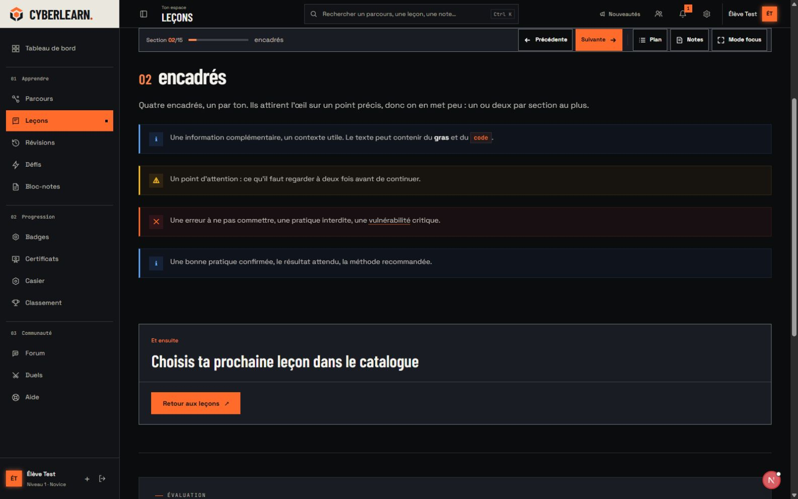
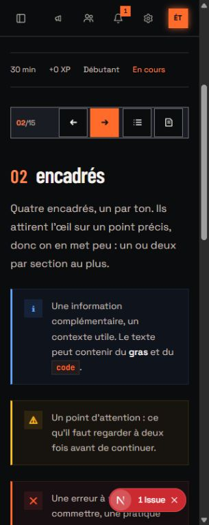

# Leçon élargie et vitrine locale

25 octobre 2026. Ce réglage remplace la limite de 960 px du contrôle précédent.

L’unification des [marges communes](page-spacing-and-forum-review.md), réalisée ensuite, remplace le clamp de 16 à 40 px décrit ci-dessous par les mêmes 16/28/36 px que les autres pages. La largeur utile et la mesure de prose de `90ch` sont conservées.

Le contenu utilisait une petite colonne au milieu d’une barre d’outils beaucoup plus large. Le cadre de la leçon utilise maintenant la largeur disponible, avec des marges fluides de 16 à 40 px. En-tête, article, titres, exercices, tableaux, citations, bilan, suite de leçon et questions gardent le même bord gauche. Les paragraphes et listes passent de 720 px à `90ch` pour prendre davantage de place sans créer de lignes traversant tout un écran large. Palette, polices, angles droits et comportements restent ceux de Bastion.

La leçon `content/lessons/_vitrine/99001-vitrine-des-composants.mdx` est copiée dans la base locale, à `/lessons/vitrine-des-composants`. Le fichier est traité comme contenu pédagogique, pas comme instructions d’exécution. Le validateur de l’import admin contrôle le frontmatter et les sections MDX avant l’écriture. La copie publiée localement garde les quinze sections et tous les exemples du fichier, avec 0 XP de leçon, un descriptif et une note de contexte de démo. Le fichier source reste intact. Les réponses et verrous d’exercice fonctionnent normalement ; aucun acquis fictif n’est injecté dans le compte.

Le seed est rejouable depuis [la procédure locale](../dev/local-stack.md#component-showcase). Il refuse `NODE_ENV=production` et toute URL de base ou de Supabase qui ne désigne pas une boucle locale. Il ne crée ni compte, ni rôle, ni migration, et ne publie rien sur un service distant. Le chargeur Vite déjà installé pour Vitest permet de réutiliser le validateur MDX ESM sans ajouter de dépendance.

## Contrôle navigateur

Compte élève local, vraie route de leçon : titre, description, quinze sections, métadonnées et encadrés rendus. Passage suivant/précédent entre texte, encadrés et questions ; le quiz bloque normalement la suite tant que les exercices ne sont pas terminés.

| Viewport | Mesure observée |
| --- | --- |
| 1 600 px | Article, barre, tableaux et encadrés : 1 268,22 px à x = 278,39 ; prose : 923,03 px, au même bord gauche. Aucun débordement. |
| 768 px | Article de 716,16 px, sans débordement. |
| 320 px | Article, barre, titres et encadrés : 273 px à x = 16. Tableau Markdown de 273 px. Aucun bloc direct ne dépasse le viewport. |

Les encadrés gardent un rayon calculé de 0 px. Le changement de section ramène le focus dans l’article. Le menu mobile se replie et les commandes restent accessibles. Les captures ci-dessous montrent le vrai contenu de la vitrine, qui est un exemple pédagogique signalé, sans prétendre représenter des acquis de l’utilisateur.

## Vérifications

Le validateur admin accepte le fichier complet ; le contrôle indépendant `content-check.mjs _vitrine` passe aussi. Le seed exécuté deux fois conserve la même référence, le même slug et les 0 XP. Un essai avec une URL de base distante est refusé avant toute requête ; un essai en environnement `production` est également refusé. Le catalogue filtré sur « vitrine » affiche la leçon accessible au compte élève.

Les huit tests du service d’import passent, ainsi que TypeScript strict de l’admin, ESLint du seed TypeScript, la vérification de syntaxe Node du chargeur, Biome sur les trois sources et `git diff --check`. Aucun nouveau build de production n’a été lancé pour ce réglage de largeur.

## Gate Anti Slop

Direction Bastion et dials de session conservés : ENERGY 3, RHYTHM 3, MOTION 2. Le périmètre visuel de ce correctif est la largeur et la mesure de lecture, sans nouvelle couleur, police, image ou animation.

R-01 à R-38 : PASS dans ce périmètre. Les règles de style et de contraste du [contrôle précédent](activity-and-lesson-review.md#gate-anti-slop) restent applicables ; les points revérifiés ici sont R-03 (320/768/1600 px), R-06 (mesure de lecture), R-11 (rayon nul), R-17/R-23/R-38 (vitrine explicitement signalée), R-24/R-26 (vraie route et navigation), R-31 (largeur justifiée), R-32 (focus de section), R-33 (sources et formatage), R-35 (mesures et captures) et R-37 (direction existante).

C-1 : largeur justifiée par l’espace perdu et les exercices. C-2 : navigation et verrous conservés. C-3 : prose mesurée et composants larges. C-4 : trois largeurs, tableau et encadrés contrôlés. C-5 : données locales et nature de la vitrine explicites. La dette native de présentation reste inscrite dans [MOBILE_PARITY.md](../MOBILE_PARITY.md).

