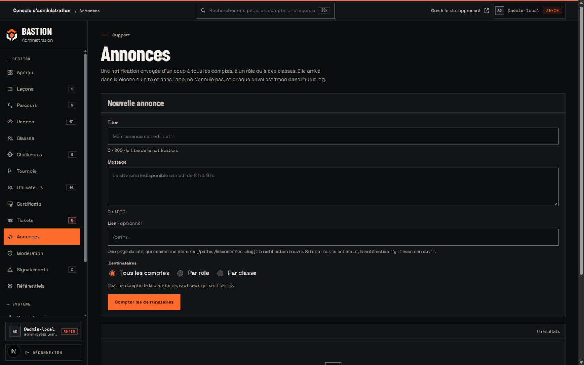
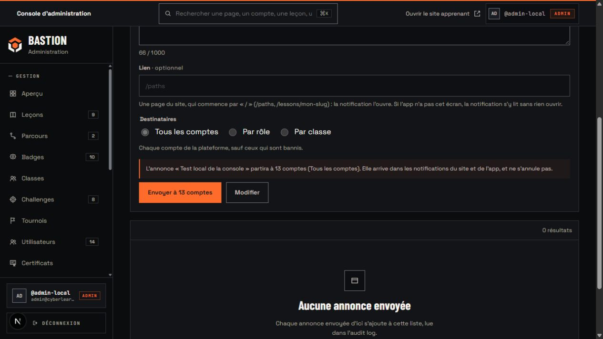
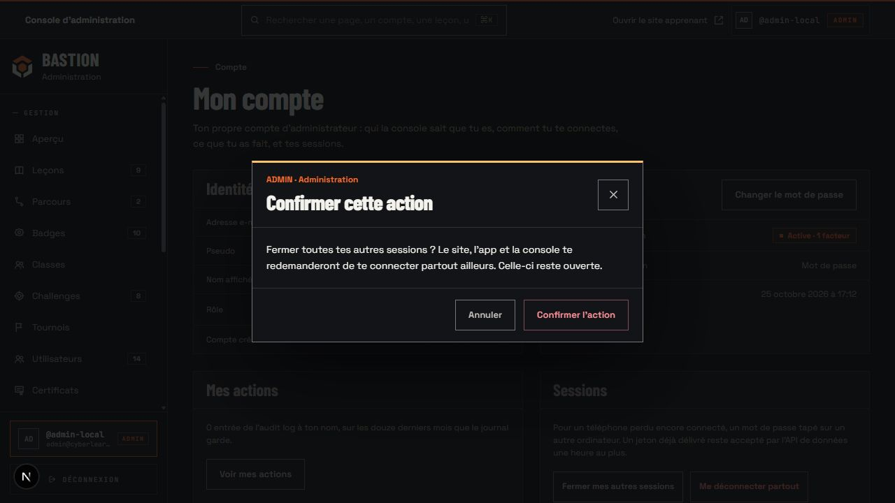
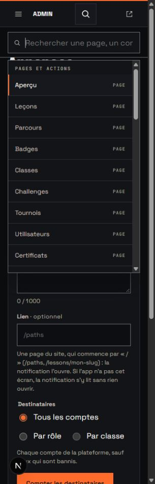
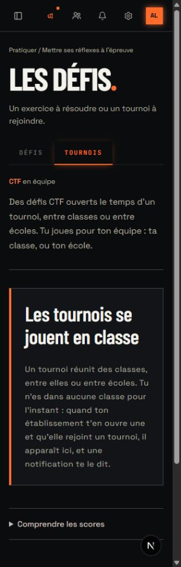

# Intégration de main dans Bastion

Vérification du 26 octobre 2026. La branche `redesign` reprend les 40 commits de `main` jusqu’à `786e4c3d`, après le jalon admin `ee3e94fe`. La fusion conserve les fonctionnalités récentes et les deux jalons de refonte déjà publiés.

Lecture visuelle : console de travail pour les administrateurs, dans la DA Bastion existante. ENERGY 2 / RHYTHM 2 / MOTION 1. Le cuivre identifie les actions et l’administration ; les titres condensés structurent les écrans denses ; les surfaces mates et carrées évitent de concurrencer les contenus. Les animations accompagnent les ouvertures et changements d’état, avec réduction des mouvements.

## Ce que la fusion reprend

La console compte désormais **54 modèles de page** : une redirection racine, quatre pages d’accès et 49 pages protégées. Les douze nouveaux modèles utilisent le même cadre que les pages précédentes.

| Famille | Modèles | Intégration |
| --- | ---: | --- |
| Racine et accès | 5 | Redirection, connexion, MFA, configuration MFA et accès refusé |
| Dashboard | 1 | Synthèse Bastion et nouveaux compteurs métier |
| Utilisateurs | 3 | Liste, inscriptions en attente, fiche avec corrections XP, série et badges |
| Leçons | 8 | Catalogue, création, studio, avis, import, synchronisation, archives et signalements |
| Parcours | 5 | Catalogue, création, édition, examen et archives |
| Badges | 3 | Liste, création et édition |
| Défis | 3 | Liste, création et édition |
| Classes | 4 | Liste, création, structure et détail |
| Tournois | 4 | Liste, création, détail et flags |
| Certificats | 1 | Liste et gestes de révocation/rétablissement |
| Tickets | 2 | Liste et détail, assignation, notes internes et appel de bannissement |
| Annonces | 1 | Ciblage, comptage préalable et confirmation d’envoi |
| Modération | 4 | File automatique, notes, signalements et contenus publiés |
| Référentiels | 5 | Cosmétiques, quêtes, saisons, sections du forum et positionnement |
| Système et compte | 5 | Tâches planifiées, compte admin, audit, paramètres et banc d’essai |

La sidebar et la recherche lisent le registre de navigation de `main`. La recherche conserve ses résultats serveur sur les comptes, leçons et tickets. « Mon compte » reste accessible dans le chrome. Le libellé ADMIN reste visible sur téléphone quand la recherche s’ouvre sous la barre.

Les toasts Sonner de `main` utilisent les couleurs et angles Bastion. Leur décalage et celui de la sidebar partent de 56 px : le repère cuivre appartient à la barre, sans ajouter une bande de 2 px au contenu.

Le studio conserve l’enregistrement du brouillon, les versions, les marqueurs MDX, les aperçus bureau/mobile et le séparateur réglable au clavier. L’import conserve les différences avec la base, la validation localisée et sa disposition en deux colonnes. À 320 px, les champs Catégorie/Difficulté du studio se superposent pour éviter un débordement.

Les nouvelles confirmations sur les sessions, corrections de progression, contenus publiés, flags et brouillons passent par la fenêtre administrative commune. Les formulaires gardent leurs données et leur bouton d’envoi après confirmation ; annuler ou Échap n’exécute pas l’action.

## Vérifications et corrections de fusion

Les marges mesurées dans le studio correspondent au socle partagé :

| Largeur | Latéral | Haut | Bas | Barre | Débordement de page |
| ---: | ---: | ---: | ---: | ---: | --- |
| 320 px | 16 px | 24 px | 80 px | 56 px | Non |
| 768 px | 28 px | 28 px | 96 px | 56 px | Non |
| 1280 px | 36 px | 32 px | 110 px | 56 px | Non |
| 1600 px | 36 px | 32 px | 110 px | 56 px | Non |

Le même contrôle a été répété sur les annonces après redémarrage : [mesures du cadre](assets/admin-main-frame.json).

Le rejeu mobile couvre annonces, signalements, les cinq référentiels, tâches planifiées, compte, création de leçon, import et synchronisation. Le studio a été ouvert depuis la recherche : « OSI » produit la vraie leçon, puis les touches fléchées et Entrée l’ouvrent. Flèche droite sur le séparateur fait passer sa valeur de 55 à 57.

Le comptage d’une annonce de test local a répondu avec 13 destinataires, pour 14 comptes dont un banni. La réponse apparaît dans la confirmation avant l’envoi. Aucun envoi d’annonce n’a été exécuté. Sur « Mon compte », la fermeture des autres sessions ouvre la fenêtre « ADMIN · Administration » ; Échap l’annule et rend le focus au bouton d’origine. Aucune session n’a été fermée pendant ce contrôle.

La fusion touche aussi le site : les badges et certificats deviennent des onglets du profil, les tournois un onglet des défis, les révisions une fenêtre de rappel. Le design est conservé sur ces nouvelles structures. Les réponses d’examen restent sauvegardées, les outils de notes retrouvent leurs cibles tactiles, les paramètres révèlent la section active, et le formulaire de contact conserve une saisie refusée. Le test de positionnement déjà enregistré ne propose plus de le recommencer avant la fin de l’inscription. Les textes de suppression de compte disent que les certificats restent vérifiables sans le nom du titulaire.

Le dernier rejeu apprenant vérifie les onglets Certificats et Tournois à 320 px. La liste des tournois ne porte plus son ancien `page-container` : son nouvel écran parent applique déjà les marges, et le cumul produisait un retrait de 32 px au lieu de 16 px.

Les huit migrations existantes de `main` ont été appliquées à la pile Supabase locale, sans réinitialisation des comptes. La dernière est `20261023120000_drop_review_schedules_legacy`. La ligne historique locale concernait une leçon sans quiz, donc sans carte à convertir ; une copie SQL a été conservée hors du dépôt avant la migration. Aucune migration supplémentaire n’est créée pour le design.

Le test RLS possède désormais son propre parcours de fixture : il ne tente plus d’ajouter un deuxième examen au premier parcours du catalogue local, qui peut déjà en avoir un. Ses 51 assertions restent exécutées sur la vraie base.

| Suite | Fichiers | Tests |
| --- | ---: | ---: |
| Web | 348 | 2 873 |
| Admin | 95 | 1 959 |
| Base, RLS et intégration locale inclus | 100 | 1 141 |
| UI | 21 | 211 |
| Logique partagée | 110 | 2 614 |
| Types | 28 | 238 |
| E-mails | 11 | 139 |
| Mobile | 53 | 827 |
| Total | 766 | 10 002 |

Le formatage, le lint et les types du monorepo, ainsi que les builds webpack web/admin, sont contrôlés. Les tests de présentation ont été adaptés aux titres, classes CSS et dimensions Bastion ; les contrats fonctionnels de `main` restent vérifiés. Les polices Next sont simulées dans les tests qui lisent la navigation, les fichiers de police réels restant contrôlés par les tests d’assets et les builds.

Une passe parallèle a dépassé les cinq secondes du contrôle d’architecture de l’éditeur, qui lit les sources des deux applications. Ce contrôle réussit dans la suite UI complète puis dans la passe monorepo avec une seule tâche à la fois ; son délai et ses assertions restent inchangés.

Les vérifications portent sur la pile locale et les données disponibles. Les variantes de détails de classe/tournoi sans fixture locale, les envois réels, les changements de droits, les suppressions et les publications ne sont pas exécutés manuellement : leurs règles et refus sont couverts par les suites. Ce rapport ne prétend pas constituer une exécution de la CI distante.

## Preuves

## Filtre antislop

Le filtre s’applique aux adaptations visuelles de cette intégration, dans la continuité de la DA documentée. Les limites des contrôles manuels figurent ci-dessus.

| Règle | Résultat et preuve |
| --- | --- |
| R-01 | PASS : aucune nouvelle ambiance décorative ; les fonds restent mats. |
| R-02 | PASS : textes français contrôlés par le script typographique du dépôt. |
| R-03 | PASS : studio mesuré aux quatre largeurs ; nouvelles pages rejouées à 320 px. |
| R-04 | PASS : icônes du registre existant associées à leurs rubriques et gestes. |
| R-05 | PASS : tables pour les catalogues, formulaire pour l’annonce, outils de rédaction pour le studio. |
| R-06 | PASS : Barlow pour la hiérarchie, Space Grotesk pour les commandes, mono pour le code et les identifiants. |
| R-07 | PASS : aucune grille de fond ajoutée. |
| R-08 | PASS : flèches conservées seulement pour les destinations et déplacements. |
| R-09 | PASS : étiquettes portant un vrai état ou rôle, angles droits. |
| R-10 | PASS : panneaux et fenêtres mats, pas de chrome en verre. |
| R-11 | PASS : audit des sources admin sans rayon positif ; fenêtres et portails carrés. |
| R-12 | PASS : ombres réservées aux couches flottantes et à la ligne déplacée. |
| R-13 | PASS : pas de nouveau halo décoratif. |
| R-14 | PASS : pas de grille de cartes ajoutée pour des commandes de gestion. |
| R-15 | PASS : verbes métier conservés, dont « Compter les destinataires ». |
| R-16 | PASS : descriptions des fonctions réelles, pas de promesse marketing ajoutée. |
| R-17 | PASS : compteurs issus des repositories ; comptage d’annonce relié à la base. |
| R-18 | PASS : aucun témoignage ajouté. |
| R-19 | PASS : transitions de fenêtres et d’état ; mouvement réduit conservé. |
| R-20 | PASS : chrome Bastion, cuivre, marque commune et identification ADMIN. |
| R-21 | PASS : console carbone conforme à la direction approuvée. |
| R-22 | PASS : logo existant et captures réelles, aucune illustration générique. |
| R-23 | PASS : géométrie de marque commune conservée, pas de nouvel actif de marque. |
| R-24 | PASS : registre de navigation et contrôles de couverture des routes conservés. |
| R-25 | PASS : palette approuvée conservée, texte encre sur cuivre et craie ; statuts nommés. |
| R-26 | PASS : commandes raccordées aux services de main ; comptage préalable rejoué. |
| R-27 | PASS : chargements spécifiques de main, états vides et erreurs conservés. |
| R-28 | PASS : aucune FAQ ajoutée. |
| R-29 | PASS : cuivre et neutres de la DA ; couleurs sémantiques pour les états. |
| R-30 | PASS : identité du projet conservée. |
| R-31 | PASS : couleurs, composition, typographie et espacement motivés en ouverture. |
| R-32 | PASS : recherche et séparateur au clavier ; Échap et retour de focus exercés. |
| R-33 | PASS : fusion Git des parents puis ajustements explicites de TSX et CSS ; pas de modification du produit par script de DOM. |
| R-34 | PASS : thème de console inchangé ; portails sur les alias racine Bastion. |
| R-35 | PASS : builds, suites et rejeu navigateur documentés, avec limites explicites. |
| R-36 | PASS : aucune certification ou promesse de sécurité inventée. |
| R-37 | PASS : DA approuvée et niveaux 2/2/1 explicités. |
| R-38 | PASS : données locales réelles ; annonce de vérification explicitement nommée test local et non envoyée. |
| C-1 | PASS : les choix visuels prolongent la direction approuvée. |
| C-2 | PASS : fonctionnalités de main raccordées, gestes sensibles testés sans exécution réelle. |
| C-3 | PASS : aucune section de remplissage ajoutée. |
| C-4 | PASS : repli des champs, défilement des tableaux, focus et états contrôlés. |
| C-5 | PASS : preuves locales et chiffres des suites, sans affirmer une validation de production. |
