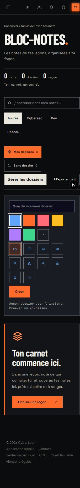

# Dossiers : correction des angles

Périmètre : panneau de gestion des dossiers du bloc-notes. La correction porte sur les angles et la propriété des styles des sélecteurs, sans nouvelle fonction. Direction Bastion conservée, ENERGY 3 / RHYTHM 3 / MOTION 2. Les angles carrés prolongent la géométrie de la marque ; les cibles de 44 px restent faciles à toucher.

Vérification du 23 octobre 2026 : navigateur à 320 et 1040 px, aucun débordement horizontal, rayon calculé de 0 px sur le panneau et ses contrôles. Sélection couleur/icône et focus clavier vérifiés sans enregistrer de dossier. Les huit tests existants de `notes-library-menu.test.tsx` passent ; formatage et `git diff --check` passent.

## Gate Anti Slop, limité à cette correction

- R-02 PASS : aucun texte ajouté à l’interface.
- R-03 PASS : aucun débordement mesuré à 320 et 1040 px.
- R-17 PASS : aucune statistique ajoutée.
- R-18 PASS : aucun témoignage ajouté.
- R-23 PASS : aucun actif ou élément de navigation créé.
- R-24 PASS : aucun lien ajouté ou modifié.
- R-25 PASS : couleurs et textes conservés, aucune nouvelle paire de contraste.
- R-26 PASS : choix de couleur et d’icône vérifiés ; création couverte par le test existant.
- R-27 PASS : état sans dossier conservé et visible ; gestion des résultats inchangée.
- R-28 PASS : aucune FAQ dans ce panneau.
- R-32 PASS : Tab déplace le focus vers l’icône suivante avec un contour visible.
- R-33 PASS : correction écrite dans les sources CSS et TSX avec apply_patch.
- R-34 PASS : aucun thème ou réglage de thème modifié.
- R-35 PASS : application exécutée, sélecteurs utilisés dans le navigateur et huit tests passés.
- R-36 PASS : aucune affirmation de sécurité ou de performance ajoutée.
- R-37 PASS : direction Bastion et demande explicite d’angles carrés.
- R-38 PASS : aucune donnée de contenu créée.
- R-01 PASS : aucun dégradé ajouté.
- R-04 PASS : choix d’icônes existant conservé pour identifier les dossiers.
- R-06 PASS : typographie existante conservée.
- R-07 PASS : aucun motif de fond ajouté.
- R-08 PASS : aucune flèche ajoutée.
- R-09 PASS : aucune capsule ajoutée.
- R-10 PASS : aucun effet de verre ajouté.
- R-12 PASS : aucune ombre ajoutée.
- R-13 PASS : aucune lueur ajoutée.
- R-14 PASS : aucune carte ajoutée ; les cases égales servent la comparaison des choix.
- R-19 PASS : aucune animation ajoutée, interaction existante conservée.
- R-22 PASS : aucune illustration ajoutée.
- Dials PASS : ENERGY 3 / RHYTHM 3 / MOTION 2 conservés de la direction existante.
- Cohérence PASS : correction locale de géométrie, sans changement de composition ou de motion.
- Point focal PASS : champ de nom et bouton Créer conservés dans la zone de création.
- Espacement PASS : repli des sélecteurs observé à 320 px sans collision.
- Accent PASS : sélection cuivre existante conservée.
- Identité PASS : angles carrés alignés sur la demande et la signature Bastion.
- Design Read PASS : panneau utilitaire pour organiser ses notes, dans la direction Bastion déjà établie.
- C-1 PASS : géométrie imposée par la demande, dimensions motivées par le toucher.
- C-2 PASS : actions conservées, tests existants passés.
- C-3 PASS : aucune section ajoutée.
- C-4 PASS : contrôles carrés aux deux largeurs et focus clavier visible.
- C-5 PASS : aucune affirmation ou donnée inventée.
- R-05 PASS : aucune nouvelle composition de page.
- R-11 PASS : aucun contrôle arrondi dans le panneau, mesure calculée à 0 px.
- R-15 PASS : bouton Créer spécifique à l’action, inchangé.
- R-16 PASS : aucun texte marketing ajouté.
- R-20 PASS : correction rattachée à la géométrie Bastion existante.
- R-21 PASS : thème de marque existant conservé.
- R-29 PASS : palette de rangement existante conservée, aucune couleur ajoutée.
- R-30 PASS : aucune référence ou imitation d’un autre produit.
- R-31 PASS : angles pour la marque, 44 px pour les cibles tactiles ; autres décisions conservées.

Les tests utilisent des actions simulées. Aucun dossier réel n’a été créé, renommé ou supprimé pendant cette vérification.

Nouvelle vérification le 24 octobre 2026 : tous les éléments visibles du panneau ont un rayon calculé de 0 px, sur bureau et à 320 px, sans débordement. Le champ, les couleurs, les icônes et Créer gardent une hauteur de 44 px. Les huit tests du bloc-notes passent à nouveau.

