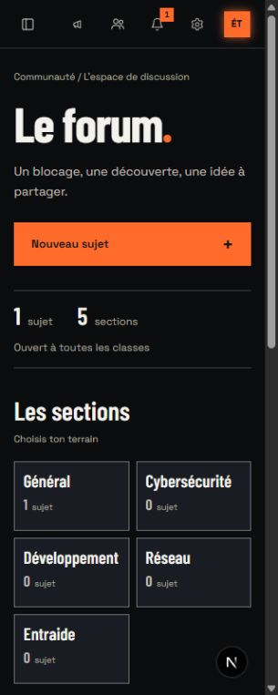

# Marges communes et accueil du forum

25 octobre 2026. Suite à l’élargissement des leçons et au retour sur l’accueil du forum.

## Cadre partagé

Les marges de page sont définies une seule fois dans `apps/web/app/globals.css`. Le dashboard, les conteneurs de page, les leçons, les défis, le forum, le catalogue de parcours et l’éditeur professeur utilisent ce cadre. Les styles d’examen utilisent les mêmes variables pour leur cadre externe ; les surfaces internes de lecture et de questions gardent leur composition. Les plafonds indépendants du forum et des défis sont retirés. Les paddings locaux concurrents et le second padding supérieur des en-têtes de catalogue connectés sont retirés. Les chargements prennent le même cadre que leurs pages.

| Viewport | Côtés | Haut | Bas |
| --- | --- | --- | --- |
| Moins de 768 px | 16 px | 24 px | 80 px |
| De 768 à 1279 px | 28 px | 28 px | 96 px |
| À partir de 1280 px | 36 px | 32 px | 110 px |

Le texte des leçons garde ses `90ch` et les composants leur largeur disponible. Les panneaux, titres et sections peuvent avoir leurs propres espacements internes ; le cadre externe ne change plus à chaque destination.

Mesures navigateur : à 1600 px, dashboard, parcours, catalogue de leçons, révisions, défis, notes et forum ont tous `32px 36px 110px`. Le bord gauche des titres mesurés est x = 276, pour un contenu démarrant après une sidebar de 240 px. À 320 px, dashboard, parcours, leçon, défis et forum utilisent `24px 16px 80px`, sans débordement. À 2160 px, la page Défis occupe les 1905 px de son espace principal, sans l’ancien plafond de 1760 px, avec les mêmes 36 px latéraux. Les examens n’ont pas été lancés pour vérifier leur nouvelle marge.

## Accueil du forum

L’ancien répertoire occupait la plus grande colonne, face à un fil de messages souvent très court. La nouvelle composition place la dernière discussion sur craie dans la colonne principale, avec titre, extrait, auteur autorisé, catégorie, date et nombre de réponses. Les autres discussions restent dans le fil. Le répertoire des sections devient une colonne compacte et garde ses compteurs réels. Le conseil de rédaction donne une utilité au bas d’un fil court sans inventer d’activité.

« Nouveau sujet » ouvre un choix de section natif (`details`/`summary`), puis la destination existante `/forum/<section>?compose=1`. L’état sans sujet propose d’écrire dans une section réellement disponible ; sans section, aucune action impossible n’est rendue. Les requêtes de données, l’ordre du dépôt, les règles de visibilité, les auteurs supprimés, les marques d’amitié et les états épinglé/fermé restent ceux du composant partagé. Aucun sujet n’est créé pour remplir les captures : le sujet « Titre test » était déjà présent dans la base locale.

Le rendu reste côté serveur. Aucun nouveau composant client, moteur de requête ou paquet n’est ajouté. Le chargement est recomposé sur les mêmes classes. Sur téléphone, les sections précèdent visuellement le fil ; chaque tuile consacre toute sa largeur au nom, puis affiche le compte en dessous. La réduction des mouvements existante coupe l’arrivée du titre et de la première discussion. Les interactions n’attendent pas une animation.

## Vérifications

- Forum inspecté à 320, 768 et 1600 px, sans débordement. À 768 px, les deux colonnes mesurent 380,39 et 292,61 px ; à 320 px, la discussion fait 273 px et le choix de section reste dans cette largeur.
- Choix de section ouvert et fermé au clavier avec Entrée sur téléphone ; ses cinq liens mesurent 44 px de haut. Sur bureau, le lien Général ouvre le vrai compositeur, puis sa fermeture restitue la catégorie. Aucun formulaire envoyé.
- Noms longs de section revus après rechargement sur téléphone, sans découpage d’une dernière lettre sur une ligne seule.
- Texte `#55544F` sur craie `#EAE7DF` : 6,14:1 ; extrait `#454640` sur craie : 7,71:1. Les paires carbone/cuivre restent celles du contrôle précédent.
- Suite web finale : **2167 tests dans 290 fichiers**, tous passés, dont 34 tests du forum. Les trois nouveaux tests couvrent la destination et l’état fermé du sujet, le choix entre lecture et composition, et l’état sans données ni action impossible.
- TypeScript strict, ESLint des cinq fichiers TSX touchés, formatage Biome des sources et `git diff --check` passent. Aucun build de production supplémentaire lancé.

Revue React : composition serveur, lectures parallèles conservées, listes identifiées par leurs IDs, aucune nouvelle dépendance d’effet ou de contexte client. Les modifications de `TopicRow` sont optionnelles et s’appliquent au premier sujet de l’accueil ; les autres listes conservent leur rendu. L’adaptation native et le choix de section depuis l’accueil restent inscrits dans [MOBILE_PARITY.md](../MOBILE_PARITY.md).

## Gate Anti Slop

Direction Bastion conservée : ENERGY 3 / RHYTHM 3 / MOTION 2. La craie distingue le dernier échange, le cuivre l’action de publication, et le répertoire dense sert au choix d’une section.

| Règle | Résultat |
| --- | --- |
| R-01 | PASS : matières mates ; couleur de priorité motivée. |
| R-02 | PASS : libellés et conseil fonctionnels, sans promesse. |
| R-03 | PASS : trois tailles de forum contrôlées, marges communes. |
| R-04 | PASS : logo existant et repères fonctionnels. |
| R-05 | PASS : fil principal et répertoire ont des poids distincts. |
| R-06 | PASS : Barlow pour les titres, Space pour lire, indices monospace. |
| R-07 | PASS : aucun motif de fond. |
| R-08 | PASS : flèche réservée à l’ouverture de la discussion mise en avant. |
| R-09 | PASS : états et compteurs réels. |
| R-10 | PASS : surfaces opaques, aucun flou ajouté. |
| R-11 | PASS : angles droits hérités du workspace. |
| R-12 | PASS : aucun ajout d’ombre. |
| R-13 | PASS : aucun halo. |
| R-14 | PASS : discussion craie, index compact, conseil en ligne. |
| R-15 | PASS : Nouveau sujet, Lire la discussion et sections explicites. |
| R-16 | PASS : aucun texte promotionnel ajouté. |
| R-17 | PASS : compteurs et fil du dépôt existant. |
| R-18 | PASS : aucune preuve sociale inventée. |
| R-19 | PASS : arrivée unique, réduction des mouvements conservée. |
| R-20 | PASS : signature typographique et matière Bastion. |
| R-21 | PASS : thème de marque existant. |
| R-22 | PASS : aucun visuel générique. |
| R-23 | PASS : logo réutilisé, aucune image créée. |
| R-24 | PASS : liens de sections et compositeur existants. |
| R-25 | PASS : contrastes mesurés et palette commune conservée. |
| R-26 | PASS : ouverture, choix de section et fermeture vérifiés. |
| R-27 | PASS : états peuplé, vide et sans section couverts ; chargement adapté. |
| R-28 | PASS : aucune FAQ ajoutée. |
| R-29 | PASS : carbone, craie, cuivre. |
| R-30 | PASS : composition fondée sur les vrais sujets et sections. |
| R-31 | PASS : raisons de largeur et de hiérarchie écrites ici. |
| R-32 | PASS : disclosure natif au clavier, régions nommées, cibles de 44 px. |
| R-33 | PASS : sources modifiées avec apply_patch et formatées. |
| R-34 | PASS : palette du workspace, aucun nouveau thème. |
| R-35 | PASS : vrai navigateur, mesures et formulaire réel sans envoi. |
| R-36 | PASS : aucune affirmation de performance ou de popularité ajoutée. |
| R-37 | PASS : direction et cadrans de session conservés. |
| R-38 | PASS : aucun faux sujet ajouté à l’application. |

C-1 : décisions motivées. C-2 : actions reliées au produit existant et vérifiées. C-3 : composition propre au forum. C-4 : mobile, noms longs, compteurs nuls et données absentes couverts. C-5 : captures réelles et tests distingués.

