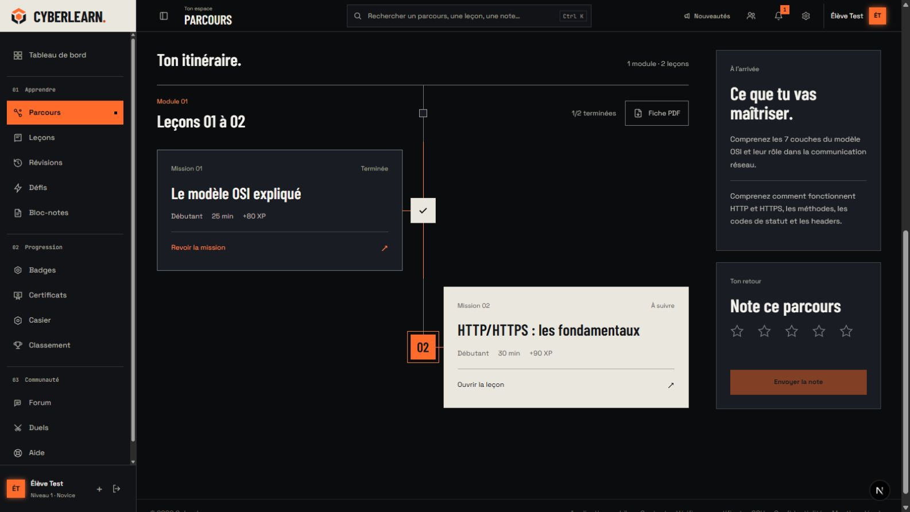
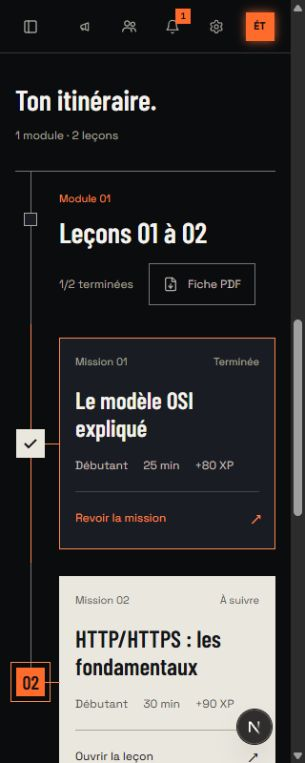

# Retour de l’itinéraire de parcours

25 octobre 2026. L’utilisateur préfère la structure précédente au grand empilement de cartes. La version `dfe1890a` du détail de parcours a été relue dans Git : axe central, cartes alternées, jalons carrés et portes de module. Cette structure est reprise dans la DA Bastion actuelle, sans rétablir les anciens halos, petites étiquettes ou pulsations permanentes.

## Choix

Les cartes occupent alternativement les deux côtés de l’axe. Leur largeur est limitée à 460 px, avec un titre lisible, les métadonnées de la leçon et une action. Une mission lisible est un seul lien, sans lien imbriqué ; une mission verrouillée reste un bloc sans destination, avec le nom de la leçon précédente à terminer. Le document conserve toujours l’ordre des missions.

Le jalon de la mission terminée porte une coche. La prochaine mission calculée par `resumeLesson` reçoit le jalon cuivre, la carte craie, « À suivre » et `aria-current="step"`. Une autre mission ouverte, par dispense ou droit administrateur par exemple, reste simplement « Disponible ». La couleur ne remplace jamais l’état écrit. Le comptage par module utilise exclusivement les états `completed`, sans transformer une dispense en acquis.

Chaque module conserve titre, description, numérotation globale et fiche PDF. Les blocs sans titre de module indiquent la plage de leçons. Les gardes, la reprise, les conditions d’examen et de certificat, le rail d’objectifs et les avis ne changent pas. L’ancre de l’itinéraire laisse 8 px en plus du décalage global de 80 px, au lieu de doubler l’espace sous la navigation.

Le changement de disposition dépend de la largeur réellement disponible dans le curriculum : sous 740 px, la ligne passe à gauche et les cartes forment une seule colonne. Sous 400 px, jalons et retraits se resserrent. Le chargement dessine la même structure. La notation conserve cinq cibles de 44 px sur une ligne, avec un espacement local de 4 px. Les marges de page partagées restent en place.

## Preuves et limites

- Parcours Réseaux réel : une mission terminée, une mission suivante, 50 %, 170 XP de missions. À 1600 px, le curriculum mesure 935 px et les cartes 431,5 px, alternativement à gauche et à droite. Leurs jalons sont alignés sur le même axe et centrés sur leur carte. Aucun débordement horizontal.
- À 768 px : curriculum de 697 px, cartes de 633 px, rail à gauche. À 320 px : curriculum de 273 px, cartes de 227 px à x = 62, jalons à x = 17. Aucun débordement ; les cinq étoiles mesurent 44 px et partagent le même y.
- Parcours Cybersécurité réel : première mission à suivre, XSS verrouillé, aucun lien dans la carte verrouillée et prérequis SQL nommé. Aucun acquis ni sujet fictif ajouté pour les captures.
- Trois tests ajoutés : destinations et verrou réel, distinction entre disponibilité/dispense et achèvement, ordre de plusieurs modules avec numéros globaux et destinations PDF. Les cas à plusieurs modules sont vérifiés en test, pas revendiqués dans une capture peuplée artificiellement.
- Suite web complète : **2170 tests dans 291 fichiers**, tous passés. La série ciblée de composants du parcours et de garde du certificat passe aussi : 21 tests. Ces séries se recoupent et ne sont pas additionnées.
- TypeScript strict, ESLint des TSX concernés, formatage Biome et `git diff --check` passent. Aucun build de production supplémentaire lancé.

Aucun examen commencé, certificat émis ou avis envoyé. Les fiches PDF et actions d’examen conservent leurs routes et tests ; aucun téléchargement de PDF n’est revendiqué. Les paires de couleurs sont celles déjà mesurées : encre/craie, secondaire/craie, cuivre/carbone, secondaire/panneau. La réduction des mouvements existante coupe les transitions ; les seuls nouveaux mouvements sont ceux du repère d’ouverture au survol et au focus.

Revue React : `PathCurriculum` est serveur, sans effet ni état client. Les éléments sont identifiés par les IDs des modules et leçons. L’accès aux données et le calcul partagé des droits restent dans la page ; la présentation reçoit leurs résultats. La dette de présentation native est inscrite dans [MOBILE_PARITY.md](../MOBILE_PARITY.md).

## Gate Anti Slop

Direction Bastion, ENERGY 3 / RHYTHM 3 / MOTION 2 conservés.

| Règle | Résultat |
| --- | --- |
| R-01 | PASS : surfaces mates ; craie et cuivre nomment la prochaine mission. |
| R-02 | PASS : états et prérequis fonctionnels en français. |
| R-03 | PASS : 1600, 768 et 320 px sans débordement. |
| R-04 | PASS : coche et cadenas portent un état réel. |
| R-05 | PASS : l’ordre pédagogique détermine l’itinéraire. |
| R-06 | PASS : Barlow lisible pour les titres, Space pour les commandes et métadonnées. |
| R-07 | PASS : ligne d’itinéraire fonctionnelle, pas de grille de fond. |
| R-08 | PASS : repère d’ouverture sur les cartes navigables. |
| R-09 | PASS : états réels et texte lisible, sans capsule décorative. |
| R-10 | PASS : aucune surface floutée. |
| R-11 | PASS : jalons et cartes carrés. |
| R-12 | PASS : aucun ajout d’ombre. |
| R-13 | PASS : aucune lueur ajoutée. |
| R-14 | PASS : portes, missions, objectifs et certificat ont leur rôle. |
| R-15 | PASS : Revoir la mission, Ouvrir la leçon, Fiche PDF. |
| R-16 | PASS : aucun slogan technologique ajouté. |
| R-17 | PASS : progression et métadonnées réelles. |
| R-18 | PASS : aucune preuve sociale inventée. |
| R-19 | PASS : transition de commande brève, aucune boucle. |
| R-20 | PASS : tracé et géométrie Bastion. |
| R-21 | PASS : thème de la plateforme conservé. |
| R-22 | PASS : aucune illustration générique. |
| R-23 | PASS : aucun actif créé ou téléchargé. |
| R-24 | PASS : routes et actions existantes conservées. |
| R-25 | PASS : palette contrastée déjà mesurée, aucune opacity de verrou. |
| R-26 | PASS : destinations et absence de lien verrouillé vérifiées. |
| R-27 | PASS : états terminé, ouvert, suivant, verrouillé, vide et chargement conservés. |
| R-28 | PASS : aucune FAQ ajoutée. |
| R-29 | PASS : carbone, craie, cuivre et états écrits. |
| R-30 | PASS : reprise de l’interface précédente à la demande de l’utilisateur. |
| R-31 | PASS : choix de tracé, taille et repli motivés ci-dessus. |
| R-32 | PASS : ordre DOM, étapes nommées, aria-current et cibles conservés. |
| R-33 | PASS : apply_patch et Biome dans les sources. |
| R-34 | PASS : thème existant, pas de nouvelle bascule. |
| R-35 | PASS : vrai navigateur, métriques et tests ; limites nommées. |
| R-36 | PASS : aucune nouvelle promesse. |
| R-37 | PASS : direction de l’utilisateur et cadrans de session conservés. |
| R-38 | PASS : données réelles ; aucune complétion artificielle. |

C-1 : raisons écrites. C-2 : accès et verrous conservés. C-3 : parcours des missions réel. C-4 : titres, droits, dispenses et largeurs contrôlés. C-5 : captures et cas de test distingués.

