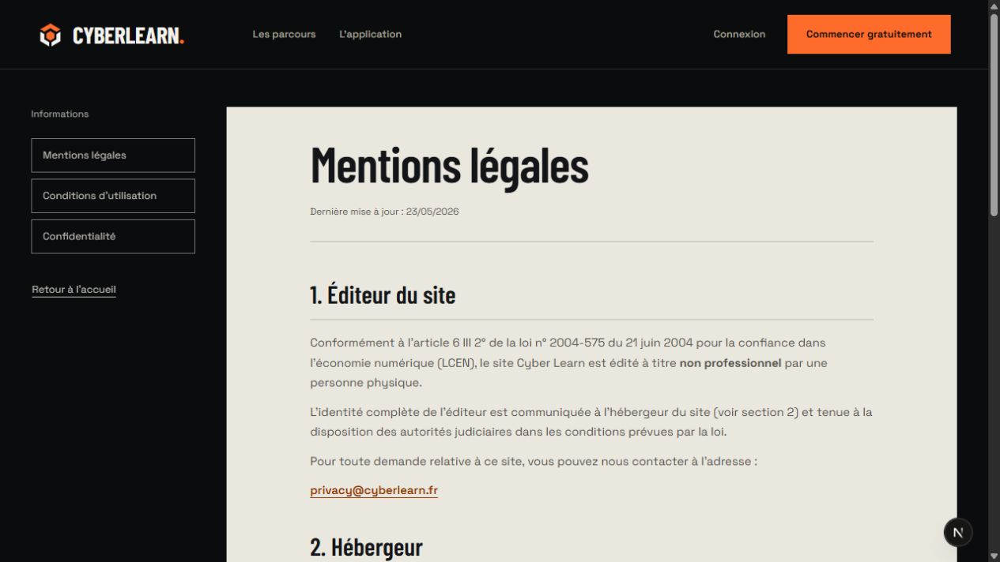
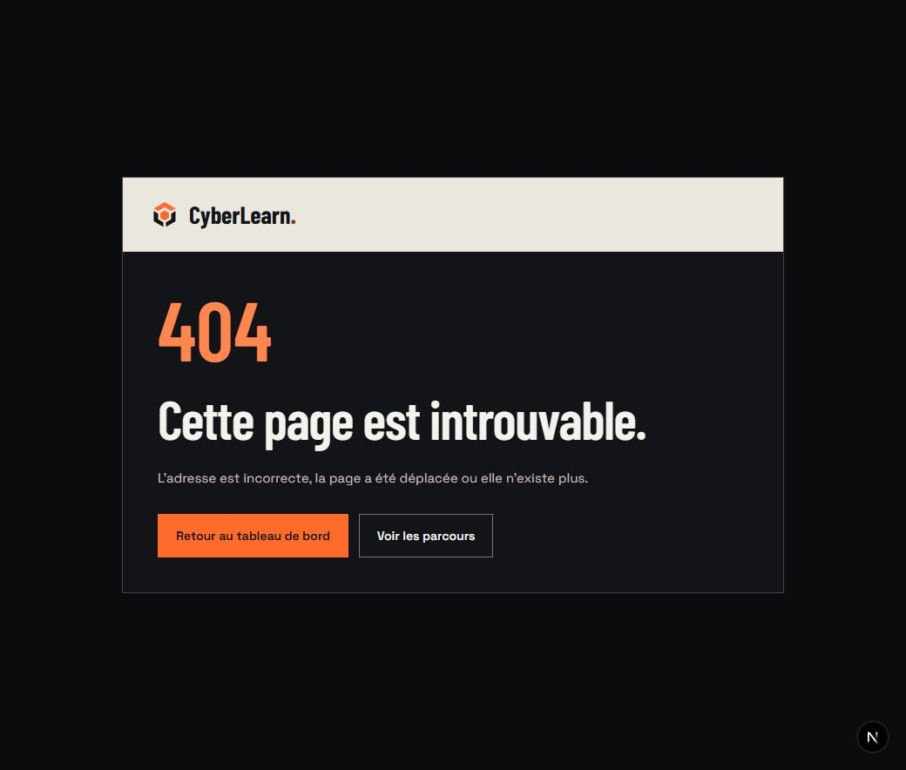
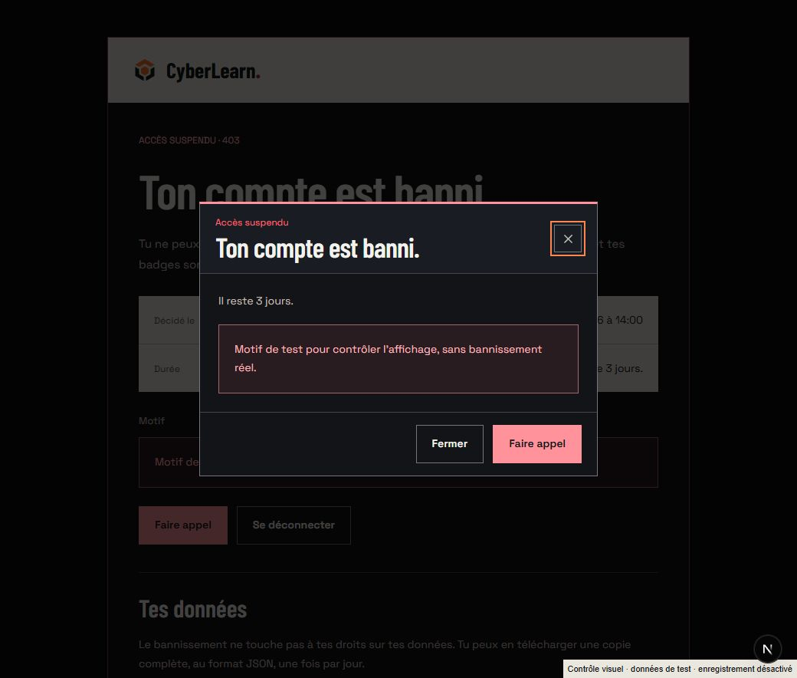

# Informations et états : contrôle Bastion

24 octobre 2026. Mentions, conditions, confidentialité, bannissement, conservation et suppression du compte, erreurs et page introuvable. Direction Bastion existante : carbone/craie/cuivre, vrai logo, Barlow Condensed et Space Grotesk, angles droits. ENERGY 3 / RHYTHM 3 / MOTION 2.

## Composition et fonctions

Les trois documents juridiques partagent une navigation de documents et une feuille craie. La lecture est limitée à 75 caractères de largeur ; les tableaux défilent dans leur propre région, accessible au clavier et nommée par leurs en-têtes. Les clauses et dates restent identiques : aucun changement de contenu dans les mentions et conditions, seulement les attributs de la région des tableaux dans la confidentialité.

Les pages de compte et les erreurs partagent un cadre mat avec la marque sur craie. Les titres, actions et faits restent dans le flux. Les contrôles occupent au moins 50 px ; le titre arrive en opacité pendant 180 ms, sans déplacement ni boucle. La réduction des mouvements retire cette arrivée et les transitions. La page introuvable garde les destinations adaptées à la session : accueil et catalogue en visiteur, dashboard et parcours en compte connecté.

Les trois limites d’erreur conservent leur signalement Sentry et leur rappel `reset`. Le panneau commun ne déclenche aucun signalement lui-même et n’affiche que le digest, jamais l’exception ni sa pile. Le lien de contact encode ce digest. L’erreur globale apporte ses propres éléments `html` et `body`, sa langue, ses polices, ses couleurs et son dimensionnement ; elle ne dépend pas du layout défaillant.

Le bannissement garde ses gardes serveur, son motif, sa durée, sa date, l’appel, la déconnexion et l’export. Le dialogue portalisé possède ses styles carrés et son fond mat. Le focus reste dans le dialogue. Son comportement existant est conservé : Échap et le fond ne valent pas accusé de lecture ; les boutons ferment et enregistrent cet accusé. Le message d’appel transmis possède un rôle de statut.

La conservation garde la vérification du lien et son action existante. La confirmation de suppression reste dynamique à chaque requête et utilise le formulaire POST natif existant avec son jeton caché. Afficher la page ne supprime rien. Les paramètres de présentation passent par `safeParse` : même format de jeton, liste fermée des motifs d’erreur. Une clé inconnue telle que `toString` utilise désormais le message de repli, sans lire un membre du prototype. Les services de conservation, suppression et nettoyage Auth ne changent pas.

## Vérifications et limites

- Les trois documents réels ont été contrôlés sur bureau et à 320 px, sans débordement de page ni angle arrondi. Sur téléphone, le premier tableau de confidentialité occupe 225 px pour un contenu de 304 px ; la touche Droite le fait défiler avec son focus visible.
- La vraie 404 a été vérifiée en session connectée : code, titre et liens dashboard/parcours. Le rendu visiteur et ses destinations sont également couverts par les tests.
- Douze variantes d’erreur et de cycle de compte ont été rendues à 320 px sans arrondi ni débordement dans un aperçu temporaire portant la mention de test, avec écritures bloquées. L’erreur de section a aussi été contrôlée dans le véritable cadre de l’app.
- Réessayer a invoqué son rappel de test au clavier. Faire appel a ouvert le champ de message. Le dialogue de bannissement garde le focus entre ses boutons ; Échap ne l’acquitte pas. L’espacement et le fond ont été contrôlés sur bureau et téléphone.
- Aucun compte supprimé ou conservé, aucun bannissement créé ou acquitté, aucun appel envoyé, aucun export réel et aucun faux incident Sentry produits pour ces captures. Les états protégés et destructifs utilisent des données de test signalées.
- Les deux fichiers de l’aperçu ont été archivés hors du dépôt puis supprimés. Les types de routes ont été régénérés ; `/dev/states` répond par la vraie page introuvable.
- 52 tests ciblés sur huit fichiers : destinations de la 404, capture et rappel des erreurs, document d’erreur globale, validation des paramètres, formulaire POST, conservation, bannissement et règles RGPD. Les actions sensibles sont simulées dans les tests.
- Revue React : documents, cadres et lectures de compte restent serveur ; le panneau de réessai et les formulaires gardent leurs interactions clientes justifiées. Pas de dépendance, de fetch client ou de règle d’autorisation ajouté. Les styles sont limités aux cadres concernés et au dialogue portalisé.
- Les contrôles globaux, leurs résultats et leurs limites figurent dans [l’audit final](redesign-audit.md). Aucun build de production ni parcours destructif réel n’est revendiqué.

Contrastes calculés : texte principal/carbone 16,48:1 ; texte secondaire/carbone 10,04:1 ; texte atténué/carbone 7,67:1 ; encre/bouton destructif 8,55:1 ; lien cuivre sombre/craie 6,34:1 ; texte gris/craie 6,29:1 ; texte de motif/fond d’alerte 10,10:1. Le statut reste nommé en texte.

## Gate Anti Slop

| Règle | Résultat et preuve |
| --- | --- |
| R-01 | PASS : surfaces unies de marque. |
| R-02 | PASS : textes directs ; contenu juridique conservé. |
| R-03 | PASS : documents, états et dialogue contrôlés à 320 px sans débordement. |
| R-04 | PASS : vrai logo, pas de pictogramme décoratif ajouté. |
| R-05 | PASS : document de lecture, écran d’état et dialogue suivent leurs tâches. |
| R-06 | PASS : polices de marque ; monospace limité au digest. |
| R-07 | PASS : aucun quadrillage d’ambiance. |
| R-08 | PASS : aucune flèche décorative ajoutée. |
| R-09 | PASS : repères en texte, sans capsule. |
| R-10 | PASS : fonds mats, sans verre. |
| R-11 | PASS : rayons calculés à zéro, dialogue compris. |
| R-12 | PASS : pas d’ombre flottante ajoutée. |
| R-13 | PASS : aucune lueur. |
| R-14 | PASS : faits comparables sur craie ; texte continu pour les documents. |
| R-15 | PASS : Réessayer, Faire appel et Supprimer définitivement nomment leur effet. |
| R-16 | PASS : aucun discours promotionnel ajouté. |
| R-17 | PASS : dates et motifs issus des données, exemples signalés. |
| R-18 | PASS : aucun témoignage. |
| R-19 | PASS : arrivée de titre de 180 ms, sans boucle, réduction des mouvements prévue. |
| R-20 | PASS : marque sur craie, titres condensés et actions carrées. |
| R-21 | PASS : thème de marque conservé, document clair pour la lecture longue. |
| R-22 | PASS : actif de marque existant. |
| R-23 | PASS : aucune identité inventée ; aperçu explicitement de test. |
| R-24 | PASS : destinations conservées, paramètres de contact encodés. |
| R-25 | PASS : contrastes calculés et focus adaptés à chaque matière. |
| R-26 | PASS : rappel de réessai et ouverture d’appel contrôlés ; actions sensibles couvertes par simulations. |
| R-27 | PASS : erreur, succès, lien incomplet, expiré ou consommé conservent leur explication. |
| R-28 | PASS : aucune FAQ ajoutée. |
| R-29 | PASS : palette Bastion ; rose réservé au bannissement et à la destruction. |
| R-30 | PASS : aucune imitation de produit. |
| R-31 | PASS : craie pour marque et faits, carbone pour action et lecture courte. |
| R-32 | PASS : formulaire natif, focus visible, tableau défilable au clavier, piège de focus du dialogue conservé. La règle métier existante interdit Échap comme accusé de lecture. |
| R-33 | PASS : modifications dans les sources avec apply_patch, formatage Biome. |
| R-34 | PASS : thème unique ; styles de repli autonomes pour l’erreur globale. |
| R-35 | PASS : rendus exécutés et tests ; limites des actions réelles explicites. |
| R-36 | PASS : aucune nouvelle promesse de sécurité ou de conformité. |
| R-37 | PASS : direction existante et demande explicite d’angles droits respectées. |
| R-38 | PASS : vraies pages distinguées des états sur données de test. |

C-1 PASS : géométrie et matière rattachées à une tâche. C-2 PASS : gardes, actions et signalement conservés. C-3 PASS : contenu juridique inchangé. C-4 PASS : mobile, erreur, succès et clavier contrôlés avec les limites indiquées. C-5 PASS : aucune preuve de production ni donnée réelle inventée.

Les dials prolongent la DA : ENERGY 3 par les titres et la matière, RHYTHM 3 entre document long et état court, MOTION 2 pour une arrivée brève. L’action reste le point focal ; les faits et les commandes reviennent dans le flux sur téléphone.

